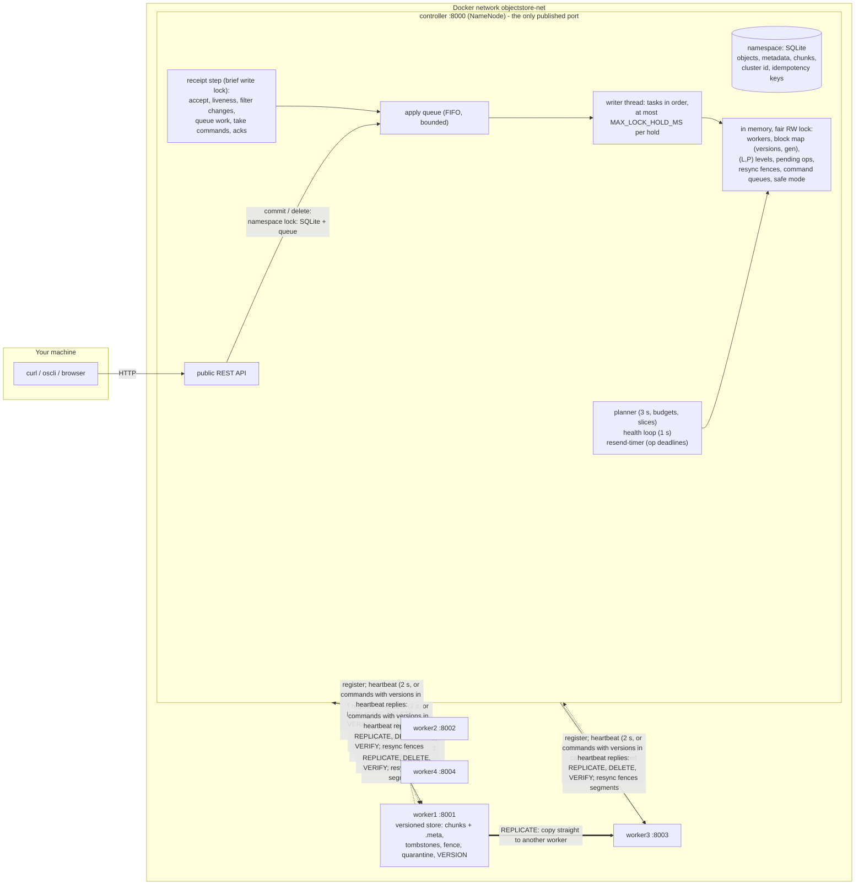

# Mini Distributed Cloud Object Store

A small S3-like object store built as a faithful, miniature re-creation of **HDFS**. Clients upload
arbitrary binary objects (documents, images, video, audio, archives, anything) to a single
**controller** (the NameNode), which splits them into **1 MB chunks** (blocks) and stores **two
copies of every chunk on different storage workers** (DataNodes). Like HDFS, the controller keeps
only the namespace on disk; where every copy lives is held in memory and rebuilt from the workers'
change streams and fenced resyncs (block reports). Every operation the controller orders carries
a **version**, and each worker is a **versioned store** that applies an operation only if it is
newer than what it holds, so a delayed, repeated or reordered command can never undo a newer one.
It detects dead, stale, partitioned and restarted workers and corrupted data, quarantines bad
copies, keeps serving objects from good copies, has workers copy chunks directly to each other to
restore the replication factor, and survives its own crash at any instruction.

| | |
|---|---|
| Controller nodes | 1 (the NameNode) |
| Storage / worker nodes | 4 (DataNodes), each with its own persistent Docker volume |
| Clients | 1 or more: `curl`, the bundled `oscli` CLI (also runs as a container), a browser dashboard |
| Chunk size | 1 MB (1,048,576 bytes) |
| Replication factor | 2, copies always on different workers |
| Deployment | Docker Compose (no Kubernetes); every service restarts by itself after a crash |
| Stack | Java 21, Spring Boot 4.1, Maven, SQLite (controller namespace) |

**Contents:**
[Quick start](#quick-start) ·
[Architecture](#architecture) ·
[HDFS mapping](#what-is-re-created-from-hdfs) ·
[Using the system](#using-the-system) ·
[Client REST API](#client-rest-api) ·
[Worker protocol](#the-worker-protocol) ·
[Configuration](#configuration) ·
[Demonstrations](#demonstrations) ·
[How it works](#how-it-works) ·
[Failure model](#failure-model) ·
[Edge cases](#edge-case-catalogue) ·
[Guarantees and limits](#guarantees-and-limits) ·
[Testing](#testing) ·
[Requirements traceability](#requirements-traceability) ·
[Decisions](#decisions) ·
[Future work](#future-work) ·
[Repository layout](#repository-layout) ·
[Troubleshooting](#troubleshooting)

---

## Quick start

**Prerequisites:** Docker Engine or Docker Desktop with Compose v2, plus `bash`, `curl`, `make` and
`jq`. A JDK is **not** needed. (Python 3 is needed only for the chaos test and the showcase.)

**On any machine (Intel/AMD or ARM), with the published images:**

```bash
docker compose up -d --wait   # downloads kunaljindal19/objectstore-{controller,worker,client}:<version>
make demo                     # run the seven demonstrations; ends with "7/7 PASS"
```

Nothing is built: `docker-compose.yml` names the exact image version, published for `linux/amd64` and
`linux/arm64`, so every machine runs the same code. A machine that ran an older release cannot reuse
its old images by mistake, because each release has its own version.

**To build from your own checkout instead** (when you change the code):

```bash
make up          # = docker compose -f docker-compose.yml -f docker-compose.build.yml up --build -d --wait
```

**Publishing a new release** (maintainers): bump `OBJECTSTORE_VERSION` in `docker-compose.yml` (the
default after `:-`, used in three places), then `docker login` and `make publish`, which builds the
three images for both architectures and pushes them. It refuses to overwrite a version that is
already published. Commit the bumped `docker-compose.yml`, so anyone who pulls the code gets the new
images. `OBJECTSTORE_REPO` and `OBJECTSTORE_VERSION` can also be set in the environment to use other
images.

Then open the dashboard at <http://localhost:8000/dashboard>, or store something yourself:

```bash
./oscli upload samples/sample.jpg --meta owner=alice     # prints the new object, including its id
./oscli where  <object-id>                               # which workers hold which chunk
./oscli download <object-id> .demo/copy.jpg              # verifies the checksum while downloading
make fsck                                                # end-to-end consistency check
```

| Command | What it does |
|---|---|
| `make up` | build from this checkout and start (`docker compose -f docker-compose.yml -f docker-compose.build.yml up --build -d --wait`), then print the container table |
| `make pull` / `make publish` | download the published images / build both architectures and push them (see above) |
| `make down` / `make down-v` | stop the containers keeping all data / wiping all data |
| `make ps` / `make logs` / `make status` / `make fsck` | container table / all logs / cluster status JSON / fsck |
| `make stop W=worker2` / `make start W=worker2` | stop a worker (it goes STALE, then DEAD) / bring it back |
| `make pause W=worker2` / `make unpause W=worker2` | freeze a worker (STALE only, if short) |
| `make where O=<object_id>` | each chunk of an object and the two workers holding it (the ids the commands below need) |
| `make corrupt W=worker3 C=<chunk_id>` | overwrite 4 bytes inside a stored chunk file |
| `make corrupt-meta W=worker3 C=<chunk_id>` | write a wrong checksum into a chunk's `.meta` file (the data is untouched) |
| `make rmchunk W=worker2 C=<chunk_id>` | delete a stored copy (data and `.meta`), as a lost disk would |
| `make rmmeta W=worker2 C=<chunk_id>` | delete only a chunk's `.meta` file, so the copy can no longer be verified |
| `make quarantine W=worker2` | list the copies a worker has quarantined |
| `make demo` | the seven demonstrations, self-checking (about 2 minutes) |
| `make showcase` | a guided tour of the inner state: messages, chunk placement, `worker2` stopped and started ([below](#showcase-the-inner-state-on-the-console)) |
| `make app` | open the web client, <http://localhost:8000/app> |
| `make test` | 233 unit and in-process system tests (local Maven, or a Maven container) |
| `make test-scale` | the scale test: 500,000 chunks, 8 workers, no HTTP (about a minute) |
| `make scenarios` | the acceptance-criteria scripts against Docker (about 15 minutes; wipes data) |
| `make chaos` | the chaos test: 5 minutes of load and disruption with network faults, then convergence checks |

If port 8000 is taken: `CONTROLLER_PORT=9000 make up` and `BASE=http://localhost:9000 make demo`.

---

## Architecture



**Threads.**

| Process | Thread | Job |
|---|---|---|
| controller | HTTP request threads (virtual) | The receipt step for heartbeats; the public API. Uploads and deletes take the namespace lock for "SQLite + queue"; readers take the read lock. |
| controller | `writer` | The **only** thread that applies queued tasks to the block map |
| controller | `planner-loop` (3 s) | Under-replication levels, safe excess cleanup with VERIFY, postponed set, waiting ops, periodic resyncs, the rolling invariant check |
| controller | `resend-timer` | Turns the resend deadlines of handed-out ops into `OpDeadline` tasks (same version) |
| controller | `health-loop` (1 s) | STALE transitions; queues `MarkDead` |
| worker | `link` | Registration (fence adoption), heartbeats carrying the change stream, fenced resync segments |
| worker | `block-scanner` | Rate-limited verification (quarantine) and disk ↔ index reconciliation |
| worker | `disk-check` | Volume probe |
| worker | command executor (4 at a time, bounded queue) | `REPLICATE` (worker to worker), `DELETE`, `VERIFY`, each version-checked; `CMD_FAILED` with a reason when one cannot run |

**The controller decides; workers act.** The controller keeps the namespace (which objects exist,
their metadata, which chunks they consist of) durably in SQLite. Everything about *where* copies
are and *how healthy* workers are lives in memory and is rebuilt from what the workers report,
exactly like the HDFS NameNode's block map. Repairs and deletions are commands the controller hands
out in heartbeat replies; workers execute them, copying chunks **directly to each other**.

**Workers are DataNodes.** Each stores chunk files with a `.meta` sidecar holding the checksum,
and in memory one record per chunk: the copy with its version, or a tombstone. It checks the
version of every PUT and DELETE, verifies every chunk it serves, moves a copy that fails
verification to quarantine, scans its disk for silent corruption, checks that its volume is
writable, and tells the controller about every change to its disk in one numbered change stream
that travels on heartbeats and on its answers to the controller's chunk uploads, each change kept
until the controller acknowledges it. It knows nothing about objects.

| Module | What it is |
|---|---|
| [`common/`](common) | The wire contract: protocol messages, SHA-256 and chunk-id helpers, JSON error handling, fault-injecting HTTP clients |
| [`worker/`](worker) | The DataNode: versioned chunk store (sidecars, index, tombstones, fence, quarantine, fail-stop), change log, controller link (registration, heartbeats, resync segments), command executor, block scanner, disk check |
| [`controller/`](controller) | The NameNode: public API, namespace, operation versions, cluster state and pending ops, registry and receipt step, change applier, replication planner, resend timer, safe mode, fsck, dashboard |
| [`client/`](client) | `oscli`, a command-line client with idempotent, retrying uploads |
| [`system-tests/`](system-tests) | The real controller and four real workers in one JVM, for end-to-end tests |
| [`tests/`](tests) | Docker scenario scripts per acceptance-criteria block, and the chaos test |

---

## What is re-created from HDFS

| HDFS | Here |
|---|---|
| NameNode persists the namespace (fsimage + edit log) | SQLite (WAL, `synchronous=FULL`): `objects`, `object_metadata`, `chunks`, `idempotency_keys`, `cluster_meta`, plus `upload_intents` and `deleted_objects` (see [orphans](#orphans-and-the-safety-valve)) |
| NameNode keeps block locations and DataNode state **in memory**, rebuilt from reports | [`ClusterState`](controller/src/main/java/com/objectstore/controller/cluster/ClusterState.java): workers, block map and its reverse index, pending ops, command queues |
| `clusterID` in each DataNode's `VERSION` file; mismatched DataNodes are refused | `cluster_id` in `cluster_meta` and in `/data/VERSION` on each worker |
| DataNode registration; the NameNode tells unknown or dead DataNodes to re-register (`DNA_REGISTER`) | `POST /internal/workers/register`; other messages answer 404 `unknown_worker` and the worker re-registers |
| `BPServiceActor`: one thread per NameNode for registration, heartbeats and reports | the worker's `link` thread, on its own HTTP client with a short time-out (`HEARTBEAT_HTTP_TIMEOUT`) |
| Stale DataNode: avoided for reads and writes, replicas still count | `STALE` after 6 s of silence |
| Stale ratio: if more than half are stale, stop avoiding them for writes | `STALE_RATIO = 0.5` |
| Dead DataNode: its replicas leave the block map | `DEAD` after 12 s of silence |
| Incremental block reports (`blockReceivedAndDeleted`) and full block reports | one numbered change stream per worker (`RECEIVED`, `DELETED`, `CMD_FAILED`, each with a version), kept until acknowledged, on heartbeats and PUT answers; **fenced resyncs** (the controller hands out a fence t0; the listing is in segments on heartbeats, with a baseline and hold-back) after registering, when needed and every `RESYNC_INTERVAL` |
| `.meta` checksum file per block; DataNode verifies on read and transfer | `<chunk_id>.meta`; the worker verifies on GET and before every REPLICATE |
| DataNode block scanner (rate-limited, with disk/index reconciliation); `reportBadBlocks` | worker scanner: at most one pass per 10 s, reading at most 32 MiB/s; a bad copy is quarantined and reported `DELETED(corrupt)`; the controller orders `DELETE(CORRUPT)` when a read or listing proves a copy does not match the namespace |
| Disk checker; the DataNode shuts down on volume failure | worker disk check every 30 s; on failure the process exits, goes DEAD and is repaired |
| RedundancyMonitor over `LowRedundancyBlocks` priority queues | the planner every 1 s (`MONITOR_INTERVAL`) over levels `(L, P)` (live copies, pending INSERT ops; any RF), kept up to date on every change, with exact weighted quotas and round-robin per level |
| PendingReconstructionBlocks with a time-out | pending ops (one per chunk and worker, with a version) and the `resend-timer` thread: resent with the same version after 15 s, doubling to 240 s; a REPAIR is dropped after `OP_MAX_INSERT_ATTEMPTS` (5) sends and planned again elsewhere |
| Generation stamps | operation versions: `(term << 40) \| (seq << 1)`, the term persisted and incremented at every controller start |
| `DNA_TRANSFER`: DataNode copies directly to DataNode | `REPLICATE` command in the heartbeat reply; the worker PUTs to the target worker |
| `DNA_INVALIDATE` | `DELETE` command |
| `max-streams` per DataNode | `MAX_STREAMS = 2` copies in flight per source |
| Excess replicas trimmed, postponed while replicas sit on stale nodes | `DELETE(EXCESS)` only with every holder current and RF other holders freshly verified (VERIFY); postponed otherwise |
| A corrupt replica is deleted only after a good one is restored | a corrupt copy is never served and never deleted: it is quarantined on the worker (kept for inspection) and the chunk repaired |
| Safe mode: read-only until 99.9 % of blocks are reported, plus an extension | `SAFE_MODE_THRESHOLD = 0.999`, `SAFE_MODE_EXTENSION = 5 s`, `SAFE_MODE_TIMEOUT = 30 s` |
| Start-up delay before deleting blocks | no orphan deletion during the first `ORPHAN_GC_DELAY = 60 s` after a controller start |
| Write-pipeline recovery: replace a failed DataNode mid-write | an upload replaces a failed target and retries that chunk |
| `completeFile` only after blocks reach minimum replication | 201 only after both copies are fsynced **and** the namespace commit is durable |
| `hdfs fsck` | `GET /api/v1/fsck` |

**Deliberately not re-created**

| HDFS feature | Why not |
|---|---|
| Rack awareness | One host, one "rack". |
| Client → DN1 → DN2 write pipeline | The assignment requires that clients never see workers. The controller acts as the HDFS client and writes both copies in parallel. |
| Leases, append, per-block generation stamps | Chunks are **immutable and never reused** (ids embed a fresh UUID), so their *contents* have no versions. What can go stale are the *operations* on them (a delayed DELETE, a late copy): those carry versions. |
| NameNode high availability (standby, journal nodes, ZooKeeper failover) | The assignment fixes one controller. We guarantee no loss and automatic recovery, not availability while it is down. |
| Balancer, erasure coding, storage policies, security | Out of scope. |

---

## Using the system

### With the CLI

`./oscli` runs the client inside the `client` container by default (so only Docker is needed);
the project directory is mounted there, so **file arguments must be paths inside this directory**.
`OSCLI_MODE=local ./oscli …` runs it with a local JVM instead (after
`mvn -pl client -am package -DskipTests`), where any path works.

```text
Usage: oscli [--base URL] <command> [arguments]

  upload PATH [--name NAME] [--type MIME] [--key KEY] [--meta key=value ...]
  download ID OUT_PATH      fetch an object and verify it against its checksum
  meta ID                   show system + custom metadata and chunk locations
  patch ID [key=value ...] [--remove key ...]
  list [--limit N] [--offset N]
  delete ID
  where ID                  table: which workers hold each chunk
  status                    cluster overview (workers, replication health, repairs)
```

The client is built for an unreliable service: every upload carries an `Idempotency-Key` (random,
or `--key`), and connection errors and 503 answers (safe mode, too few workers, a chunk briefly
without a readable copy) are retried with back-off 0.5, 1, 2, 4, 5, 5 … s for up to
`OSCLI_RETRY_SECONDS` (default 60). A download that breaks off is retried; a completed download is
verified against the `ETag`. Exit codes: `0` success · `1` the server answered with an error ·
`2` unreachable, or the transfer kept breaking · `3` downloaded bytes do not match the checksum ·
`64` wrong usage.

### With curl

```bash
API=http://localhost:8000/api/v1
curl -H "Idempotency-Key: my-upload-1" -F "file=@report.pdf" -F 'metadata={"owner":"alice"}' $API/objects   # 201
curl -o report.pdf $API/objects/$ID                                         # 200, the original bytes
curl $API/objects/$ID/metadata                                              # 200, system + custom metadata
curl -X PATCH -H 'Content-Type: application/json' -d '{"owner":"team","old":null}' $API/objects/$ID/metadata
curl "$API/objects?limit=50&offset=0"                                       # 200, newest first
curl -X DELETE $API/objects/$ID                                             # 204
curl $API/cluster/status                                                    # 200, the cluster at a glance
curl $API/fsck                                                              # 200, consistency check
```

### Web client

<http://localhost:8000/app> (also `http://localhost:8000/`, or `make app`) is the object store for
people: a single page served by the controller on top of the REST API below, so it needs nothing
else.

- **Upload** several files at once by dropping them or choosing them, with optional custom metadata
  for the batch. Each file shows its progress, then "storing two copies of every chunk…" until the
  `201`. Every upload carries its own `Idempotency-Key`, and a dropped connection or a `503`
  (safe mode, too few workers) is retried automatically with that same key, so a retry never stores
  a file twice. An upload can be cancelled.
- **Browse** the objects, newest first, page by page, filtered by name, type or id.
- **Open** an object: its system metadata (size, content type, SHA-256, chunk count, times,
  replication), its **custom metadata** to edit in place (add, change, remove; validated with the
  same rules as the server, saved as one `PATCH`), and every chunk with the workers that hold its
  copies (`OK`, `CORRUPT`, `EXCESS`; a copy on a STALE worker is outlined).
- **Download** (streamed by the browser), **preview** images, video, audio, PDF and text, and
  **verify integrity**: the page downloads the object, computes its SHA-256 and compares it with the
  checksum recorded at upload (up to 256 MB; on `localhost` or https).
- **Delete**, after a confirmation.
- A **status chip** (healthy, starting up, repairing, too few workers, unreachable) and banners say
  when uploads will wait or some objects cannot be read; the page links to the dashboard.

Names and metadata are always inserted as text, never as HTML.

### Dashboard

<http://localhost:8000/dashboard> polls the status every 0.5 s (the chunk grid every 2 s; a 2 s poll ran in step with the 2 s heartbeats and made "last heartbeat" look frozen): a safe-mode banner; KPIs (objects,
chunks, copies, under-replicated, copies on their way, missing chunks, corrupt and excess copies,
invariant violations); worker cards (ALIVE green, STALE amber, DEAD red; process id, last
heartbeat, copies, free space, queued commands, copies being sent, fence and resync attempt,
quarantined copies, tombstones, pending ops); a **pending operations, resyncs and VERIFY** panel
(ops by reason and state, VERIFYs outstanding, workers resyncing, term and highest version); the
chunk-by-worker grid of the newest object (`OK`, `C` quarantine pending, `E` surplus delete
pending); an **fsck** button with its chunk and worker findings; and the monitor's last 20 events.

---

## Client REST API

Base path `/api/v1`. Structured data is JSON with `snake_case` keys; object data is binary.

| Method | Endpoint | Purpose | Success |
|---|---|---|---|
| `POST` | `/api/v1/objects` | Upload an object | `201` (`200` for an idempotent replay) |
| `GET` | `/api/v1/objects/{object_id}` | Download an object | `200` |
| `GET` | `/api/v1/objects/{object_id}/metadata` | Retrieve metadata | `200` |
| `PATCH` | `/api/v1/objects/{object_id}/metadata` | Update custom metadata | `200` |
| `DELETE` | `/api/v1/objects/{object_id}` | Delete an object | `204` |
| `GET` | `/api/v1/objects` | List stored objects | `200` |
| `GET` | `/api/v1/cluster/status` | Cluster overview *(extra)* | `200` |
| `GET` | `/api/v1/fsck` | Consistency check *(extra)* | `200` |
| `GET` | `/health`, `/dashboard`, `/app` | Liveness probe, dashboard page, web client *(extra)*; `/` redirects to `/app` | `200` |

### Upload — `POST /api/v1/objects`

`multipart/form-data` with a required `file` part and an optional `metadata` field (a JSON object of
custom key/value pairs). The controller assigns a UUID. The name is the uploaded file name (or
`unnamed`); the content type is the one declared for the part, or inferred from the extension if
none or only `application/octet-stream` was declared. An empty file is a valid object (0 chunks).

- **`Idempotency-Key`** (optional header, 1–128 visible ASCII characters): if an earlier upload with
  the same key succeeded, the answer is `200` with that object and `Idempotent-Replay: true`, even
  in safe mode, and nothing is stored again. The same key with a file of a different size is
  `409 conflict`. Two concurrent uploads with one key create exactly one object.
- **201 means durable**: every chunk is fsynced on two workers and the namespace commit is durable
  (`synchronous=FULL`). The object survives a controller crash and the loss of any one worker.
- Refused before the body is read: `503 safe_mode` (with `Retry-After: 5`) and
  `503 insufficient_workers` (fewer than 2 workers can take writes).

### The object description

Returned by upload, `GET …/metadata` and `PATCH …/metadata`:

```json
{
  "object_id": "c25c8bbf-b601-49a4-a20d-57bb7c664211",
  "name": "report.pdf",
  "size": 1500000,
  "content_type": "application/pdf",
  "checksum": "5320dde6be765f4e1cb2d03fbc143cf9aed165f15b17aaa7782a4bf506ebaa66",
  "chunk_count": 2,
  "created_at": "2026-11-16T16:43:50.268Z",
  "updated_at": "2026-11-16T16:43:50.594Z",
  "replication_ok": true,
  "custom_metadata": { "course": "cloud-computing", "owner": "team" },
  "chunks": [
    {
      "chunk_id": "c25c8bbf-b601-49a4-a20d-57bb7c664211-00000",
      "index": 0,
      "size": 1048576,
      "checksum": "cb33b3f01ba887ca83d0e94a8815114a9697fc1840a8b51ed03293f2fe805c7a",
      "locations": [
        { "worker_id": "worker1", "status": "OK", "worker_status": "ALIVE" },
        { "worker_id": "worker4", "status": "OK", "worker_status": "ALIVE" }
      ]
    }
  ]
}
```

`checksum` is the SHA-256 of the whole object; each chunk has a unique id (`<object_id>-<index>`),
its `index` (order in the object), size, SHA-256 and `locations`. A location's `status` is the
copy's state (`OK`, `CORRUPT`, `EXCESS`), `worker_status` the worker's (`ALIVE`, `STALE`).
`replication_ok` is true when every chunk has at least 2 live copies.

### Download, metadata, delete, list

- **Download** streams the original bytes with the stored `Content-Type`, `Content-Length`,
  `Content-Disposition`, `ETag: "<sha256>"` and `X-Object-Id`. `404` if unknown; `503
  chunk_unavailable` if some chunk has no readable copy right now (decided before the first byte).
- **PATCH metadata**: a string sets a key, `null` removes it; only the metadata tables change.
  Keys: 1–64 characters from `A-Z a-z 0-9 _ . -`; values: strings of at most 1024 characters; at
  most 64 keys. Anything else is `400 invalid_metadata`. `503 safe_mode` in safe mode.
- **DELETE**: `204`; the namespace row is deleted durably and every known copy gets a versioned
  DELETE op, and so does the target of any copy still on its way. Right after the `204` (the client
  never waits for it) the controller sends each one straight to its holder with
  `DELETE /internal/chunks/{chunk_id}`, as an upload sends its chunks with `PUT`, so the files go
  within milliseconds. A holder that is resyncing, STALE or unreachable gets its deletes in heartbeat
  replies instead; each op is sent again (same version) until the worker confirms it. Copies the controller could not know about (on a DEAD worker) become garbage
  and are collected from the worker's changes or its resync when it returns.
  `404` if unknown, `503 safe_mode` in safe mode.
- **List**: `limit` 1–500 (default 50), `offset` ≥ 0; newest first; `{items, total, limit, offset}`.

### Status codes and errors

Every error is JSON: `{"error": "<code>", "detail": "<sentence>"}`.

| Status | When | `error` codes |
|---|---|---|
| `200` | download, metadata, list, status, fsck; an idempotent upload replay | |
| `201` | object created | |
| `204` | object deleted | |
| `400` | no `file` part, not multipart, bad `limit`/`offset`, invalid metadata, bad `Idempotency-Key` | `bad_request`, `invalid_metadata` |
| `404` | object not found; unknown route | `object_not_found`, `not_found` |
| `409` | an `Idempotency-Key` reused for a file of a different size | `conflict` |
| `500` | unexpected server error (stack trace in the log only) | `internal_error` |
| `503` | safe mode (with `Retry-After: 5`), too few writable workers, a chunk that could not be stored twice, a chunk with no readable copy | `safe_mode`, `insufficient_workers`, `upload_failed`, `chunk_unavailable` |

Also used where they are the precise answer: `405 method_not_allowed`, `413 payload_too_large`,
`415 unsupported_media_type`.

### Cluster status — `GET /api/v1/cluster/status`

`safe_mode`, `cluster_id`, `config{…, op_resend_initial, resync_interval}`; per worker `state`,
`boot_id` (8 chars), `has_reported`, `last_seen_s_ago`, `chunk_count`, `queued_commands`,
`pending_as_source`, `resyncing`, `fence`, `attempt`, `verify_epoch`, `pending_ops`,
`stats{chunks, used_bytes, free_bytes, active_transfers, quarantined_chunks, quarantined_bytes,
tombstones}`; `replicas{ok, corrupt, excess, on_stale_workers}` (`corrupt`: a quarantine is pending,
`excess`: a surplus delete is pending), `under_replicated`, `over_replicated`, `missing_chunks`,
`pending_replications` (INSERT ops), `blocked` (chunks the last monitor tick could not schedule);
`ops{by_reason, by_state}`, `verify_outstanding`, `resyncing`, `term`, `version`;
`counters{invariant_violations, orphan_gc_refused, stale_messages, duplicates, blocked, changes_gap,
apply_queue_full, writer_task_failures, namespace_reconciled, upload_commit_wait_timeouts,
cmd_failed_ignored, stale_rejections, ops_resent, quarantines, excess_postponed, future_versions, …}`;
`repair_log`, the monitor's last 200 events (`replicate`, `copied`, `failed`, `source failed`,
`stale`, `timeout`, `trimmed`, `quarantined`, `deleted`, `missing`, `orphan`, `unrecoverable`,
`recoverable`); and the writer's health:
`lock_max_hold_ms` (the longest continuous write-lock hold since the previous status read, also per
holder in `lock_max_hold_by`; reading resets it), `apply_queue_depth`, `apply_oldest_task_age_ms`,
`writer_busy_ratio` (share of the time since the previous read that the writer held the lock),
`report_sessions_open`, `ledger{waiting, queued, delivered}` (DELETE ops by state, under their v4
names), `levels{"L,P": size}` (chunks needing
copies by priority level), `cleanup_size` and `postponed_size`. Every number is a counter: the
status costs O(workers + levels), however many chunks there are.

### fsck — `GET /api/v1/fsck`

Takes the namespace lock, queues a barrier for the writer and waits for it (every namespace change
queued before is applied), reads the `chunks` table and snapshots the block map, and releases the
lock. Then it asks every ALIVE worker, in parallel, for its chunks with checksums **recomputed from
the files**, compares that with the snapshot and the namespace, and runs the invariant checks plus
I7 (memory mirrors the `chunks` table). It never deletes or changes anything.

```json
{"status": "HEALTHY",
 "objects": {"total": 12, "healthy": 12, "under_replicated": 0, "corrupt_replicas": 0, "missing": 0},
 "disk_vs_map": {"on_disk_not_in_map": [], "in_map_not_on_disk": [], "checksum_mismatch": []},
 "orphans_on_disk": 0, "unreachable_workers": [], "invariant_violations": [], "quiescent": true,
 "chunks": {"under_replicated": 0, "unrecoverable": [], "excess": 0, "pending_quarantines": 0},
 "workers": [{"worker_id": "worker3", "state": "ALIVE", "reported": true, "resyncing": false,
              "quarantined_chunks": 1, "quarantined_bytes": 1048576}]}
```

`CORRUPT` if some object has a chunk without any live copy; `DEGRADED` if anything is
under-replicated, a copy is corrupt, a worker is unreachable, an invariant is violated, or (while
quiescent) disks and the map differ or orphans exist; otherwise `HEALTHY`. `chunks` lists chunks
with fewer than RF available copies, unrecoverable ones (no live copy), surplus copies and pending
quarantines; `workers` lists workers that are not ALIVE, have not completed a resync, are resyncing,
or hold quarantined copies. `quiescent` means no pending op, no queued command, not in safe mode,
an empty apply queue, no listing open, no resync running and no worker being purged; only then are
differences between disks and the map meaningful.

---

## The worker protocol

**The main design principle (v5):** the controller decides the desired state; workers execute
**versioned** instructions and report physical facts. Every instruction carries an operation
version, every result comes back through the worker's numbered change log, and versions alone
decide what is stale. No wall-clock deadline decides correctness (commands have no expiry; resend
timers only drive retries).

### Endpoints

| Method | Endpoint | Served by | Purpose |
|---|---|---|---|
| `POST` | `/internal/workers/register` | controller | Register a worker process; the answer carries the registration fence |
| `POST` | `/internal/workers/heartbeat` | controller | Liveness and statistics, the worker's next changes, at most one resync segment and a resync request; receive commands, acknowledgements and resync instructions |
| `PUT` | `/internal/chunks/{chunk_id}` | worker | Install a copy at a version (the controller's upload, or another worker's transfer); the controller's PUT also acknowledges and collects changes |
| `GET` | `/internal/chunks/{chunk_id}` | worker | Retrieve a chunk, verified against its `.meta` |
| `DELETE` | `/internal/chunks/{chunk_id}` | worker | Delete a copy at a version: the same versioned delete as the DELETE command; used by the controller for a client's object delete |
| `GET` | `/internal/workers/{worker_id}/chunks` | worker | Every chunk on disk with a freshly computed checksum (fsck) |

There are no separate report endpoints: change runs and resync listings both travel on heartbeats.

**DELETE** (headers `X-Op-Version: <v>`, required, an even controller version; optional `X-Cmd-Id`,
and `X-Reason: corrupt` to quarantine instead of delete) runs exactly the versioned delete of the DELETE
command → `204` deleted, or a repeat of the current version · `409 stale_version` (not newer than the
copy or the fence: nothing changes, so a delayed or replayed DELETE can never delete a newer copy) ·
`400` missing or odd version (an unversioned delete is exactly the v4 double-delete bug) · `500` a disk
error before anything was removed · `503` shutting down or fail-stopped. Every result is also logged
in the change stream (`DELETED(v)` or `CMD_FAILED`), so the controller learns it exactly as for the
command.

**PUT** (raw bytes; headers `X-Op-Version: <v>` (required, an even controller version) and
`X-Checksum: <sha256>` (the namespace checksum); from the controller also `X-Change-Ack:
<boot_id>:<n>`) → `201` installed · `200` the same intact bytes were already there (no write, only
the new version) or the PUT repeats the record's version (REPEAT) · `400` malformed id, missing or
odd version, missing header, `checksum_mismatch`, or a body that did not arrive within
`SERVER_READ_TIMEOUT` · `409 stale_version` (not newer than the record or the fence) · `409
in_progress` (the same chunk and version is being received) · `413` (more than one chunk) · `503`
(shutting down or fail-stopped) · `507 insufficient_storage`. **GET** → `200` bytes with
`X-Checksum` · `404 chunk_not_found` · `409 chunk_corrupt` (the copy failed verification and is in
quarantine; never served). Chunk ids must match
`^[0-9a-f]{8}-[0-9a-f]{4}-[0-9a-f]{4}-[0-9a-f]{4}-[0-9a-f]{12}-\d{5}$`, so no request can reach a
path outside `/data/chunks`.

### Versions

- **Controller versions are even and never reused:** `version = (term << 40) | (seq << 1)`. `term` is
  stored in SQLite and incremented and committed on **every** controller start; `seq` is an
  in-memory counter that starts at 0 each term (39 bits: more than 500 billion operations per run; if
  it ever ran out the controller would stop and the next start uses a new term). The status shows
  `term` and the highest `version` issued.
- **Worker observations are odd:** a worker's own physical findings (a corrupt copy, a vanished file,
  a file placed by hand) use `localVersion = max(record version, fence) | 1`. They never equal a
  controller version and **never complete a controller operation**.
- **The version check** (on the worker, under the chunk's stripe lock, for a PUT or DELETE at `v`):
  no fence yet → STALE; `v ≤ max(record, fence)` → REPEAT if `v` is the record's version and the record
  has the same kind (a copy for PUT, a tombstone for DELETE), otherwise STALE; else ACCEPT. REPEAT logs
  the same result again (a lost answer is re-delivered); STALE changes nothing and logs
  `CMD_FAILED(stale, v)`.
- **Tombstones:** a deleted chunk remembers its delete version. Tombstones are kept until a fence
  covers them, **not** until their `DELETED` is acknowledged: an acknowledgement says the controller
  heard the result, not that no older PUT is still travelling. Above `TOMBSTONE_MAX` tombstones the
  worker asks for a resync, whose fence clears them.

### The envelope and the acceptance rules

Every heartbeat carries `{"worker_id", "boot_id", "seq", "sent_at", "stats", "changes", "segment",
"resync_wanted"}`: `boot_id` is a UUID generated once per worker *process*; `seq` numbers the
heartbeats; `sent_at` is the wall-clock time of the send. The controller checks, in this order:

| Condition | Answer | Effect |
|---|---|---|
| worker unknown, or DEAD | 404 `unknown_worker` | the worker registers again (HDFS `DNA_REGISTER`) |
| `boot_id` is not the current process | 409 `stale_boot` | ignored: a message from a dead old process |
| sent more than `MAX_MESSAGE_AGE` ago | 409 `too_old` | ignored; the worker resends it at once with a fresh `sent_at` |
| `seq` ≤ the last one | 200 `{"ignored":"duplicate", "changes_received_up_to"}` | only the acknowledgement is echoed: no commands, nothing applied |
| otherwise | the receipt step (below) | |

**Registration** carries `url`, `boot_id`, the `cluster_id` from `/data/VERSION` (or `null` for a
new volume), `attempt`, `change_seq` (the hold baseline `M` of the listing that follows), the last
heartbeat `seq` and statistics. The checks are those of v4 (`cluster_id_mismatch`, `too_old`,
`duplicate_worker`, `stale_registration`; the same `attempt` again answers with the same fence and
attempt). An accepted registration starts a new **epoch** (`received = applied = change_seq`, command
queue cleared, receipts purged, REPAIR ops it was the source of re-sourced) **and a resync**: the
answer is `{"ok", "cluster_id", "state", "floor": t0, "attempt": 1}`. The worker adopts the fence
before it accepts any operation; a registration fence not above its current fence means the
controller's history went backwards, so it fail-stops instead of adopting it.

### The change stream

Every change to a worker's disk gets the next number in its process (the first is 1) and is kept in
the worker's `ChangeLog` until the controller acknowledges it. Every change carries the version of
the record it produced:

| Change | Meaning |
|---|---|
| `RECEIVED(chunk, size, checksum, version[, cmd_id])` | the worker holds verified bytes at `version` (an install, a REPEAT, a file found by hand at an odd version, or, with a VERIFY's `cmd_id`, that VERIFY's answer) |
| `DELETED(chunk, version, detail)` | the worker no longer holds `chunk`: `deleted`, `corrupt` (quarantined) or `missing` |
| `CMD_FAILED(chunk, version, reason[, target])` | the operation with this version could not be carried out: `stale`, `busy`, `io_error`, `no_local_copy`, `local_copy_corrupt`, `transfer_failed`, `bad_command` |

Changes travel on heartbeats (up to `MAX_CHANGES_PER_MESSAGE`; a new change wakes the link after
`HEARTBEAT_MIN_GAP_MS`) and on the worker's answers to the controller's PUTs (`X-Change-Ack`), each a
contiguous run. **The receipt step** drops changes up to `received`; a **gap** accepts nothing and
starts a resync (or, during one, a new attempt), so the acknowledgement never moves past a gap; a
change-log overflow (`CHANGE_LOG_MAX`) drops the unacknowledged changes and the worker asks for a
resync (`resync_wanted: overflow`). Only heartbeats count for liveness.

**Applying a change** does two separate things, in this order:

1. **The physical part, always.** `RECEIVED` adds or updates the replica (a new copy or a changed
   version gets a new generation `gen`), unless its checksum differs from the namespace, in which
   case `ensure(DELETE, CORRUPT)` is created instead; `DELETED` removes the replica.
2. **Completion, only if** the version is even, **at least the op's version**, and the kind matches
   (`RECEIVED` ↔ INSERT, `DELETED` ↔ DELETE). An even version above the highest one issued is a bug:
   logged, physical part only.

`CMD_FAILED(v)` is ignored unless an op on the chunk has exactly that version; then: `stale` (from the
worker the op concerns) → the same kind and reason again with a fresh version; `busy`, `io_error` →
WAITING, same version; `no_local_copy`, `local_copy_corrupt` (from the REPAIR's source) → same version,
another source, the target is **not** blamed (the source's `DELETED(odd)` earlier in its log already
removed its replica); `transfer_failed` → the op is dropped, that target avoided for the chunk for a
while, and the planner re-plans; `bad_command` → an error is logged and the op dropped.

**Upload receipts.** A `RECEIVED` for a chunk of an upload that has not committed yet becomes an
upload receipt. At commit, a receipt becomes the replica; a target whose PUT succeeded but whose
`RECEIVED` has not been applied yet gets an **INSERT UPLOAD op at that PUT's version**: it counts in P,
downloads may read from it, and if its `RECEIVED` never comes the resend turns it into a REPAIR **at
the same version** (the worker answers REPEAT if it already has the copy). A 2xx answer to a PUT
never creates a replica by itself.

### Fenced resync

A resync is how the controller rebuilds its view of one worker safely: at registration, after a
change-log gap or overflow, when the worker asks (too many tombstones), every `RESYNC_INTERVAL` ±
`RESYNC_JITTER`, and once when orphan GC becomes allowed (at most `RESYNC_MAX_CONCURRENT` periodic or
GC-triggered resyncs at once).

- **Start** (O(1), under the write lock): `t0 = versions.next()` (a fresh version, above every op issued
  before it), `resyncing = true`, `attempt = 1`, and the worker's `verifyEpoch++` (all its VERIFY
  credit is void). Replies carry `resync {t0, attempt}` until the attempt's segment 0 arrives.
- **Freezing is a hand-out filter:** while W is resyncing nothing whose op targets W is handed out (no
  DELETE or VERIFY to W, no REPLICATE *to* W), but a REPLICATE where W is only the source still goes
  out; uploads skip W; resends of ops targeting W are re-armed without counting an attempt; P counts
  only INSERT ops whose target is ALIVE, reported and not resyncing, so repairs can go elsewhere.
- **On the worker:** a new fence takes **every stripe** (mutations in progress finish), sets the fence,
  removes the tombstones ≤ t0, takes `M = beginHold()`, releases the stripes and builds the listing
  from the index without locks. The same fence with a newer attempt re-holds and lists again; an
  older fence or attempt is ignored. Segments carry `report_id`, `floor = t0`, `attempt`, `index`,
  `last`, `baseline = M` and entries `(chunk, size, checksum, version)`, stop-and-wait.
- **Hold-back:** while an attempt is open, no change above `M` leaves the worker. The listing may already
  show some post-M state; that is fine, because the held-back changes are replayed after completion, in
  order, and the view converges to the worker's index.
- **Acceptance** (receipt step): the current attempt's next segment is applied (`ok`; segment 0 sets
  `segmentSeen`); a duplicate is acknowledged again without applying anything (`ok`); a segment of the
  attempt that already completed gets `done`; one whose baseline the stream has already passed
  (`received > baseline`) authorizes the next attempt (`stale`); anything else is `stale`. A gap or
  `resync_wanted` during a resync authorizes a new attempt only once segment 0 has arrived (repeated
  signals cause one); no segment progress for `RESYNC_STALL_TIMEOUT` does too.
- **Completion** (a writer task, in slices): re-check `applied ≤ baseline`; **drop every op targeting W
  with version ≤ t0** (the fence made them unrunnable; the planner re-derives what is still needed
  with fresh versions); collect garbage and orphans (after the drop, so nothing just created is
  dropped); sweep W's unlisted replicas; `resyncing = false`, `lastCompleted = (t0, attempt)`, reported.
- **A controller restart** starts a new term, so every new version, and every new fence, is larger than
  anything from the old term: the workers get 404, register again and reject every old command and
  transfer.

### Pending operations

Every repair, upload copy and deletion is a **pending op** in the controller's `PendingOps`
(replacing v4's pending copies and deletion ledger):

- **At most one op per (chunk, worker):** INSERT (`REPAIR` from a source, `UPLOAD`) or DELETE (`EXCESS`,
  `CORRUPT` = quarantine, `OBJECT_DELETED`, `UPLOAD_FAILED`, `ORPHAN`). A new desired state gets a fresh
  version; resending the same op reuses it; a stronger DELETE supersedes a weaker one (or an INSERT)
  with a newer version and withdraws its queued command. `ensure` is idempotent: a retried task never
  creates a second op. No op is created for an unknown or DEAD worker.
- **States:** WAITING (no command queued) → QUEUED → SENT. An unanswered SENT op goes back to WAITING
  with the **same** version after `min(OP_RESEND_INITIAL · 2^attempts, OP_RESEND_MAX)`; an INSERT is
  dropped after `OP_MAX_INSERT_ATTEMPTS` (the planner re-plans), a DELETE never is.
- **MarkDead** drops every op targeting the worker and re-sources the REPAIRs it was sending.

**Commands** in heartbeat replies (no expiry: versions decide what is stale). One exception: the
DELETEs of a client's object delete are taken from the holders' queues as soon as they exist, under
the same hand-out rule, and sent directly with `DELETE /internal/chunks/{chunk_id}`
(`ObjectDeleteSender`); a call that certainly did not arrive puts the op back for the next heartbeat
reply, and one that may have arrived is left to the resend timer (`DIRECT_OBJECT_DELETES=false` turns
this off):

```json
{"cmd_id": "…", "type": "REPLICATE", "chunk_id": "…", "expected_checksum": "…", "target_url": "http://worker3:8003", "version": 1099511627858}
{"cmd_id": "…", "type": "DELETE", "chunk_id": "…", "reason": "excess|corrupt|orphan|object_deleted|upload_failed", "version": 1099511627860}
{"cmd_id": "…", "type": "VERIFY", "chunk_id": "…", "expected_checksum": "…"}
```

- **REPLICATE** (to the source): its copy is read and hashed without a lock; missing →
  `DELETED(odd, missing)` then `CMD_FAILED(no_local_copy)`; corrupt or not the expected checksum →
  quarantine then `CMD_FAILED(local_copy_corrupt)`; otherwise PUT to the target with `X-Op-Version`. On
  2xx, 409 `stale_version` or 409 `in_progress` nothing is logged (the target logs the result); on
  anything else `CMD_FAILED(transfer_failed, target)`.
- **DELETE:** the version-checked delete; `corrupt` quarantines the bytes.
- **VERIFY:** the copy is hashed now and compared with its sidecar and `expected_checksum`: pass →
  `RECEIVED(current version, cmd_id)`; fail → quarantine; missing → `DELETED(odd, missing)`. It never
  logs `CMD_FAILED`; an unanswered VERIFY just earns no credit.
- At most 4 commands run at a time and at most `EXECUTOR_QUEUE_MAX` wait; beyond that REPLICATE and
  DELETE answer `CMD_FAILED(busy)` and VERIFY is dropped.

### Quarantine, fail-stop and shutdown on the worker

- **Quarantine:** a copy that fails verification (a GET, a REPLICATE or VERIFY read, the scanner) is
  re-checked under its stripe and then renamed to `/data/quarantine/<chunk_id>.<n>.bad` (same volume:
  an atomic rename), its sidecar deleted, a tombstone set and `DELETED(corrupt)` logged. Quarantined
  bytes are never indexed, never served (GET answers 409 `chunk_corrupt`) and never deleted by a
  command: an operator inspects them (`docker exec worker2 ls -l /data/quarantine`) and removes them by
  hand (`docker exec worker2 sh -c 'rm /data/quarantine/*.bad'`). Their count and bytes are in the
  worker's stats, the dashboard and fsck.
- **Installing a copy:** data to a temp file + fsync; sidecar to a temp file + fsync; sidecar renamed
  into place + directory fsync; **data renamed into place: the commit point**; directory fsync, index,
  `RECEIVED(v)`. A copy is never overwritten in place (rotten bytes are quarantined first). A failure
  before the commit point cleans up and answers 500; at or after it the worker **fail-stops**: it
  refuses every mutation and read with 503, stops heartbeating, logs the chunk and the step, and exits
  with code 70; Compose restarts it and start-up recovery plus the registration resync make it
  consistent.
- **Start-up recovery:** temp files and sidecars without data are deleted, data without a sidecar gets
  one, every pair is indexed at version 0, the quarantine is counted; no fence, no tombstones until
  the worker registers.
- **Shutdown:** one closing flag and one in-flight counter: every mutation enters before its first temp
  file or stripe and leaves in `finally`; on shutdown the flag is set (new PUTs and commands get 503 or
  are dropped) and the stop waits up to `SHUTDOWN_DRAIN_TIMEOUT` (3 s) for mutations in progress; that
  is below Spring's `timeout-per-shutdown-phase` (6 s), which is below Compose's `stop_grace_period`
  (10 s). A worker validates the ordering at start-up.

---

## Configuration

Everything is an environment variable, set in [`docker-compose.yml`](docker-compose.yml).

| Variable | Default | Where | Meaning |
|---|---|---|---|
| `HEARTBEAT_INTERVAL` | 2 | worker | heartbeat period (s) |
| `STALE_AFTER` | 6 | controller | silence → STALE |
| `DEAD_AFTER` | 12 | controller | silence → DEAD |
| `STALE_RATIO` | 0.5 | controller | above this fraction of STALE workers, stop avoiding STALE workers for writes |
| `HEALTH_INTERVAL` | 1 | controller | liveness check period |
| `MONITOR_INTERVAL` | 1 (Compose; 3 in `controller.yml`) | controller | replication monitor (planner) period |
| `OP_RESEND_INITIAL` / `OP_RESEND_MAX` | 15 / 240 | controller | an unanswered op is resent (same version) after `min(INITIAL · 2^attempts, MAX)`; replaces `PENDING_TIMEOUT` |
| `OP_MAX_INSERT_ATTEMPTS` | 5 | controller | an unanswered copy (INSERT) is dropped and re-planned after this many sends; DELETEs are never dropped |
| `RESYNC_INTERVAL` / `RESYNC_JITTER` | 3600 / 0.1 | controller | periodic fenced resync of every worker, ± the jitter; replaces `FULL_REPORT_INTERVAL` |
| `RESYNC_MAX_CONCURRENT` | 1 | controller | periodic and GC-triggered resyncs at once |
| `RESYNC_STALL_TIMEOUT` | 60 | controller | no segment progress for this long → the next report attempt |
| `VERIFY_FRESH_FOR_DELETE` | 3600 | controller | how recent a survivor's VERIFY must be before a surplus copy is deleted |
| `VERIFY_RESEND` | 60 | controller | minimum gap between VERIFYs of one copy |
| `DIRECT_OBJECT_DELETES` | true | controller | a client's object delete sends its chunk deletes straight to the holders (`DELETE /internal/chunks/{id}`); `false`: heartbeat replies only |
| `TARGET_BACKOFF` | 30 | controller | after a failed copy, avoid that (chunk, target) pair for this long |
| `MAX_STREAMS` | 2 | controller | copies in flight per source worker |
| `MAX_COMMANDS_PER_WORKER` | 1000 | controller | queue cap; never exceeded and nothing is dropped (ops wait) |
| `CLEANUP_BUDGET` | 2000 | controller | waiting ops re-checked, and surplus chunks visited, per monitor tick |
| `MAX_MESSAGE_AGE` | 10 | controller | reject worker messages sent longer ago than this |
| `SAFE_MODE_THRESHOLD` | 0.999 | controller | fraction of chunks with a reported OK copy needed to leave safe mode |
| `SAFE_MODE_EXTENSION` | 5 | controller | stay in safe mode this long after the threshold is reached |
| `SAFE_MODE_TIMEOUT` | 30 | controller | leave safe mode after this regardless |
| `ORPHAN_GC_DELAY` | 60 | controller | no orphan deletion during the first N s after a controller start |
| `ORPHAN_GC_MAX_FRACTION` | 0.5 | controller | refuse orphan GC if one report would delete more than this fraction of a worker's chunks (when > 10) |
| `MIN_FREE_BYTES` | 16777216 | controller | minimum free space for a write or repair target |
| `HEARTBEAT_MIN_GAP_MS` | 250 | worker | earliest next heartbeat when changes or report segments are waiting |
| `CHANGE_LOG_MAX` | 10000 | worker | unacknowledged changes kept; on overflow all are dropped and the worker asks for a resync |
| `MAX_CHANGES_PER_MESSAGE` | 2000 | worker | changes per heartbeat |
| `MAX_CHANGES_PER_PUT_ANSWER` | 256 | worker | changes per answer to a controller PUT |
| `REPORT_SEGMENT_SIZE` | 2000 | worker | entries per resync segment |
| `TOMBSTONE_MAX` | 100000 | worker | above this many tombstones the worker asks for a resync (no hard cap, no eviction) |
| `EXECUTOR_QUEUE_MAX` | 500 | worker | commands waiting to run; beyond it REPLICATE/DELETE answer `busy`, VERIFY is dropped |
| `SERVER_READ_TIMEOUT` | 20 | worker | longest a chunk PUT may take to deliver its body (also the socket read time-out) |
| `SHUTDOWN_DRAIN_TIMEOUT` | 3 | worker | on shutdown, mutations in progress get this long; must stay below the 6 s shutdown phase, itself below the 10 s `stop_grace_period` |
| `SCAN_INTERVAL` | 10 | worker | at most one block scanner pass per this many seconds |
| `SCAN_MAX_BYTES_PER_SEC` | 33554432 | worker | block scanner read rate limit (32 MiB/s, a token bucket refilled each second) |
| `DISK_CHECK_INTERVAL` | 30 | worker | volume probe period |
| `HEARTBEAT_HTTP_TIMEOUT` | 3 | worker | heartbeat request time-out (below `STALE_AFTER`) |
| `CONNECT_TIMEOUT` | 2 | both | HTTP connect time-out |
| `READ_TIMEOUT` | 10 | both | HTTP read time-out for chunk transfers |
| `INVARIANT_CHECKS` | 1 | controller | run the rolling invariant check every planner tick (the full check runs in fsck) |
| `PLANNER_VISIT_BUDGET` | 2000 | controller | chunks visited in the under-replication levels per planner tick |
| `POSTPONED_BUDGET` | 1000 | controller | postponed chunks re-checked per tick |
| `ROLLING_CHECK_CHUNKS` | 1000 | controller | chunks checked by the rolling invariant check per tick |
| `MAX_LOCK_HOLD_MS` | 5 | controller | longest continuous write-lock hold by the writer before it yields (≥ 1) |
| `APPLY_QUEUE_CAPACITY` | 10000 | controller | tasks; when full, the receipt step acknowledges nothing (the worker resends) |
| `UPLOAD_COMMIT_WAIT` | 10 | controller | how long an upload or delete waits for its task before answering anyway |
| `DOWNLOAD_SETTLE_WAIT` | 5 | controller | how long a download waits for a just-committed chunk to be readable in memory |
| `FAULT_DELAY_MS` | 0 | both | fault injection: random delay 0..N ms before each internal call |
| `FAULT_DROP_RATE` | 0 | both | fault injection: probability a call is lost (half before sending, half after: a lost answer) |
| `FAULT_DUP_RATE` | 0 | both | fault injection: probability a call is sent twice |
| `CHUNK_SIZE` | 1048576 | both | bytes per chunk; workers reject larger chunk bodies |
| `REPLICATION_FACTOR` | 2 | controller | live copies wanted per chunk |
| `DB_PATH` | `/data/meta.db` | controller | SQLite namespace |
| `DATA_DIR` | `/data` | worker | volume mount: `chunks/`, `quarantine/`, `VERSION` |
| `WORKER_ID` | *(required)* | worker | `worker1` … `worker4`; also the container name |
| `CONTROLLER_URL` / `ADVERTISE_URL` | `http://controller:8000` / `http://<WORKER_ID>:<PORT>` | worker | where to register / how the controller and peers reach this worker |
| `MAX_UPLOAD_SIZE` | `10GB` | controller | largest accepted object |
| `PORT`, `LOG_LEVEL` | 8000 / 8001–8004, `INFO` | both | |
| `TRACE_MESSAGES` | `off` | controller | log every message to and from the workers: `all`, `changes` (leaves out plain "I am alive" heartbeats) or `off` |
| `STATE_PRINT_INTERVAL` | 0 (off) | both | print the cluster (controller) or the worker's own state every this many seconds |

All services have `restart: unless-stopped` (a crashed or fail-stopped process comes back by itself;
`docker stop` still keeps it stopped); workers have `stop_grace_period: 10s`, the others 5 s. Both
processes validate their settings at start-up (positive values, `OP_RESEND_INITIAL ≤ OP_RESEND_MAX`,
`DEAD_AFTER > STALE_AFTER`, the shutdown ordering) and refuse to start with a message naming the
setting. [`docker-compose.chaos.yml`](docker-compose.chaos.yml)
turns fault injection on (300 ms, 5 % drops, 5 % duplicates); [`docker-compose.showcase.yml`](docker-compose.showcase.yml)
sets `TRACE_MESSAGES=all` and `STATE_PRINT_INTERVAL=10` (see [Showcase](#showcase-the-inner-state-on-the-console)).

Log tags: controller `[api]`, `[upload]`, `[download]`, `[registry]`, `[report]`,
`[monitor]`, `[ops]` (supersedes, resends, drops), `[safemode]`, `[integrity]`, `[invariant]`,
`[fsck]`, `[versions]`, `[msg]` (one line per message,
with `TRACE_MESSAGES`), `[state]` (with `STATE_PRINT_INTERVAL`); worker `[link]` (registration,
heartbeats, resync listings, change-log overflow), `[cmd]`, `[store]` (installs, quarantines, the
fence, fail-stop), `[scanner]`, `[diskcheck]`,
`[version]`, `[state]`.

---

## Demonstrations

`make demo` runs all seven and checks every claim; it ends with:

```text
 PASS  1/7  Object storage - upload an object, retrieve it, verify it is identical
 PASS  2/7  Chunking and distribution - an object larger than 1 MB
 PASS  3/7  Replication - every chunk has two copies; where they are
 PASS  4/7  Metadata - custom metadata on upload; read and modify it without re-uploading
 PASS  5/7  Worker failure - docker stop worker2, then docker start worker2
 PASS  6/7  Data integrity - corrupt stored data on purpose
 PASS  7/7  Controller crash - docker kill controller in the middle of an upload
 7/7 PASS
```

Nothing in the script waits for a fixed time: every wait polls until the expected state is reached.
The sections below show what each demonstration does and how to do it by hand
(`API=http://localhost:8000/api/v1`, scratch files in `.demo/`).

### 1. Object storage

```bash
head -c 307200 /dev/urandom > .demo/small.bin
ID=$(curl -s -F "file=@.demo/small.bin" $API/objects | jq -r .object_id)
curl -s -o .demo/small.out $API/objects/$ID
shasum -a 256 .demo/small.bin .demo/small.out        # identical; equal to the ETag and to .checksum
```

A real image (`samples/sample.jpg`) is stored as `image/jpeg` and served back with that type.

### 2. Chunking and distribution

```bash
head -c 3500000 /dev/urandom > .demo/big.bin
BIG=$(./oscli upload .demo/big.bin | jq -r .object_id)
./oscli where $BIG
```

```text
IDX  CHUNK_ID                                       SIZE  COPIES
0    6f7b94b7-ed56-4c5b-8a49-8770976575d7-00000  1048576  worker1(OK)  worker4(OK)
1    6f7b94b7-ed56-4c5b-8a49-8770976575d7-00001  1048576  worker1(OK)  worker2(OK)
2    6f7b94b7-ed56-4c5b-8a49-8770976575d7-00002  1048576  worker2(OK)  worker3(OK)
3    6f7b94b7-ed56-4c5b-8a49-8770976575d7-00003   354272  worker3(OK)  worker4(OK)

copies per worker: worker1=2  worker2=2  worker3=2  worker4=2
```

3,500,000 bytes become three 1 MiB chunks and one of 354,272 bytes; on disk there are 8 chunk
files, 2 per worker, each with its `.meta` sidecar.

### 3. Replication

Each chunk has exactly two copies on two different workers, both `OK`; both files hash to the
checksum recorded at upload; `replicas.ok = 2 × chunks` and nothing is under- or over-replicated.

### 4. Metadata

```bash
MID=$(curl -s -F "file=@.demo/big.bin;filename=report.pdf;type=application/pdf" \
           -F 'metadata={"owner":"ansh","course":"cloud-computing"}' $API/objects | jq -r .object_id)
curl -s -X PATCH -H 'Content-Type: application/json' -d '{"owner":"team","tag":"v1"}' $API/objects/$MID/metadata
./oscli patch $MID --remove tag
```

Keys are added, updated and removed; `updated_at` moves forward; size, checksum and chunk layout
stay the same; no worker is contacted.

### 5. Worker failure

```bash
docker stop worker2
```

| Time | What happens |
|---|---|
| ~6 s of silence | `worker2` is **STALE**: avoided for reads and writes, but its copies still count; nothing is re-replicated (a GC pause or a network blip must not trigger mass copying) |
| ~12 s of silence | **DEAD**: `[registry] worker2 DEAD after 12.0s - N replicas removed, M pending ops dropped`; `under_replicated` > 0; downloads keep working from the other copies |
| within ~1 s | the monitor orders copies, each a REPAIR op with its own version: `[monitor] REPLICATE chunk=… copies=1 worker1->worker4 v=…` |
| within ~2 s more | the source picks the command up with its heartbeat and copies the chunk **directly to the target**: `[cmd] replicate ok chunk=…` in the source's log; the target's `RECEIVED` change confirms it: `[monitor] copied …` |

```bash
docker start worker2
```

It registers again, adopts a new fence and resyncs: its listing names the chunks still on its
volume, and those chunks now have 3 copies. Once every holder is ALIVE and has completed a resync,
the monitor asks the two copies that would remain to VERIFY themselves, then orders `DELETE(EXCESS)`
of the third (`[monitor] EXCESS chunk=… on … survivors [...] verified`, then `trimmed` in the
monitor log). Every chunk ends with exactly two copies; at no point did any chunk have fewer than
one.

### 6. Data integrity

```bash
make corrupt W=worker1 C=<chunk_id>        # 4 bytes overwritten inside the data file
./oscli download <object_id> .demo/x.bin   # still byte-identical
```

- **Found on read:** the worker re-hashes a chunk before serving it; the bytes fail, so it
  **quarantines** them (`[store] chunk=… QUARANTINED`: moved to `/data/quarantine/<chunk>.<n>.bad`,
  kept for diagnosis), answers `409 chunk_corrupt` and logs `DELETED(corrupt)`. The controller reads
  the other copy; the client gets correct data. A copy the controller itself finds wrong (a 200 whose
  checksum differs from the namespace) gets `ensure(DELETE, CORRUPT)`, which quarantines it too.
- **Found without anyone reading:** the worker's block scanner (every 10 s, at most
  `SCAN_MAX_BYTES_PER_SEC`) re-hashes every chunk: `[scanner] CORRUPT chunk=… quarantined`, reported
  as `DELETED(corrupt)` with the next heartbeat.
- **Restored:** the quarantined copy no longer counts, so the chunk is under-replicated and a healthy
  holder copies it to another worker (`quarantined` → `replicate` → `copied` in the monitor log). A
  corrupt copy is never returned while a good one exists, and its bytes are never destroyed:
  `docker exec worker1 ls -l /data/quarantine` shows them; remove them by hand when done.

### 7. Controller crash

```bash
./oscli upload .demo/crash.bin --key demo7 &      # a 100 MB upload
docker kill controller                            # while its chunks are being written
docker start controller
```

The client's connection drops; it keeps retrying with the same `Idempotency-Key`. The restarted
controller is in **safe mode** (writes refused with `503 safe_mode`, nothing repaired or deleted)
until the workers have re-registered and reported. The retried upload then succeeds and **exactly
one object** exists. The chunks the killed attempt had written are orphans: workers keep listing
them, and once `ORPHAN_GC_DELAY` has passed since the controller start every worker is asked for a
resync, whose listing gets them deleted (`DELETE(UPLOAD_FAILED)`, since the upload intent survived
the crash). `fsck` is `HEALTHY`.

---

## Showcase: the inner state on the console

```bash
make showcase                     # guided: waits for Enter before each step
make showcase ARGS=--no-pause     # straight through
make showcase-logs                # in a second terminal: the five containers, live
```

[`showcase.sh`](showcase.sh) restarts the stack with [`docker-compose.showcase.yml`](docker-compose.showcase.yml),
which sets `TRACE_MESSAGES=all` on the controller and `STATE_PRINT_INTERVAL=10` everywhere, then:

0. waits until every worker is ALIVE and has completed a resync;
1. shows the latest messages and state blocks, and where to watch them live;
2. uploads three files and draws where every copy of every chunk went;
3. **`docker stop worker2`**: it goes STALE after 6 s and DEAD after 12 s; every chunk it held is
   copied from the surviving copy to another worker; the grid shows two live copies again and every
   file downloads with its original SHA-256;
4. **`docker start worker2`**: it registers with a new process id, adopts a new fence and resyncs;
   chunks that were re-copied meanwhile now have a surplus copy: the controller has the two copies
   that would stay VERIFY themselves, then deletes the surplus; chunks not yet re-copied count
   worker2's copy again; every chunk ends with exactly two copies;
5. uploads one more file (worker2 takes copies again) and runs `fsck` (HEALTHY).

Re-copying is paced by the planner (`MAX_STREAMS=2` copies in flight per source, a tick every `MONITOR_INTERVAL`,
about 1.5 copies/s). On a store that already holds a lot (after `make chaos`, a worker holds ~850
copies) step 3 moves on once the showcase files have two copies again and says the rest continues
in the background; `make down-v` first gives a quick run. To go back to quiet logs: `make up`.

The same output is available without the script: `make showcase-up`, or set the two variables
yourself.

**Every message** — `TRACE_MESSAGES=all` (or `changes`, which leaves out "I am alive" heartbeats
and their empty replies). `←` is received by the controller, `→` sent by it. `3e28d6d6/2` is chunk 2
of object `3e28d6d6-…`. `ack #N` tells the worker it may forget its changes up to `#N`.

```text
[msg] ← worker2   REGISTER    attempt 1 · boot 05d88f60 · change_seq 0 · cluster 41523293  ⇒ accepted, ALIVE, fence 3298534883500 attempt 1
[msg] ← worker2   HEARTBEAT   #0 · resync listing 5025f437 (fence 3298534883500 attempt 1) segment 0 (last), 61 chunks, baseline #0
[msg] → worker2   REPLY       #0 · ack #0 · segment 0 ok
[msg] → worker4   PUT CHUNK   f01aac1b/0 · 13.1 KB
[msg] ← worker4   PUT ANSWER  f01aac1b/0 stored · 1 change #1: RECEIVED f01aac1b/0 v3298534883338
[msg] → worker3   REPLY       #55 · ack #21 · VERIFY 5acb54b0/0 · VERIFY 5acb54b0/1 · VERIFY 631eb40d/0 · VERIFY 631eb40d/3 · …
[msg] → worker4   REPLY       #58 · ack #25 · DELETE 5acb54b0/0 v3298534883504 (excess) · DELETE 631eb40d/0 v3298534883508 (excess) · …
[msg] ← worker4   HEARTBEAT   #59 · 22 changes #26–#47: DELETED d8d21d49/11 v3298534883528, DELETED 5acb54b0/0 v3298534883504, …
```

Every operation carries its version (`v3298534883504` = `(3 << 40) | (88 << 1)`: term 3, sequence 88). A worker
rejects one older than its record or fence: a `PUT ANSWER … failed` (`409 stale_version`), or a
`CMD_FAILED … (stale)` change for a command. A VERIFY's answer shows as `RECEIVED … (verified)`.
Downloads add `GET CHUNK` / `GET ANSWER` lines (`… 1.0 MB, checksum verified`, or why a copy was refused).

**The cluster every 10 s** — `STATE_PRINT_INTERVAL` on the controller: the workers (copies held,
heartbeats since the last print, silence, queued commands, copies being sent), the placement of the
newest objects, and the repair queues.

```text
[state] ═══ cluster at 13:38:37 ═══ 4/4 workers ALIVE · 10 objects · 125 chunks · 250 copies · every chunk has 2 copies
[state]   worker    state  copies  heartbeats  last seen  queued cmds  copying out
[state]   worker1   ALIVE      45           5      1.0 s            0            0
[state]   worker2   ALIVE      62           5      1.1 s            0            0
[state]   worker3   ALIVE      81           5      1.3 s            0            0
[state]   worker4   ALIVE      62           5      1.0 s            0            0
[state]   placement of the 8 newest objects   ● copy   ✗ corrupt   ○ surplus, being deleted   ⇢ copy on its way
[state]   object                  chunk  worker1  worker2  worker3  worker4
[state]   after.bin                  #0                       ●        ●
[state]                              #1     ●                          ●
[state]                              #2     ●        ●
[state]   notes.bin                  #0     ●        ●
[state]                              #1              ●        ●
[state]   dataset.bin                #0              ●        ●
[state]                              #1                       ●        ●
[state]                              #2     ●                          ●
[state]                              #3              ●        ●
[state]   …
[state]   repairs: 0 chunks short of copies · 0 with no live copy · 0 copies on their way · surplus 0 · deletions 0 waiting, 0 queued, 0 sent · VERIFYs outstanding 0 · surplus waiting for VERIFY 0
```

**Each worker every 10 s** — `STATE_PRINT_INTERVAL` on a worker: registration and process id, its
chunks grouped by object, its link to the controller (last heartbeat, acknowledged changes, changes
waiting), the resync listing in progress, its fence, tombstones, quarantined copies, running
transfers and waiting commands.

```text
[state] ═══ worker2 at 13:38:45 ═══ registered · process 05d88f60 · 62 chunks · 58.7 MB · 410.1 GB free
[state]   link: heartbeat #22 sent 1.1 s ago · changes acknowledged up to #62 (last change #62) · 0 waiting to be acknowledged
[state]   resync listing: none in progress (last one 39.9 s ago)
[state]   chunks by object: 5acb54b0 #0 #1 · 631eb40d #0 #3 · 7a074f1a #2 #3 · a2c5638f #1 #2 · a791c70a #2
[state]                     cf60fe73 #1 · df813000 #0 #1 · d8d21d49 #0 #3 #4 #7 #8 #11 #12 #15 · …
[state]   fence: 3298534883500 · tombstones: 0 · quarantined: 1 copies (1.0 MB) · copies being sent: 0 · commands waiting: 0
```

**What the script draws** from the REST API ([`tests/showcase_view.py`](tests/showcase_view.py)), here
right after worker2 came back: the copies made while it was away were the surplus; the controller
had the survivors VERIFY themselves (`EXCESS chunk=… postponed: 2 survivor(s) asked to VERIFY
first`), then deleted the surplus one tick later (`EXCESS chunk=631eb40d/0 on worker4 (3 live
copies; survivors [worker3, worker2] verified)`):

```text
  ▸ docker start worker2
  +   0s  worker2 DEAD · showcase files: 0 of 7 chunks short, 0 with a surplus · whole store: 0 short, 0 on the way, 0 surplus, 0 deletions
  +   2s  worker2 ALIVE · showcase files: 0 of 7 chunks short, 4 with a surplus · whole store: 0 short, 0 on the way, 61 surplus, 0 deletions
  +   7s  worker2 ALIVE · showcase files: 0 of 7 chunks short, 1 with a surplus · whole store: 0 short, 0 on the way, 39 surplus, 39 deletions
  +   8s  worker2 ALIVE · showcase files: 0 of 7 chunks short, 0 with a surplus · whole store: 0 short, 0 on the way, 0 surplus, 0 deletions
  ✓ reached after 8 s

  object                   chunk  worker1  worker2  worker3  worker4
                                   ALIVE    ALIVE    ALIVE    ALIVE
  ───────────────────────────────────────────────────────────────────
  photo.jpg                   #0     ●        ·        ·        ●
  dataset.bin                 #0     ·        ●        ●        ·
                              #1     ·        ·        ●        ●
                              #2     ●        ·        ·        ●
                              #3     ·        ●        ●        ·
  notes.bin                   #0     ●        ●        ·        ·
                              #1     ·        ●        ●        ·
  ───────────────────────────────────────────────────────────────────
  copies held, all objects           43       61       80       60
  ● copy   ○ surplus copy, being deleted   ✗ corrupt copy   · no copy      every chunk shown has exactly 2 live copies
```

---

## How it works

### State and invariants

The controller's in-memory state ([`ClusterState`](controller/src/main/java/com/objectstore/controller/cluster/ClusterState.java)):
workers (state, boot id, epoch, `received` / `applied` change numbers, the resync fields `resyncing`,
`fenceFloor`, `attempt`, `segmentSeen`, `lastCompleted`, `verifyEpoch`, statistics, command queue), a
mirror of the `chunks` table, the **block map** (chunk → worker → copy) with its exact reverse index,
the pending ops ([`PendingOps`](controller/src/main/java/com/objectstore/controller/cluster/PendingOps.java)),
upload receipts, uploads in progress, recent failures, safe mode and counters. A copy carries the
**version** the worker reported, its generation **`gen`** (new whenever the controller learns of a new
or changed copy), its VERIFY credit and outstanding VERIFY request, and the mark of the last listing
that named it. The API's location status is derived from the pair's pending DELETE: `OK`, `CORRUPT`
(a quarantine is pending) or `EXCESS` (a surplus delete is pending).

**L** (v5 §6.2) = copies on ALIVE or STALE workers: a STALE worker's copies still count during the grace
period, and a copy with a pending DELETE counts until its `DELETED` arrives. **P** = INSERT ops
(REPAIR, UPLOAD) whose target is ALIVE, reported and not resyncing. A chunk is under-replicated with
`L < RF` (a copy that is merely on its way does not protect anything yet), missing (unrecoverable
until a holder returns) with `L = 0`. The planner *schedules* a copy when `L + P < RF`, so it never
orders the same copy twice. The dashboard shows copies on ALIVE workers (available) separately from
copies on STALE workers (uncertain).

`checkInvariants()` runs from fsck (the rolling check covers a slice every tick); a violation is
counted, logged as `ERROR [invariant] …` and never thrown:

| | Invariant |
|---|---|
| I1 | every worker in the block map is known and not DEAD |
| I2 | the reverse index is exactly the inverse of the block map |
| I3 | every chunk in the block map and the reverse index is known |
| I4 | no op above a resyncing worker's fence was handed out to it (the hand-out filter) |
| I7 | the in-memory chunk table equals the database's (fsck only) |
| I9 | a chunk is in exactly one level iff it is known and `L + P < RF`, and that level is its `(L, P)`; the cleanup and postponed sets hold only known chunks and are disjoint |
| I10 | every counter (copies by API state, `safeCount`, missing, level sizes) equals its recomputation |
| I11 | for every worker, `applied ≤ received` |
| I12 | the pending ops: at most one per (chunk, worker) (by construction); the chunk, worker, source and command indexes and the counters by reason, state and busy streams equal a recount; every QUEUED op has its command in the right queue; every queued DELETE and REPLICATE belongs to a QUEUED op; no op concerns a DEAD worker |
| I13 | no upload receipt belongs to an old epoch or to an object that is not being uploaded |
| I14 | the outstanding-VERIFY counter equals the requests on the replicas |

### The concurrency rule

All cluster state is guarded by **one fair read-write lock** (the HDFS namesystem lock).
**No network I/O, no SQLite access and no sleeping happen while it is held**, read or write; a guard
on every database connection enforces the SQLite part (`SqliteGuard`).

- **Readers** take the read lock: download candidates, metadata views, status, placement, fsck
  snapshots.
- **One writer.** Everything that changes the block map is a task on one bounded FIFO queue
  (`APPLY_QUEUE_CAPACITY`), applied by one thread, `writer`, in batches of at most
  `MAX_LOCK_HOLD_MS` per write-lock hold. A long task (a DEAD purge, a resync completion, a large
  commit or delete) works in steps of at most ~1000 items and answers `MORE`: the writer releases
  the lock briefly and resumes **that** task before any other, so a continuation keeps its queue
  position (a purge finishes before the worker's next registration; a resync completes before the
  worker's newer changes). The state satisfies every invariant at every step. A task that throws is
  logged and counted (`writer_task_failures`) and the writer carries on.
- **Brief writers** that only queue work: the heartbeat's receipt step (O(message)), the health
  loop's STALE marking, `beginUpload`; the planner works under the write lock in slices of at most
  `MAX_LOCK_HOLD_MS`.
- **Epochs.** Each worker's epoch grows on every accepted registration and on DEAD; every task about
  a worker carries the epoch it was created in and is dropped if that epoch has ended.
- **The namespace lock** is held across "SQLite transaction + putting the matching task on the
  queue" for upload commits and deletes, so the queue order of namespace changes is the database's.
  Lock order: never the cluster lock while holding the namespace lock; the writer never takes it;
  putting a task on the queue takes no cluster lock. If a `CommitObject` or `DeleteObject` task
  fails, a *reconcile helper* (a virtual thread) takes the namespace lock, reads that object's rows,
  and queues `ApplyObjectMirror`, which makes the mirror match (`namespace_reconciled`).

| Task | Queued by | Applies |
|---|---|---|
| `ApplyChanges`, `ApplySegment`, `Completion` | the receipt step, PUT answers | the change stream, resync listings and their completion |
| `Register` | registration (the HTTP thread waits) | the registration checks, a new epoch, a resync with a fresh fence |
| `MarkDead` | the health loop | re-checks (a heartbeat meanwhile, or a new epoch, cancels it), then DEAD and a stepped purge |
| `CommitObject` / `EndUpload` | an upload (waits up to `UPLOAD_COMMIT_WAIT`) | the mirror, the replicas and UPLOAD ops / `DELETE(UPLOAD_FAILED)` ops |
| `DeleteObject` | a delete (waits up to `UPLOAD_COMMIT_WAIT`) | `DELETE(OBJECT_DELETED)` ops for every holder and INSERT target; the chunks are forgotten |
| `ReportCorrupt` | a download | `DELETE(CORRUPT)` for a copy proven not to match the namespace, if it is still the same copy generation in the same epoch |
| `OpDeadline` | the resend timer | an unanswered op goes back to WAITING with the same version (or UPLOAD → REPAIR, or an INSERT is dropped) |
| `ApplyObjectMirror` | the reconcile helper | the mirror of one object matches the database again |
| `Barrier` | fsck, tests | nothing; its completion means everything before it is applied |

If the controller itself was paused or starved (more than `STALE_AFTER / 2` between health passes),
every worker's `last_seen` is refreshed before liveness is evaluated
(`[registry] controller stalled 20.0s - liveness grace applied`), so a frozen controller never
declares the whole cluster dead.

### Liveness

ALIVE → STALE after 6 s of silence (the health loop) → DEAD after 12 s, as a queued `MarkDead`
task that checks again when it runs: a heartbeat that arrived meanwhile cancels it. DEAD starts a new
epoch (work queued for the old one is dropped), forgets the worker's upload receipts and any open
listing, ends its resync, voids its VERIFY credit (`verifyEpoch++`), clears its command queue, drops
every op that targets it, gives the REPAIRs it was the source of another source (same version), and
then removes every copy it held, in steps (the worker is *purging* meanwhile). The next message from
it is answered 404; it registers again (its `Register` task runs after the purge), adopts a new
fence and resyncs, which puts back whatever is still on its disk.

### Applying changes and listings

([`ChangeApplier`](controller/src/main/java/com/objectstore/controller/cluster/ChangeApplier.java);
every step carries the worker's epoch and is skipped if the epoch has ended.) Each change does two
things, in this order:

1. **The physical part, always.** `RECEIVED` of a known chunk adds or updates the replica (a new
   version gives it a new `gen`); a size or checksum that differs from the namespace removes it from
   the map and creates `DELETE(CORRUPT)` instead. `RECEIVED` of an unknown chunk is an upload receipt
   if its upload is in progress, a DELETE if it is known garbage and orphan GC is allowed, otherwise
   nothing (the next resync decides). `DELETED` removes the replica and any receipt (`deleted`,
   `trimmed`, `quarantined` or `missing` in the event log, from its detail).
2. **Completion, only if** the version is even (a controller version), at least the op's version, and
   the kind matches (`RECEIVED` ↔ INSERT, `DELETED` ↔ DELETE). A worker's own observation (odd), an
   older version or the wrong kind leaves the op alone. An even version above the highest one issued
   is a bug: logged, physical part only.

`CMD_FAILED` follows the table in [the worker protocol](#the-worker-protocol): it acts only on an op
of that chunk with exactly that version, and is counted and ignored otherwise
(`cmd_failed_ignored`).

**Listing segments** add or keep each listed copy with its version and *mark* it with the session; a
mismatched one becomes `DELETE(CORRUPT)`; unknown chunks become receipts, known garbage or orphans. A
change up to the baseline M that arrives after the segment that listed its chunk is older than the
listing, so its physical part is skipped. **Completion**, in steps that each re-check the epoch,
the session and `(t0, attempt)`: re-check `applied ≤ M`; drop every op targeting the worker with a
version ≤ t0 (the fence made them unrunnable, and the planner re-derives what is still needed with
new versions); collect garbage and orphans (if allowed); remove every copy of the worker without
this session's mark (`chunk=… not listed by …`); finally `resyncing = false`, `lastCompleted = (t0,
attempt)`, and the worker's waiting ops can be queued again. A copy created at commit from a receipt
takes the receipt's mark, so an upload during a listing is not lost.

### Orphans and the safety valve

A chunk on a worker that the namespace does not know is an **orphan**. Orphans are deleted only
after safe mode and `ORPHAN_GC_DELAY` (60 s) after a controller start (at that moment every worker
is asked for a resync, once), and are split in two:

- **Known garbage:** chunks of an upload that never committed (`upload_failed`), or of a deleted
  object (`object_deleted`). Before an upload writes its first chunk it records an *upload intent*
  durably, and the commit transaction removes it; a delete leaves a *tombstone* in its transaction.
  Both survive a controller crash, so the leftovers of a failed upload, of an upload cut short by a
  crash, and the copies of a deleted object on a worker that was down at the time are always
  recognised and deleted.
- **Unaccountable** (`orphan`): chunks of an object the controller has never heard of. This should
  not happen, so if more than 10 of them would be deleted from one worker and they are more than
  half of its listing (`ORPHAN_GC_MAX_FRACTION`), nothing is deleted and `[report] orphan GC refused`
  is logged: that pattern points to a bug or a restored old database, not to garbage.

### The priority index

Every chunk that needs copies is in exactly one **level** `(L, P)` with `L + P < RF` (L and P as
defined above): `RF·(RF+1)/2` levels, in priority order `L` ascending, then `P` (HDFS
`LowRedundancyBlocks`, for any RF). Levels with `L = 0` have no source and are never scheduled
(`unrecoverable` is logged once, `recoverable` when a copy returns). Chunks with more than RF live
copies and no op are in the **cleanup** set; those whose holders are not all current, or that wait
for a VERIFY, are **postponed**.

There is one way to change it: every method that changes a copy, an op or the chunk mirror marks the
chunk **dirty**, and before every write-lock release (and at every writer yield) each dirty chunk is
recomputed from scratch, O(copies + ops of the chunk), moving it between levels and sets and moving
the counters by the difference: copies by API state, under-/over-replicated and missing chunks,
`safeCount` (safe mode in O(1)). The status endpoint reads only counters: O(workers + levels).

### The planner

Every `MONITOR_INTERVAL` (thread `planner-loop`), under the write lock in slices of at most
`MAX_LOCK_HOLD_MS`
([`ReplicationPlanner`](controller/src/main/java/com/objectstore/controller/replication/ReplicationPlanner.java)):

1. **Safe mode** from `safeCount` (O(1)); while it is on, nothing else runs.
2. **Free streams:** `MAX_STREAMS − busy streams` (REPAIRs the worker is the source of) for every
   ALIVE, reported worker whose command queue is not full; none free: no repair this tick.
3. **Repair** while `L + P < RF`: the schedulable levels (`L ≥ 1`) in priority order; level *k* of
   *K* non-empty ones has the weight `2^(K−1−k)` and an integer quota of `PLANNER_VISIT_BUDGET` in
   that proportion: the floor of each share plus one more for the largest remainders, so the quotas
   add up exactly to the budget (v4 rounded each share up and could exceed it); unused quota passes
   on. Each needed copy is `ensure(INSERT, REPAIR)` on a target (ALIVE, reported, not resyncing, not
   holding the chunk, no op on the pair, not recently failed with it, least loaded) with a REPLICATE
   queued to a source with a free stream (ALIVE, reported, no DELETE on its copy). A visited chunk
   still in its level goes to the tail (round-robin), so blocked chunks never starve the others;
   with no stream left, the step stops.
4. **Safe excess cleanup** (at most `CLEANUP_BUDGET`): a chunk with `L > RF`, every holder current,
   and no op of any kind. One victim is chosen (an unverified copy first, then the busiest worker).
   If at least RF *other* holders have fresh VERIFY credit, `setDelete(EXCESS)` records them as the
   survivors; otherwise the survivors that need it get a VERIFY and the chunk is postponed. Keeping an
   extra copy is always safer than deleting on unproven redundancy. The survivors are checked again
   when the DELETE is queued and when it is handed out; if one has changed (a new `gen`, a STALE or
   resyncing worker, credit gone), the DELETE is dropped and the chunk re-planned.
5. **Postponed** (at most `POSTPONED_BUDGET`, rotating): chunks whose holders are current and whose
   VERIFYs are answered (or due again) return to cleanup.
6. **Waiting ops** (at most `CLEANUP_BUDGET`): a WAITING REPAIR gets a source; any waiting op is
   queued if its worker can take it.
7. **Resyncs:** periodic ones (`RESYNC_INTERVAL ± RESYNC_JITTER`) and the GC-triggered one, at most
   `RESYNC_MAX_CONCURRENT` at a time.
8. **Rolling invariant check** on `ROLLING_CHECK_CHUNKS` chunks of a ring of all chunks: I2, I3 and
   the chunk's index entry (I9, I10). A mismatch is logged, counted (`index_mismatches`) and repaired
   by recomputing the chunk. The full check (every invariant, every counter) runs in fsck and in the
   tests.

When RF is larger than the eligible workers, the chunks are `blocked`: one warning per minute, no
spinning.

**VERIFY credit** ([`ClusterState`](controller/src/main/java/com/objectstore/controller/cluster/ClusterState.java)):
a VERIFY is timed from the moment the controller hands it out. Its `RECEIVED(cmd_id)` earns credit
only if it answers the current request, for the same copy generation and the same `verifyEpoch` of
the worker; the credit is valid for `VERIFY_FRESH_FOR_DELETE` and never survives a new copy, a
resync start or the worker dying. A VERIFY that is not answered is sent again after
`VERIFY_RESEND`.

**Op deadlines** ([`ResendTimer`](controller/src/main/java/com/objectstore/controller/cluster/ResendTimer.java)):
a handed-out op whose result has not arrived goes back to WAITING with the **same version**
(`OP_RESEND_INITIAL`, doubling up to `OP_RESEND_MAX`). Deadlines only drive retries; correctness
comes from versions. An op targeting a resyncing worker is re-armed without counting an attempt (the
resync decides). An UPLOAD op becomes a REPAIR at the same version. A REPAIR is dropped after
`OP_MAX_INSERT_ATTEMPTS` (the target is avoided for `TARGET_BACKOFF`) and the planner chooses again;
a DELETE is resent until its `DELETED`, a STALE (reissued at a new version) or a resync of its
worker ends it.

### Placement

A worker is **write-eligible** if it is ALIVE (or STALE while more than half the workers are STALE),
has completed a resync, is not resyncing now, and has at least `MIN_FREE_BYTES` free. An upload's
chunk `i` goes to the ring of write-eligible workers (sorted by id) starting at position
`(offset + i) mod n`, where the offset comes from the object id; the copies go to consecutive
positions, so they are always on different workers and spread evenly.

### The upload path

Per chunk: choose two targets and, **under the read lock**, record each target's epoch and reserve a
new version for it (the version a resync fence would compare against). Then PUT in parallel with
`X-Op-Version` and `X-Change-Ack`; the changes in each answer go through the receipt step (normally
including the chunk's `RECEIVED(v)`, which becomes an upload receipt with its version). A target that
fails, or answers `409 stale_version`, is excluded for the rest of the upload and the next worker on
the ring takes its place with a new version (pipeline recovery). If two copies are impossible: `503
upload_failed`, and an `EndUpload` task creates `DELETE(UPLOAD_FAILED)` for every copy written or
possibly written. Finally, under the namespace lock: the idempotency check and the namespace
transaction (object, metadata, chunks, idempotency key), and `CommitObject` is queued; the upload
then waits for it, at most `UPLOAD_COMMIT_WAIT` (on time-out it still answers `201`: the object is
durable; `upload_commit_wait_timeouts`). `CommitObject` puts the chunks in the mirror and, for each
target still in the same epoch, turns its receipt into the replica (with the receipt's version) or
creates an UPLOAD op at the reserved version until its `RECEIVED` arrives; a target that died or
re-registered meanwhile gets nothing, and the planner simply repairs that chunk.

### The download path

Every chunk must have a readable copy before the first byte is sent. A chunk that is in the database
but not yet in memory (its `CommitObject` is still queued), or that has no candidate yet, is waited
for (polling every 100 ms with no lock held, at most `DOWNLOAD_SETTLE_WAIT`); then `503
chunk_unavailable`, or `404` if the object was deleted meanwhile. Then each chunk is read with
candidates computed at that moment (copies on ALIVE workers without a pending CORRUPT delete; no
recent data error first, least loaded first; then ALIVE targets of UPLOAD ops, so an object can be
read right after its 201), and each answer is classified:

| Worker's answer | Meaning | Action |
|---|---|---|
| connection error, time-out, 5xx, 404 | transient | note the error; next candidate |
| 409 `chunk_corrupt` | the worker's own check failed: it quarantined the copy and reports `DELETED(corrupt)` itself | next |
| 200, wrong length | truncated transfer | next candidate |
| 200, the worker's checksum differs from ours | a copy that does not match the namespace | `DELETE(CORRUPT)` for that copy generation; next |
| 200, bytes do not hash to the worker's (correct) checksum | corrupted in transit | retry the same copy once, then next |
| 200, all checks pass | good | send it |

A transient error never marks a copy corrupt. If every candidate fails, the candidates are
recomputed after a second for one more round; if that fails too, the connection is dropped (the
client sees fewer bytes than `Content-Length` and retries).

### Safe mode

After every controller start: no writes (`503 safe_mode`, `Retry-After: 5`), no repairs, no
deletions, until 99.9 % of the chunks have a copy on a worker whose resync has completed, plus 5 s;
at the latest after 30 s. Reads work as soon as listings arrive.

### On the worker

- **Versioned store** ([`ChunkStore`](worker/src/main/java/com/objectstore/worker/storage/ChunkStore.java)):
  every chunk has at most one in-memory record, a copy (size, checksum, version) or a tombstone (the
  version it was deleted at). Every PUT and DELETE passes the version check under the chunk's stripe
  lock (ACCEPT / REPEAT / STALE); tombstones are kept until a fence covers them (at most
  `TOMBSTONE_MAX`, beyond which the worker asks for a resync). Until the first registration of the
  process has set the fence, every versioned operation is STALE.
- **Install:** data to a temporary file and fsync; sidecar to a temporary file and fsync; sidecar
  renamed into place and directory fsync; data renamed into place, **the commit point**; directory
  fsync; index; `RECEIVED(v)`. A failure before the commit point cleans up and answers 500; at or
  after it the worker fail-stops. A copy is never overwritten in place. A PUT of a chunk that
  already exists at the same version re-verifies it (`200` and `RECEIVED` again if it is good).
- **Start-up:** one walk of the directory removes temporary files, rebuilds a missing sidecar from
  its data, drops a stray sidecar, moves a copy whose sidecar does not match to quarantine, and fills
  the index at version 0 (below every fence, so any controller operation can replace or delete it);
  until the first registration sets the fence, nothing can be changed by command.
- **Quarantine:** a copy that fails verification (on GET, the scanner, a VERIFY, a REPLICATE's read,
  a DELETE with reason `corrupt`) is moved under the stripe to `/data/quarantine/<id>.<n>.bad` and
  reported `DELETED(local, corrupt)`; quarantined files are never read, indexed or deleted by a
  command. A verdict found outside the stripe is applied only after checking that the record has not
  changed and re-hashing.
- **VERSION:** a volume whose `worker_id` is another worker's makes the worker refuse to register
  and its health check fail (`misconfigured`), so the data stays untouched.
- **Executor:** at most 4 commands at a time from a bounded queue (`EXECUTOR_QUEUE_MAX`, then
  `CMD_FAILED(busy)`), fair stripe locks; REPLICATE reads the local copy, verifies it against the
  sidecar and the command's checksum (a bad copy is quarantined, never sent) and PUTs it to the target
  with the command's version; DELETE and VERIFY go through the store.
- **Scanner:** at most one pass per `SCAN_INTERVAL`. Each pass first **reconciles** the index with
  the directory (names only; files modified in the last 5 s are skipped): a chunk file copied in by
  hand is indexed and reported `RECEIVED(local)`; an indexed chunk whose file was deleted by hand is
  reported `DELETED(local, missing)`. Then it **verifies** every indexed chunk against its sidecar at
  most at `SCAN_MAX_BYTES_PER_SEC`, quarantining one that fails.
- **Fail-stop and shutdown:** an error at or after a commit point, or an fsync failure, makes the
  worker refuse every mutation and exit with status 70 (Docker restarts it; it registers again and
  resyncs). On SIGTERM, new mutations are refused (`503`) and in-flight ones may finish for
  `SHUTDOWN_DRAIN_TIMEOUT` before the store closes.
- **Disk check:** every 30 s, write/fsync/read/delete `/data/.probe`; on failure the process exits.

---

## Failure model

**Must be handled** (no acknowledged data or metadata lost, no wrong data served, automatic
convergence):

- **Processes:** a controller crash at any instruction (`docker kill`, `docker stop`, OOM); a
  controller pause; a worker crash, stop, restart (fast or slow), pause, permanent loss, loss of its
  volume.
- **Network:** messages delayed by any amount, lost (request or answer), duplicated, reordered;
  full partition of a worker; asymmetric partitions; time-outs where the remote side still acted.
- **Storage:** bit rot in a chunk or its `.meta`; partially written files after a crash; a full
  disk; a volume that becomes unwritable.
- **Concurrency:** any interleaving of requests, heartbeats, reports, monitor ticks and commands.
- **Misconfiguration:** a worker volume from another cluster or worker; two containers with the
  same `WORKER_ID`; the controller's database wiped while workers keep data.

**Out of scope:** malicious or Byzantine nodes; losing *every* copy of a chunk at once (RF = 2
survives one simultaneous loss, not two); losing the controller's disk; clock skew between
containers (they share the host clock; a multi-host deployment needs NTP); serving requests while
the controller is down (clients retry until it is back).

---

## Edge-case catalogue

**Edge cases of versioned operations** (v5; each has a focused test)

| Case | Behaviour | Test |
|---|---|---|
| The v4 double delete: DELETE #1's `DELETED` completed the entry, the chunk was repaired back onto the same worker, then a delayed resend of DELETE #1 ran | The resend carries DELETE #1's version, which is below the new copy's: `STALE` on the worker, the copy survives; on the controller an old `DELETED` can never complete a newer op | `VersionedOpsSystemTest.theDoubleDeleteRegressionADelayedOldDeleteCannotDestroyANewerCopy`<br/>`VersionedOpsTest.theV4DoubleDeleteCannotHappenAnOldDeletedNeverCompletesANewerOp`<br/>`ChunkStoreTest.anOldDeleteAfterANewerCopyLandedIsStaleAndTheCopySurvives` |
| A delayed old PUT after a newer DELETE whose `DELETED` was already acknowledged | The tombstone stays until a fence covers it: `STALE`, nothing resurrected | `ChunkStoreTest.anOldPutAfterANewerDeleteIsRejectedEvenAfterTheDeletedWasAcknowledged` |
| Versions after a controller restart | The term is persisted and incremented before any version is issued: every new version is above every old one | `OpVersionsTest.everyVersionOfALaterTermIsAboveEveryVersionOfAnEarlierOne`<br/>`VersionedOpsSystemTest.versionsGrowAcrossAControllerRestart` |
| The version space of a term runs out | `next()` throws and the controller stops; the restart takes a new term | `OpVersionsTest.anExhaustedSequenceThrowsAndStopsTheController` |
| A lost answer; the same op sent again | Same version: `REPEAT`, the same result is logged again, nothing acts twice | `ChunkStoreTest.aRepeatedPutReLogsTheSameResultSoALostAnswerIsDeliveredAgain`<br/>`ChunkStoreTest.aDuplicateDeleteIsHarmlessAndAcknowledgedAgain`<br/>`WorkerApiTest.putStoresTheChunkAndARepeatOfTheSameVersionAnswers200` |
| A worker rejects an op as `STALE` | Reissued with the same kind and reason at a fresh version | `VersionedOpsTest.aStaleRejectionReissuesTheSameKindAndReasonWithAFreshVersion` |
| `busy` / `io_error` | Back to WAITING with the same version | `VersionedOpsTest.busyAndIoErrorsGoBackToWaitingWithTheSameVersion`<br/>`CommandExecutorTest.beyondTheQueueLimitReplicateAndDeleteAreBusyAndVerifyIsDropped` |
| A `CMD_FAILED` for another version; a malformed command | Ignored (`cmd_failed_ignored`); `bad_command` drops the op and logs a bug | `VersionedOpsTest.aBadCommandIsDroppedAndAFailureForAnotherVersionIsIgnored`<br/>`CommandExecutorTest.aMalformedCommandIsABadCommand` |
| An even version above the highest issued | A bug: logged, physical part only | `VersionedOpsTest.anEvenVersionAboveTheHighestIssuedIsABugAndOnlyItsPhysicalPartIsApplied` |
| A result of the wrong kind (`RECEIVED` for a DELETE op) | The replica is updated; the op is left alone | `VersionedOpsTest.aReceivedOfTheWrongKindLeavesADeleteOpAlone` |
| Before the first registration of a worker process | Every versioned operation is `STALE` (no fence yet) | `ChunkStoreTest.beforeTheFirstFenceEveryVersionedOperationIsStale` |
| An op from before a worker's restart | The restarted worker adopted a newer fence: `409 stale_version` | `VersionedOpsSystemTest.aRestartedWorkerAdoptsANewFenceAndRejectsAnOperationFromBeforeIt`<br/>`ChunkStoreTest.aPutAtOrBelowTheFenceOrTheRecordIsStaleAndChangesNothing`<br/>`WorkerApiTest.anOlderVersionIsStaleAndANewerOneReplacesADifferentCopyAfterQuarantiningIt` |
| A registration fence at or below the worker's current fence | The worker fail-stops (a controller from the past) | `ControllerLinkTest.aRegistrationFenceThatWentBackwardsFailStopsTheWorker` |
| Tombstones | Removed when a fence covers them; above `TOMBSTONE_MAX` the worker asks for a resync | `ChunkStoreTest.aFenceRemovesTheTombstonesItCoversAndItselfRejectsTheirVersions`<br/>`ControllerLinkTest.aNewFenceFromAHeartbeatIsAdoptedAndClearsTheTombstonesItCovers`<br/>`ControllerLinkTest.tooManyTombstonesAskForAResync` |
| Two PUTs of the same chunk and version at once | The second answers `409 in_progress` | `ChunkStoreTest.theSameChunkAndVersionCanBeReceivedOnlyOnceAtATime` |
| A fault at each install step | Before the commit point: cleaned up, `500`; at or after it: fail-stop | `ChunkStoreTest.aFaultBeforeTheCommitPointCleansUpAndAnswers500`<br/>`ChunkStoreTest.aFaultAtOrAfterTheCommitPointFailStops`<br/>`ChunkStoreTest.aDeleteFaultBeforeTheUnlinkIsAnIoErrorAndAtTheUnlinkFailStops` |
| A shutdown while a PUT is in progress | New mutations are refused; the one in progress finishes | `ChunkStoreTest.whileShuttingDownNewMutationsAreRefusedAndOneInProgressFinishes` |
| A request body that never arrives; an oversized body | Cut off after `SERVER_READ_TIMEOUT`; `413 payload_too_large` | `WorkerApiTest.aBodyThatDoesNotArriveIsCutOffAfterTheServerReadTimeout`<br/>`WorkerApiTest.putLargerThanOneChunkIsRejected` |
| An op targeting a resyncing worker | Not handed out (the hand-out filter); its deadline re-arms without counting an attempt; an op at or below the fence is dropped at completion | `ResyncTest.anOpTargetingAResyncingWorkerIsNotHandedOutAndAnOpAtOrBelowTheFenceIsDroppedAtCompletion`<br/>`ResendTimerTest.anOpTargetingAResyncingWorkerIsReArmedWithoutCountingAnAttempt`<br/>`ClusterStateTest.theHandOutFilterHoldsWorkTargetingAResyncingWorkerButLetsItSendCopies` |
| A REPAIR whose target starts resyncing | It leaves P, so the chunk can be repaired elsewhere | `ResyncTest.aPendingRepairTargetingAResyncingWorkerLeavesPSoTheRepairCanGoElsewhere` |
| A quarantine after the listing's baseline | Held back, replayed after completion; the view converges | `ResyncTest.aPostMQuarantineIsReplayedAfterCompletionAndTheViewConverges` |
| A resync with no segment progress | A new attempt after `RESYNC_STALL_TIMEOUT` | `ResyncTest.aResyncWithoutSegmentProgressGetsANewAttempt` |
| A worker that goes DEAD during its resync | The resync ends and its VERIFY credit is void | `ResyncTest.aWorkerThatGoesDeadDuringItsResyncEndsItAndLosesItsCredit` |
| The v5 §6.4 resync example (a listed copy quarantined after M) | That copy can never be a survivor of an EXCESS delete | `ResyncTest.theResyncExampleAQuarantinedListedCopyCanNeverBeASurvivorOfAnExcessDelete` |
| A late VERIFY answer for a replaced copy, or for a replaced request; credit from before a resync | No credit | `VerifyCreditTest.anAnswerForAReplacedCopyGivesNoCredit`<br/>`VerifyCreditTest.anAnswerToAReplacedRequestGivesNoCredit`<br/>`VerifyCreditTest.aResyncStartVoidsTheWorkersCreditAtOnce` |
| A survivor changes after an EXCESS DELETE was queued | `survivorsValid` is checked again at queue and hand-out time: the DELETE is dropped | `PendingOpsTest.anExcessDeleteNeedsVerifiedSurvivorsAndIsDroppedAtHandOutIfOneFailsMeanwhile` |
| RF = 2, 3 copies, 2 of them secretly corrupt | Both are quarantined (VERIFY / reads), nothing trimmed, repair from the good copy | `ReplicationPlannerTest.rf2With3CopiesOf2SecretlyCorruptQuarantinesBothTrimsNothingAndRepairsFromTheGoodCopy` |
| A source that lost or corrupted its copy | The same op is re-sourced at the same version; the target is not blamed | `ReplicationPlannerTest.aSourceThatLostItsCopyIsReplacedAtTheSameVersionWithoutBlamingTheTarget`<br/>`CommandExecutorTest.aCorruptLocalCopyIsQuarantinedBeforeCmdFailedLocalCopyCorrupt` |
| The planner's per-level quotas | Floor plus largest remainder: they add up exactly to the budget | `PlannerQuotaTest.theQuotasAddUpExactlyToTheBudgetAndFollowTheWeights` |

**Edge cases of the event-driven design** (from v4, each with a test named after its row; rewritten
where v5 changed the behaviour)

| # | Case | Behaviour | Test |
|---|---|---|---|
| 1 | A listing sent while newer changes travel on PUT answers | Baseline `M` + hold-back on the worker + `received = max(received, M)` on the last segment | `ReceiptTest.edge1_theLastSegmentMovesReceivedToTheBaseline` |
| 2 | Gap in change numbers | Never acknowledge past it, queue nothing from that message, start a resync | `ReceiptTest.edge2_aGapStartsAResyncAndNeverAcknowledgesPastIt` |
| 3 | Delayed old registration | Age check + attempt number | `RegistrationTest.edge3_aDelayedOlderAttemptIsRefusedAsStale` |
| 4 | Heartbeat arrives between queuing `MarkDead` and applying it | Re-check at apply; nothing happens | `MarkDeadTest.edge4_aHeartbeatBetweenQueuingAndApplyingMarkDeadCancelsIt` |
| 5 | Tasks queued for an epoch that has ended | Dropped at apply | `RegistrationTest.edge5_workQueuedForAnEndedEpochIsDropped`<br/>`WriterTest.edge5_aTaskForAnEndedEpochIsDropped` |
| 6 | A long task (purge, resync completion, big commit or delete) interleaved with the same worker's next task | Continuation keeps its queue position | `WriterTest.edge6_aContinuationRunsBeforeTheNextTaskAndReleasesTheLockBetweenSteps` |
| 7 | Commit and delete of the same object racing between SQLite and the queue | `NamespaceLock` across "transaction + queue" | `NamespaceSystemTest.edge7_aDeleteRacingTheCommitOfTheSameObjectNeverLeavesItsChunksInMemory` |
| 8 | Upload receipts surviving a worker restart or DEAD | Receipts carry the epoch and are purged on re-registration and DEAD | `NamespaceSystemTest.edge8_anUploadWhoseTargetRestartsBeforeTheCommitIsRepaired`<br/>`RegistrationTest.edge8_acceptingStartsANewEpochAndForgetsWhatWasInFlight` |
| 9 | An upload copy whose change is held back, filtered, or lost | A resyncing worker is not an upload target; an UPLOAD op covers a copy whose change has not arrived (no needless repair; reads may use it) and becomes a REPAIR at the same version after its deadline | `ChangeStreamSystemTest.edge9_anUploadDuringAResyncSkipsTheResyncingWorkerAndNeedsNoRepair`<br/>`ReceiptTest.edge9_aCommitRecordsACopyWhosePutAnswerWasLostFromItsReceiptAndTheOtherAsAnUploadOp`<br/>`ResendTimerTest.anUploadOpWhoseReceivedNeverComesBecomesARepairAtTheSameVersion` |
| 10 | A PUT of a chunk the worker already has | Same version: `REPEAT`, re-verified and re-announced; a newer version over intact bytes only takes the version; over rotten bytes it quarantines them first | `ChunkStoreTest.edge10_aNewerPutOfTheSameIntactBytesOnlyTakesTheNewVersion`<br/>`ChunkStoreTest.edge10_aNewerPutOverRottenBytesQuarantinesThemFirstAndInstallsTheVerifiedCopy` |
| 11 | PUT answers growing with the backlog | `X-Change-Ack` on every controller PUT + `MAX_CHANGES_PER_PUT_ANSWER` | `WorkerApiTest.edge11_aPutAnswerIsBoundedAndRespectsTheHold` |
| 12 | PUT answer from a restarted worker process | Boot mismatch → changes ignored | `ReceiptTest.edge12_aPutAnswerFromAnotherBootIsIgnored`<br/>`WorkerApiTest.edge12_aPutAnswerForAnotherBootCarriesNoChanges` |
| 13 | A copy landing for a deleted or failed object | A DELETE op at once (`object_deleted` / `upload_failed`) | `PendingOpsTest.edge13_aCopyLandingForADeletedObjectGetsADeleteAtOnce` |
| 14 | A lost DELETE | Resent with the same version and backoff until its `DELETED`; never dropped | `PendingOpsTest.edge14_anUnansweredDeleteIsResentWithTheSameVersionAndBackoffAndIsNeverDropped`<br/>`ResendTimerTest.theTimerThreadResendsAnUnansweredDeleteThroughTheWriterWithTheSameVersion`<br/>`LedgerSystemTest.edge14_deletionsCompleteEvenWhenHalfTheHeartbeatRepliesAreLost` |
| 15 | Command-queue cap dropping DELETEs (v3 behaviour) | Never drop; ops wait in WAITING and are queued as the queue drains | `PendingOpsTest.edge15_deletingAnObjectWith50000ChunksNeverOverfillsAQueueAndDropsNothing` |
| 16 | Upload rollback relying on best-effort HTTP DELETEs | `DELETE(UPLOAD_FAILED)` ops for exactly the pairs the upload attempted | `PendingOpsTest.edge16_aFailedUploadDeletesExactlyThePairsItAttempted` |
| 17 | Orphans seen before GC is allowed | Every worker gets a resync once when GC becomes allowed | `LedgerSystemTest.edge17_aControllerKilledDuringAnUploadHasItsLeftoversCollectedAfterTheGcDelay` |
| 18 | A file deleted or added by hand | Scanner reconciliation, reported at an odd (local) version | `BlockScannerTest.edge18_aFileAddedByHandIsIndexedAtAnOddVersionWithItsSidecarRebuilt`<br/>`BlockScannerTest.edge18_aFileRemovedByHandIsReportedMissingAtAnOddVersionWithinOnePass` |
| 19 | A copy's state around the listing baseline (v4: `BAD ≤ M` dropped) | No `BAD` any more: listed entries carry the worker's version; a quarantine is a `DELETED(corrupt)` change, held back after M and replayed | `ProtocolTest.edge19_aListedCopyKeepsTheVersionTheWorkerHasItAt`<br/>`ResyncTest.aPostMQuarantineIsReplayedAfterCompletionAndTheViewConverges` |
| 20 | `CMD_FAILED ≤ M` skipped by the baseline | Ops targeting the worker at or below the fence are dropped at completion; any other op is resent at its deadline with the same version | `ResyncTest.anOpTargetingAResyncingWorkerIsNotHandedOutAndAnOpAtOrBelowTheFenceIsDroppedAtCompletion`<br/>`ResendTimerTest.theTimerThreadResendsAnUnansweredDeleteThroughTheWriterWithTheSameVersion` |
| 21 | Changes `≤ M` interleaved with segments | Marks set only by segments, removal at completion; property test | `ReportInterleavingTest.edge21_afterAnyInterleavingTheBlockMapEqualsTheDisk` |
| 22 | Commit converting a receipt during an open listing | The replica takes the receipt's `seenInSession` mark | `ReceiptTest.edge22_aCommitDuringAnOpenSessionKeepsTheReceiptsMark` |
| 23 | Blocked chunks starving others | Weighted quotas across levels, rotation within a level, early stop | `PlannerTest.edge23_tenThousandBlockedChunksDoNotStarveALowerPriorityLevelAndTheyRotate` |
| 24 | Chunks with no live copy | Levels with `L = 0` are never scheduled; log `unrecoverable` once | `PlannerTest.edge24_chunksWithoutALiveCopyAreNeverScheduled` |
| 25 | RF larger than the eligible workers | `insufficient_workers` / `blocked`; no spin | `PlannerTest.edge25_rfLargerThanTheWorkersBlocksWithOneWarningPerMinuteAndNoSpin` |
| 26 | Index drift | Single `markDirty`/`flushDirty` path; rolling check that repairs and counts; full check in fsck | `ClusterStateTest.edge26_theRollingCheckFindsCountsAndRepairsADriftedIndexEntry`<br/>`NeededReplicationPropertyTest.edge26_theIndexAndEveryCounterEqualARecomputationAfterEveryOperation` |
| 27 | A postponed trim after its holder recovers | Re-checked on ALIVE / resync completion and by budget; trimmed only with verified survivors | `ReplicationPlannerTest.edge27_surplusIsPostponedWhileAHolderIsNotCurrentAndTrimmedOnlyWithVerifiedSurvivors` |
| 28 | An UPLOAD copy and a repair both landing (v4: extra copy) | One op per pair: the UPLOAD becomes a REPAIR at the same version, so no surplus arises | `PlannerTest.edge28_aLateUploadCopyAndItsRepairAreOneOpAtOneVersionSoNoSurplusArises` |
| 29 | A heartbeat waiting behind the writer | Writer holds ≤ `MAX_LOCK_HOLD_MS`; fair lock; the receipt step is O(message) | `LockFairnessTest.edge29_heartbeatsAndReadersAreNotStarvedByTheWriter` |
| 30 | Apply queue full | No acknowledgement, liveness still updated; PUT-answer changes not queued → the UPLOAD op covers it | `ReceiptTest.edge30_aFullQueueAcknowledgesNothingButLivenessIsStillUpdated` |
| 31 | Writer task throws | Caught; counted; namespace tasks reconcile via the helper | `WriterTest.edge31_aFailingTaskDoesNotStopTheWriterAndAFailedNamespaceTaskIsReconciled` |
| 32 | Reads during partially applied tasks | Read lock; bounded download settle wait; fsck barrier | `MarkDeadTest.edge32_theInvariantsHoldBetweenThePurgeSteps` |
| 33 | Repeated resync signals (gap, overflow, tombstones) while a resync runs | At most one new attempt; the worker ignores a repeat of the attempt it is on | `ReceiptTest.edge33_repeatedResyncSignalsCauseOnlyOneNewAttempt`<br/>`ControllerLinkTest.theRegistrationFenceIsAdoptedAndARepeatedResyncOfTheSameAttemptIsIgnored` |
| 34 | Change-log overflow during a listing | `resync_wanted = overflow`; the controller starts a new attempt; nothing newer leaves meanwhile | `ControllerLinkTest.edge34_anOverflowAsksForAResyncAndANewerAttemptListsAgainWhileNothingNewerLeaves` |
| 35 | Controller restart during a listing | The worker gets 404, re-registers, adopts the new fence, lists again | `RegistrationTest.edge35_aControllerRestartDuringAReportMeansANewRegistrationAndANewReport` |
| 36 | A duplicate or reordered heartbeat carrying changes or a segment | hb-seq duplicate → only acknowledgements echoed; change numbers and `(t0, attempt, index)` make every other order harmless | `ReceiptTest.edge36_aReorderedOlderHeartbeatOnlyEchoesTheAcknowledgement`<br/>`ReceiptTest.segmentsAreAppliedOnceInOrderAndDuplicatesOrOldOnesApplyNothing` |
| 37 | `too_old` on a heartbeat carrying changes | Not queued; resent fresh | `ReceiptTest.edge37_aHeartbeatThatArrivesTooLateQueuesNothing` |
| 38 | A worker restarting between a REPLICATE's PUT and its `RECEIVED` | Its resync lists the file → the replica; the REPAIR at or below the fence was dropped → possibly a surplus → trimmed only with verified survivors | `PlannerTest.edge38_aTargetRestartingBetweenItsPutAndItsReceivedOnlyCausesASurplusThatIsTrimmedSafely` |
| 39 | `transfer_failed` where the PUT actually landed | The op is dropped and the target avoided; the copy that landed is recorded from its `RECEIVED` (physical part) → possibly a surplus → trimmed safely | `ReplicationPlannerTest.aTransferFailureDropsTheRepairAndAvoidsThatTargetForAWhile` |
| 40 | `UPLOAD_COMMIT_WAIT` exceeded | Answer `201` anyway (durable); counted; the download settle wait covers it | `NamespaceSystemTest.edge40_aDownloadRightAfter201WhileTheWriterIsSlowSucceedsWithinTheSettleWait` |
| 41 | RF = 1 | Only level `(0,0)`; nothing scheduled; trimming still works once the survivor is verified | `PlannerTest.edge41_withRfOneNothingIsEverScheduledButSurplusCopiesAreTrimmedOnceTheSurvivorIsVerified` |
| 42 | Duplicate `WORKER_ID` | Unchanged detection; registration is a task | `ProtocolTest.edge42_threeBootIdsInAMinuteLookLikeADuplicateWorkerId` |

**Liveness and network**

| Situation | Behaviour |
|---|---|
| Worker silent 6–12 s (GC pause, `docker pause`, network blip) | STALE, then ALIVE again. Its copies still count; no repair; trimming its chunks is postponed (a STALE holder is never a survivor of an EXCESS delete). |
| More than half the workers STALE at once | STALE workers become write-eligible again, so uploads keep working. Still no repair until DEAD. |
| Worker partitioned (`docker network disconnect`) | DEAD after 12 s → copies forgotten → repaired from the other copies. On reconnect: 404 → re-register → new fence → resync → surplus trimmed once the survivors are verified. |
| Worker reaches the controller but not other workers | Copies from or to it fail (`transfer_failed`) → that (chunk, target) pair is avoided → other pairs chosen. Reads try it last. |
| Controller cannot reach a worker for data, but heartbeats arrive | Uploads replace it chunk by chunk; reads fall back; repairs avoid it. |
| Very late heartbeat from a dead worker | Rejected as `too_old` or by sequence number; it never revives a DEAD worker. |
| Heartbeat answer lost | Its commands are lost: the ops stay SENT and are resent with the same version at their deadline (`OP_RESEND_INITIAL`, doubling to `OP_RESEND_MAX`); if one did run, the resend is a `REPEAT`. |
| Heartbeat answer lost (changes, segment) | The worker sends the same changes and segment again on its next heartbeat; change numbers and `(t0, attempt, index)` make the repeat harmless (only re-acknowledged). |
| Old or reordered heartbeat delivered after a newer one | Lower heartbeat `seq` → `duplicate`: only the acknowledgement is echoed. |
| A gap in a worker's change numbers | Nothing from that message is accepted, the acknowledgement never moves past the gap, and a resync starts (`changes_gap`). |
| A delayed old registration of the same process | Older `attempt` → `stale_registration`; the same attempt again → ok, nothing reset; sent too long ago → `too_old`. |
| A PUT answer from a restarted worker process | Its `boot_id` is not the current one: its changes are ignored. |
| An upload while a worker resyncs | The resyncing worker is not write-eligible; the upload goes to others. |
| Message from a dead old worker process | Different `boot_id` → `stale_boot`, ignored. |
| Command delivered twice | The second run has the same version: `REPEAT` on the worker, which logs the same result again. |
| Command executed very late | Commands have no expiry; the version decides. Below the worker's record or fence: `STALE`, nothing changes. Still the newest: it is exactly what the controller wanted. |

**Replication**

| Situation | Behaviour |
|---|---|
| A repair copy landed but the target's `RECEIVED` was lost | The target keeps the change until it is acknowledged, so it arrives later and completes the op (its version is the op's). |
| A REPLICATE fails at the source | `no_local_copy` / `local_copy_corrupt`: the same op gets another source at the same version, the target is not blamed. `transfer_failed`: the op is dropped, that target is avoided for `TARGET_BACKOFF`, the next tick plans another copy. |
| The source's copy turns out corrupt during REPLICATE | The worker quarantines it (`DELETED(corrupt)`) and reports `CMD_FAILED(local_copy_corrupt)` instead of sending it; another source is used at once. |
| The target already has different bytes under that id | A newer version quarantines them and installs the verified copy. |
| A survivor dies, goes STALE or starts resyncing while an EXCESS DELETE is only queued | `survivorsValid` fails at hand-out: the DELETE is dropped and the chunk re-planned. |
| A survivor fails after the EXCESS DELETE was handed out | It is not taken back; the chunk is repaired from the remaining verified copy (an accepted limitation). |
| Worker returns after being DEAD | Its resync re-adds its copies → 3 copies → the two that would remain are verified → `DELETE(EXCESS)` of the third → exactly 2. |
| Fast worker restart (< 12 s) | New boot id: a new epoch and a new fence; its queue and upload receipts are dropped, the copies it was sending get another source, ops at or below the fence are dropped at completion; its copies are kept and reconciled by its listing. No repair. |
| Worker returns with an empty volume | Its listing names nothing → its copies are removed → repair. Its `VERSION` is gone too, so it adopts the cluster id again. |
| Both copies of a chunk gone (holders dead) | `missing_chunks`; `unrecoverable` recorded once; the download answers 503. Recovers automatically when a holder returns. |
| Only corrupt copies remain | They are quarantined when read or scanned, so the chunk is missing (503). Their bytes stay in `/data/quarantine` for an operator. |
| No eligible target (e.g. 2 workers alive and both hold the chunk) | `blocked`; nothing spins; retried every tick. |

**The writer and the locks**

| Situation | Behaviour |
|---|---|
| A heartbeat arrives between queuing `MarkDead` and applying it | `MarkDead` checks again when it runs and does nothing. |
| Tasks queued for an epoch that has ended (DEAD, re-registration) | Dropped when applied (`stale_tasks_dropped`). |
| Segment or completion tasks of an old resync attempt | Each checks `(t0, attempt)` and the session, and does nothing. |
| A long task (a DEAD purge, a resync completion, a big commit or delete) and the same worker's next task | The long task yields the lock between steps but keeps its queue position: the next task runs after it. |
| An upload commit and a delete of the same object race | The namespace lock spans "SQLite + queue", so the queue order is the database's; a deleted object's chunks never stay in memory. |
| A heartbeat waiting behind the writer | The writer holds the fair lock for at most `MAX_LOCK_HOLD_MS` at a time; the receipt step is O(message). |
| The apply queue is full | The receipt step acknowledges nothing (liveness is still updated); the worker resends. |
| A writer task throws | Caught, logged, counted; a failed commit or delete is reconciled from the database by the helper. |
| Reads while a task is half applied | Readers use the read lock and see a consistent state at every step; a download waits (bounded) for a chunk committed but not yet in memory; fsck waits on a barrier. |
| An upload's commit task takes longer than `UPLOAD_COMMIT_WAIT` | The upload answers `201` anyway (the object is durable) and counts it; the download settle wait covers the gap. |

**Deletions**

| Situation | Behaviour |
|---|---|
| A copy lands for a deleted or failed object (a late repair, a timed-out upload PUT) | Its `RECEIVED` gets a DELETE op at once (once orphan GC is allowed). |
| A DELETE is lost | Resent with the same version until the worker's `DELETED` arrives; DELETEs are never dropped (only a resync of their worker or a `STALE` reissue ends one). |
| More deletions than `MAX_COMMANDS_PER_WORKER` | Nothing is dropped: the rest wait as WAITING ops and are queued as the queue drains. |
| An upload fails | Its copies get `DELETE(UPLOAD_FAILED)` ops, not best-effort HTTP calls. |
| Orphans seen before orphan GC is allowed | When it becomes allowed, every worker is asked for one resync. |
| A holder is DEAD when its object is deleted | Its copies are garbage; the listing it sends when it registers again names them, and they get DELETE ops. |
| A corrupt copy | Never deleted: quarantined (`DELETE(CORRUPT)` makes the worker move the bytes to `/data/quarantine`). |

**Data path**

| Situation | Behaviour |
|---|---|
| Worker fails mid-upload | Pipeline recovery replaces it for that chunk with a new version; only if no replacement exists: cleanup and `503 upload_failed`. |
| An upload PUT timed out but landed | That worker holds an extra copy at its version: a third copy (trimmed safely) if the object was committed, garbage (`DELETE(UPLOAD_FAILED)`) if not. |
| Client disconnects mid-upload | The multipart body is received completely before any chunk is written, so nothing was written; no metadata. |
| Client retries an upload whose answer was lost | Same `Idempotency-Key` → 200 with the original object; no duplicate. |
| Two concurrent uploads with one key | One commits; the others delete their chunks and return the winner (or 409 if the size differs). |
| Download while a holder dies or turns corrupt | Per-chunk fallback; the client gets identical bytes. |
| Download while the object is deleted | Chunks may vanish mid-stream → truncated body; `oscli` retries and gets 404. Accepted. |
| Bytes corrupted in transit | The hash differs from the worker's (correct) checksum → retried; the copy is **not** marked corrupt. |

**Controller crash and restart**

| Situation | Behaviour |
|---|---|
| Crash during an upload, before the commit | No metadata; written chunks are garbage (the upload intent survived) → collected after `ORPHAN_GC_DELAY`. The client retries with the same key → a fresh upload. |
| Crash after the commit, before the 201 | The object exists; the client's retry with the same key gets 200 with it. |
| Crash during a delete, after the commit, before the DELETE ops | The deletion tombstone survived → garbage → collected after the restart. |
| Crash during a repair or trim | Ops and queues are lost; the new term's fences are above every old version, so an old command still waiting on a worker is `STALE` once the worker re-registers; resyncs rebuild the state; the planner re-plans; extra copies are trimmed safely. |
| Controller paused or frozen | Stall detection gives every worker a fresh `last_seen`; no mass false DEAD. |
| Controller down for a long time | Workers keep their data, heartbeat quietly, keep scanning and buffering changes (overflow → `resync_wanted`). Clients retry. On restart: a new term → safe mode → re-registration with fences → resyncs → normal. |
| A worker dies while the controller is down | It never registers; after safe mode its chunks have 1 copy → repaired. |
| Controller database wiped (new cluster id) | Workers answer `cluster_id_mismatch`, keep all data and refuse to join, so orphan GC can never delete the old data. An operator must decide. |
| Controller restarts during safe mode | Safe mode starts again; nothing is deleted or repaired until listings arrive. |

**Misconfiguration and storage**

| Situation | Behaviour |
|---|---|
| Wrong volume mounted (`VERSION` names another worker) | The worker refuses to register; its data is untouched; its health check fails. |
| Two containers with the same `WORKER_ID` | Boot-id flips are detected → `ERROR [registry] duplicate WORKER_ID` and 409 `duplicate_worker` for 60 s. |
| Disk full | PUT answers 507 → pipeline recovery / repair back-off; the worker is not a target while it has less than `MIN_FREE_BYTES`. |
| Volume unwritable, or an fsync fails | The disk check fails or the store fail-stops → the worker exits → DEAD → repair; Docker restarts it and it resyncs. |
| One listing would delete many "orphans" (a bug, a wrong database) | The safety valve refuses the GC and logs an ERROR. Chunks of failed uploads and deleted objects are not affected: they are known garbage. |
| `.meta` damaged | The copy is quarantined, like corrupt data, and the chunk repaired. |

---

## Guarantees and limits

**Guarantees**

- A `201` survives a controller crash and the loss of any single worker.
- Corrupt data is never served while a good copy exists, and is never destroyed: it is quarantined.
- A delayed, repeated or reordered command can never undo a newer operation: an old DELETE cannot
  delete a newer copy, an old PUT cannot bring back a deleted one, and a repeat acts at most once.
- A surplus copy is deleted only while RF other copies were verified good, by a VERIFY the
  controller timed, on workers that are ALIVE, reported and not resyncing.
- Once failures stop, the cluster converges to exactly 2 good copies of every chunk, no orphans,
  and disks that match the controller's block map.

**Limits**

- No service while the controller is down (it restarts in about a second; clients retry).
- Data loss if every copy of a chunk fails within one repair window (RF = 2 survives one loss).

**Accepted limitations** (v5 §12)

- A surviving copy could fail after an EXCESS delete was handed out; repair then restores RF from
  the remaining verified copy.
- Just after a resync, the controller may briefly over- or under-count a worker's copies until the
  held-back changes are replayed. That can cause at most one surplus repair, never an EXCESS delete
  (the worker's VERIFY credit was voided when the resync started).
- Latent corruption is found only as fast as the scanner's rate allows (`SCAN_MAX_BYTES_PER_SEC`),
  or when a copy is read, copied or verified.
- Tombstone memory is bounded softly (above `TOMBSTONE_MAX` the worker asks for a resync), not by a
  hard limit.
- Quarantined files stay on the worker's volume until an operator removes them.

---

## Testing

| Layer | How to run | What it covers |
|---|---|---|
| Unit tests | `make test` | **Versions:** `OpVersions` (even, increasing, later terms above earlier ones, exhaustion stops the controller), DTO round trips with versions, fences and attempts. **The versioned store:** ACCEPT / REPEAT / STALE for PUT and DELETE, no versioned op before the first fence, tombstones kept until a fence covers them, the old-DELETE and old-PUT regressions, `in_progress`, quarantine on read, scan, VERIFY, REPLICATE and `corrupt` DELETE, replacement of rotten bytes, a fault at every install and delete step (cleanup before the commit point, fail-stop after it), the shutdown guard, start-up recovery, the index against a disk walk; the PUT API (`X-Op-Version` required, `409 stale_version`, the body read time-out, no DELETE endpoint); the executor (source rules, VERIFY never `CMD_FAILED`, the bounded queue); the link (fence adoption, a repeated attempt ignored, overflow and tombstone resync requests, a fence going backwards fail-stops). **Controller:** pending ops (one per pair, supersede, WAITING/QUEUED/SENT, resend with the same version and backoff, DELETEs never dropped, INSERTs dropped after the last attempt, DEAD, 50,000-chunk deletes), the completion rule and the `CMD_FAILED` table, the resend timer, fenced resync (fresh fences, the hand-out filter, ops ≤ t0 dropped at completion, post-M replay, stall → new attempt, DEAD during a resync, the §6.4 example), VERIFY credit (generation, request and epoch), the EXCESS gate with `survivorsValid`, exact planner quotas; and from v4: the change log, the receipt step, registration and epochs, a property test of 10⁴ interleavings of changes and segments, liveness and stall detection, the single writer, lock fairness, the priority index (10⁴ random operation sequences for RF 1–4), the planner, safe mode, placement, download classification, metadata rules, the CLI |
| In-process system tests | `make test` | [`system-tests`](system-tests): the real controller and four real workers in one JVM, real HTTP, timers scaled down tenfold. The double-delete regression end to end, versions across a controller restart, a restarted worker's fence rejecting an older PUT; cluster formation, STALE/DEAD/return, quick restarts, replay protection over raw HTTP with fences and attempts, read-your-writes (100 uploads each downloaded right after its 201), an upload during a resync, the scanner quarantining a copy that is then never served, orphan GC, safe mode after a controller restart, a wiped controller database; worker-to-worker repair and trimming with a watchdog that no chunk ever drops below one good copy, `MAX_STREAMS`, a corrupt copy quarantined and repaired, missing chunks, a copy target dying; pipeline recovery, `upload_failed`, idempotency (including 4 concurrent uploads with one key), a controller crash after a 201, deletes via commands, deletions under lost replies; fsck |
| Scale test | `make test-scale` | [`ScaleTest`](controller/src/test/java/com/objectstore/controller/cluster/ScaleTest.java) (`@Tag("scale")`, `mvn -Pscale test`): 500,000 chunks, RF 2, 8 fake workers, no HTTP. A planner tick visits at most `PLANNER_VISIT_BUDGET` chunks and holds the lock at most `MAX_LOCK_HOLD_MS` + 5 ms; the DEAD purge of a worker holding 125,000 copies keeps every hold that short and heartbeat receipt p99 under 50 ms; 60 s of 5,000 changes/s keep the apply queue under 1,000 and the writer busy less than half the time; the full invariant check passes after each phase. |
| Scenario scripts | `make scenarios` | [`tests/scenarios/`](tests/scenarios): every acceptance criterion of blocks 6–9 against the real Docker stack: `docker stop/start/restart/pause/kill`, `docker network disconnect`, a wiped controller volume, network faults. They wipe the stack's volumes; to keep a store's data, run them under another Compose project: `COMPOSE_PROJECT_NAME=objectstore-check make scenarios` (the scripts, `demo.sh` and the chaos test follow `COMPOSE_PROJECT_NAME`; the fixed container names mean only one project can run at a time) |
| Chaos test | `make chaos` | [`tests/chaos.py`](tests/chaos.py), below; it also requires `index_mismatches`, `writer_task_failures`, `namespace_reconciled` = 0, an empty apply queue, no pending op and no resync running |

**The chaos test** starts the stack with fault injection on every internal call (up to 300 ms
delay, 5 % of calls lost, 5 % duplicated), runs four concurrent clients for `CHAOS_MINUTES`
(default 5) uploading 0–5 MB objects with idempotency keys, downloading and verifying them,
deleting some and patching metadata, while a disruptor every 15–40 s stops, pauses or partitions one
worker (never more than one at a time), restarts, kills or pauses the controller, or corrupts a
random chunk file. Then it stops the disruption and requires: the status converged (nothing
under/over-replicated, missing or pending, no queued commands, no corrupt copies) within 180 s;
fsck `HEALTHY`, quiescent, no orphans, disks matching the map; every acknowledged object
downloadable with the right SHA-256; every deleted object 404 with no chunk on any disk; zero
invariant violations.

```bash
make up && python3 tests/chaos.py              # or: CHAOS_MINUTES=10 make chaos
```

### Measured results

Measured on 21 November 2026 (macOS, Docker 29.0.1), v5 code. The Docker runs used a separate
Compose project (`COMPOSE_PROJECT_NAME=objectstore-v5check`), so every one started from empty
volumes.

| Run | Result |
|---|---|
| `mvn -B -ntp clean verify` | 290 tests, 0 failures (common 22, worker 74, controller 147, client 15, system tests 32); BUILD SUCCESS in 3 min 6 s (final run, after every fix below) |
| `docker compose build` | the controller, worker and client images build |
| Upgrade of a v4 store | a store written by v4 (961 objects, 1,654 chunks, 3,308 copies) started under v5 (term 1): every copy recognised by the first resyncs, nothing quarantined, fsck `HEALTHY`, objects byte-identical |
| `make test-scale` | 5 runs in a row, 500,000 chunks, 8 workers: longest planner hold 5.00–5.19 ms (visits ≤ 2,000 chunks per tick); DEAD purge of 125,000 copies in 0.1 s, writer's longest hold 5.28–6.25 ms, heartbeat receipt p99 2.80–4.78 ms; 60 s at 5,000 changes/s: apply queue depth ≤ 1, writer busy 5.1–5.3 % of the time |
| Scenario scripts | block 6: 34/34 · block 7: 33/33 · block 8: 24/24 · block 9: 7/7 |
| `make demo` | 7/7 PASS from a clean stack three times (twice in a row on one stack, then on the final images), 2 min 10–16 s each |
| Chaos | 8/8 checks (run 2 below) |

| Chaos run | Uploads | Downloads | Deletes | Patches | Client retries | Disruptions | Problems | Converged | fsck HEALTHY |
|---|---|---|---|---|---|---|---|---|---|
| 1 | 1164 | 1142 | 303 | 547 | 121 | 9: controller kill ×3, pause ×3, restart; worker stop; partition | 0 data problems; 7/8 checks: `index_mismatches = 1` (bug 2 below) | 46 s | 1 s |
| 2 | 1214 | 1220 | 332 | 603 | 111 | 9: controller kill ×2, restart ×2, pause; worker pause, partition; 2 corrupted chunks | 0; 8/8 checks | 12 s | 43 s |

After both runs every acknowledged object (861 and 882) downloaded with the right SHA-256, every
deleted object (303 and 332) was gone from every disk, `invariant_violations` was 0, and no op,
resync or apply task was left. During the VERIFY-gated trimming in the demo the controller logged
`EXCESS chunk=… postponed: 2 survivor(s) asked to VERIFY first`, then, one planner tick later,
`EXCESS chunk=… on worker3 (3 live copies; survivors [worker4, worker2] verified)`; the surplus was
trimmed 3.4 s after the returning worker's resync (scenario AC-7.3).

**Found by these runs and fixed**

1. *The `copied` event lost its source* (demo 5 on Docker): `ChangeApplier` read `op.source()`
   after completing the op, which releases the source. Fixed; `ReplicationPlannerTest` now asserts
   the source and target of the event (and fails without the fix).
2. *The rolling check counted an unflushed change as drift* (chaos run 1): the planner tick starts
   resyncs and then runs the rolling check in the same lock hold; starting a resync takes the
   worker's INSERT ops out of P and marks their chunks dirty, and the check compared against the
   stale entries. The index itself was right (the flush at the lock release fixes it); the check
   now flushes first. Regression test:
   `ClusterStateTest.theRollingCheckFlushesFirstSoAResyncStartedInTheSameHoldIsNotCountedAsDrift`.
3. *Three scenario checks assumed v4 behaviour* (AC-6.6, AC-7.5): one waited for a `copied` event
   the chunk already had from an earlier step; two assumed a quarantining worker never receives the
   repair copy. They now wait for the new event, wait for the controller's `quarantined` event, and
   accept a file in `/data/chunks` only if it hashes to the namespace checksum.
4. *The scale test's planner bound failed in 2 of 6 runs* (18.5 and 28.5 ms against 10 ms): the GC
   log (`-Xlog:gc`) put a 25 ms young-collection pause, caused by the test's own 600 MB setup, inside
   the timed hold. The test now collects once after its setup (the bound itself is unchanged), and
   the rolling invariant check got a lock hold of its own instead of being added to the last
   planner slice (it takes about 1.5 ms at this scale). Afterwards: 5 of 5 runs passed.

**Timing tests on a loaded machine.** `LockFairnessTest` (the writer's longest hold ≤
`MAX_LOCK_HOLD_MS` + 5 ms while it applies 10⁶ changes) failed about 1 run in 10 while the Docker
test stack was running (load average ~4.9 on 8 cores). Measuring the holding thread's CPU time
showed why: in every long hold (10–16 ms) the writer was on a CPU for only 0.6–1.0 ms, so the
operating system had descheduled it while it held the lock. The bound is a wall-clock bound, so it
holds only on a machine that is not overloaded. With Docker idle: 10 of 10 runs passed, and the
final `mvn clean verify` passed. No code change was made for this (a cap on dirty chunks per hold
was tried and reverted: the measurements showed the flush was not the cause).

**On a store that already holds a lot of data**, demo 5 can fail its 60 s limit for re-replicating
everything the stopped worker held (measured: a worker with 856 copies, ~1.3 copies per second at
`MAX_STREAMS = 2`, so about 11 minutes). The repair itself progressed steadily with no invariant
violation; run the demo from a clean stack, or under another Compose project as above.

---

## Requirements traceability

**The assignment**

| § | Requirement | Implemented in | Shown by |
|---|---|---|---|
| 1 | Arbitrary binary objects across multiple nodes, chunked and replicated | `UploadService`, `DownloadService` | demos 1–3 |
| 2 | 1 controller, 4 workers, 1+ clients, 1 MB chunks, RF 2, Docker, persistent worker storage, no Kubernetes | `docker-compose.yml`, `Dockerfile` | `docker compose ps`; data survives restarts |
| 3 | Object id; name, size, type, created/modified time, checksum, chunk count, chunk information and locations; custom metadata | namespace tables; `ObjectViewAssembler` | `GET …/metadata`, demo 4 |
| 4 | 1 MB chunks, unique ids, order kept; 2 copies on different workers, spread; detect and restore lost replication | `UploadService`, `PlacementPolicy`, `ReplicationPlanner` | demos 2, 3, 5, 6 |
| 5 | The six client endpoints, JSON, binary with the right content type, status codes with JSON errors | `ObjectsController`, `GlobalExceptionHandler` | all demos |
| 6 | Internal APIs: register, heartbeat, PUT/GET/DELETE chunk (PUT and DELETE versioned), list a worker's chunks (extended with resyncs) | `InternalWorkersController`, worker `ChunkController`, `ObjectDeleteSender` | logs; scenario scripts |
| 7 | Detect unavailable workers; keep serving; detect and restore replication; `docker stop/start worker2` | `Registry`, `ChangeApplier`, `ReplicationPlanner`, worker `ControllerLink`/`CommandExecutor` | demo 5 |
| 8 | Detect corruption, never return it when a good copy exists, restore; intentional corruption | worker `ChunkStore` + `BlockScanner`, `DownloadService`, `ReplicationPlanner` | demo 6 |
| 9 | Build, start and interact instructions | this README, `Makefile`, `oscli`, `demo.sh` | Quick start |
| 10 | The demonstrations | `demo.sh` | `make demo` → `7/7 PASS` |

**The v5 definition of done (§11), requirement → proof**

| Requirement | Proved by |
|---|---|
| Compose starts one controller and four workers with persistent volumes | `docker compose up -d --wait`; `ProtocolSystemTest.theClusterFormsAndEveryVolumeRecordsTheClusterId`; demo 1 |
| A small object uploads and downloads byte for byte | demo 1; `DataPathSystemTest.anIdempotencyKeyMakesRetriesSafe`; `ObjectStoreCliTest.downloadWritesTheFileAndConfirmsItMatchesTheEtag` |
| A > 1 MiB object has the right chunk count, order and checksums and reconstructs | demo 2; `ChangeStreamSystemTest.readYourWrites_everyUploadCanBeDownloadedRightAfterItsCreated` |
| Two replicas on different workers after an upload | demos 2–3; `PlacementPolicyTest.theRingNeverPlacesTwoCopiesOfAChunkOnOneWorker` |
| GET metadata returns system and custom metadata; PATCH changes it without re-uploading | demo 4; `MetadataValidatorTest` |
| The object list returns id, name, size and content type | demo 1; `ObjectStoreCliTest.listPassesPagingParameters` |
| DELETE makes the object unavailable and removes its copies | `DataPathSystemTest.deletingAnObjectRemovesItsFilesViaCommandsEvenFromAWorkerThatWasDown`; `LedgerSystemTest.edge14_deletionsCompleteEvenWhenHalfTheHeartbeatRepliesAreLost` |
| A restarted worker keeps its chunks and is reconciled through registration and resync | `ProtocolSystemTest.aStoppedWorkerGoesStaleThenDeadAndRejoinsWithItsData`; `ProtocolSystemTest.aQuickRestartIsNeverDeclaredDead`; `ResyncTest.aRegistrationStartsAResyncWithAFreshFenceAboveEveryEarlierOp` |
| A stopped worker is detected (STALE, then DEAD) and availability updated | demo 5; `ProtocolTest.silenceMakesAWorkerStaleThenDeadAndDeadForgetsItsCopies`; scenario AC-7.1 |
| Downloads still succeed from another replica | demo 5; `ReplicationSystemTest.aChunkWhoseHoldersAreAllDownIsMissingUntilOneReturns` |
| Under-replicated chunks are repaired when a valid source exists | demo 5; `ReplicationPlannerTest.anUnderReplicatedChunkIsCopiedAndTheRepairResolvesOnlyWithItsOwnVersion`; `ReplicationSystemTest.repairRespectsMaxStreamsPerSource` |
| A restarted worker re-registers, resyncs and rejects stale operations | `VersionedOpsSystemTest.aRestartedWorkerAdoptsANewFenceAndRejectsAnOperationFromBeforeIt`; `ControllerLinkTest.theRegistrationFenceIsAdoptedAndARepeatedResyncOfTheSameAttemptIsIgnored` |
| A delayed old DELETE can't delete a newer copy; an old PUT can't resurrect a deleted one | `VersionedOpsSystemTest.theDoubleDeleteRegressionADelayedOldDeleteCannotDestroyANewerCopy`; `VersionedOpsTest.theV4DoubleDeleteCannotHappenAnOldDeletedNeverCompletesANewerOp`; `ChunkStoreTest.anOldDeleteAfterANewerCopyLandedIsStaleAndTheCopySurvives`; `ChunkStoreTest.anOldPutAfterANewerDeleteIsRejectedEvenAfterTheDeletedWasAcknowledged` |
| Duplicate commands, changes and report segments are harmless | `ChunkStoreTest.aRepeatedPutReLogsTheSameResultSoALostAnswerIsDeliveredAgain`; `ChunkStoreTest.aDuplicateDeleteIsHarmlessAndAcknowledgedAgain`; `ReceiptTest.duplicatesAndOverlapsAreAppliedOnce`; `ReceiptTest.segmentsAreAppliedOnceInOrderAndDuplicatesOrOldOnesApplyNothing`; `ProtocolSystemTest.replayedReorderedAndForeignMessagesChangeNothing` |
| A change-log gap or overflow leads to a resync and convergence | `ReceiptTest.edge2_aGapStartsAResyncAndNeverAcknowledgesPastIt`; `ControllerLinkTest.edge34_anOverflowAsksForAResyncAndANewerAttemptListsAgainWhileNothingNewerLeaves`; `ChangeLogTest.overflowDropsEverythingAndAsksForAResyncUntilOneStarts`; `ReportInterleavingTest.edge21_afterAnyInterleavingTheBlockMapEqualsTheDisk` |
| A corrupt chunk is detected, quarantined, never returned while a healthy replica exists, and repaired | demo 6; `ReplicationSystemTest.aCorruptCopyIsQuarantinedNeverServedAndRepairedFromTheGoodCopy`; `ProtocolSystemTest.theScannerQuarantinesACorruptCopyWhichIsKeptForDiagnosisAndNeverServed`; `WorkerApiTest.aCorruptCopyIsNeverServed`; `BlockScannerTest.aCorruptedFileIsQuarantinedExactlyOnceAndItsBytesAreKept` |
| A missing or corrupt source is not selected again; the target isn't blamed | `ReplicationPlannerTest.aSourceThatLostItsCopyIsReplacedAtTheSameVersionWithoutBlamingTheTarget`; `CommandExecutorTest.aSourceWhoseFileVanishedReportsMissingFirstThenNoLocalCopy`; `CommandExecutorTest.aCorruptLocalCopyIsQuarantinedBeforeCmdFailedLocalCopyCorrupt` |
| Excess deletion is postponed unless ≥ RF other replicas passed a controller-requested VERIFY in the current epoch | `ReplicationPlannerTest.edge27_surplusIsPostponedWhileAHolderIsNotCurrentAndTrimmedOnlyWithVerifiedSurvivors`; `PendingOpsTest.anExcessDeleteNeedsVerifiedSurvivorsAndIsDroppedAtHandOutIfOneFailsMeanwhile`; `VerifyCreditTest` (4 tests); `ResyncTest.theResyncExampleAQuarantinedListedCopyCanNeverBeASurvivorOfAnExcessDelete` |
| `mvn -q verify` passes and the Docker images build | see [Measured results](#measured-results) |
| The dashboard shows real worker, chunk, replication and repair state | `/dashboard` (reads `GET /api/v1/cluster/status` and `GET /api/v1/fsck`) |
| FSCK reports under-replicated, corrupt, missing and orphan chunks without changing data | `FsckSystemTest.aQuietClusterIsHealthyAndPlantedProblemsAreListed`; `FsckSystemTest.aDeadWorkerBeforeRepairMakesTheClusterDegraded` |
| `demo.sh` runs from a clean stack and prints PASS/FAIL per scenario | `make down-v && make up && make demo` |
| No test removed without equal or stronger coverage | the `DeletionLedgerTest` and `PendingTimerTest` cases were rewritten as `PendingOpsTest`, `ResendTimerTest`, `VersionedOpsTest` and `ResyncTest` cases (rows 13–16, 20, 39 of the catalogue); every other v4 test was rewritten in place for v5 semantics |

---

## Decisions

The implementation follows *Architecture & Project Flow v2*, *Implementation Specification v2*, the
HDFS amendment that supersedes their blocks 6–9, the v4 event-driven design (blocks 11–16) and the
v5 versioned-operations design (blocks 17–21). Every decision taken where those documents were
silent, contradicted each other, or did not fit the chosen stack:

**The v5 design, and why the simplified version is still safe** (v5 §12)

| Decision | Why it is safe |
|---|---|
| Even controller versions from term + seq; odd worker observations | Versions never repeat across restarts (the term is committed at start); odd versions can never complete a controller op. |
| One op per (chunk, worker), resent with the same version | A lost answer is re-delivered by REPEAT; a duplicate can never act twice, because the worker's record already has that version. |
| Physical part first, completion only on an even version ≥ the op's, of the matching kind | The controller's map always follows the worker's real history, and only the right result resolves an op (this fixes the double delete). |
| Tombstones kept until a fence covers them, not until acknowledged | A delayed old PUT can never resurrect a deleted copy; memory is bounded softly by asking for a resync. |
| A fresh `t0 = next()` per resync, adopted under all stripes before the listing | Every pre-fence op is either finished and listed or rejected; resyncs never share an identity. |
| Freezing is a hand-out filter; ops ≤ t0 dropped at completion | Nothing new reaches a resyncing worker, and nothing the fence made unrunnable lingers. |
| Report attempts `(t0, attempt)` with `lastCompleted` and `received ≤ baseline` | Old or duplicate segments are never applied, and no report completes twice. |
| The listing may include post-M state; held-back entries replayed after completion | The replay applies the worker's exact history after M, so the view converges. |
| `gen` per replica and `verifyEpoch` per worker for VERIFY credit | A late answer for a replaced copy, or credit from before a resync, never counts. |
| EXCESS needs ≥ RF fresh controller-timed VERIFY survivors, checked at hand-out | No surplus copy is deleted unless RF other copies were verified good recently; otherwise the extra copy stays. |
| Corruption quarantines, never deletes | Bytes are never destroyed because of corruption; an operator can inspect them. |
| Sidecar before data; one commit point; fail-stop after it | A data file is never visible without its checksum; ambiguous states are resolved by restart + resync. |
| One closing flag + in-flight counter for shutdown | In-progress mutations finish normally; anything cut off is cleaned by start-up recovery and corrected by the resync. |

**Where v5 had to be resolved**

| Topic | Decision | Reason |
|---|---|---|
| The `CORRUPT` copy state of v2–v4 | Gone. A copy that fails verification is quarantined by the worker at once (`DELETED(corrupt)`); a copy the controller proves wrong (checksum ≠ namespace) leaves the map at once and gets `DELETE(CORRUPT)`, which makes the worker quarantine it. The API's `corrupt` location status and `replicas.corrupt` now mean "quarantine pending". | v5 §4.5. The public API keeps its fields and meanings for clients. |
| The worker's `DELETE /internal/chunks/{id}` endpoint | Kept, but **versioned**: `X-Op-Version` is required and goes through the same check as the DELETE command (`409 stale_version` for anything not newer than the copy or the fence) | An unversioned delete is exactly the v4 double-delete bug. With the version it is as safe as the command. |
| A client's object delete | Sent directly to each holder with `DELETE /internal/chunks/{id}` right after the `204`, like an upload's PUTs; heartbeat replies only for holders that are resyncing, STALE or unreachable, and as the fallback | The files go at once instead of with the next heartbeat. Only the delivery changes: the ops, their versions, the hand-out rule (taken through the same `takeCommands` rule), the resend timer and the completion from the change stream are the same, so nothing new can go wrong; surplus, corrupt and garbage deletes keep the heartbeat path (a surplus DELETE is re-checked at hand-out). |
| `FULL_REPORT_INTERVAL`, `PENDING_TIMEOUT`, `COMMAND_TTL` | Removed; replaced by `RESYNC_INTERVAL` (controller-driven), `OP_RESEND_INITIAL` / `OP_RESEND_MAX` and versions | v5 §13. Commands need no expiry: a late one is either `STALE` or still the newest. |
| Garbage reasons | `upload_failed` for chunks of an upload intent, `object_deleted` for a deletion tombstone, `orphan` for chunks nobody can account for | The worker's `DELETE` reason is visible in its log; only `orphan` is subject to the safety valve. |
| `STALE_RATIO` | Kept for writes | v4 behaviour (uploads keep working when most workers are STALE). A STALE worker is still never a survivor of an EXCESS delete and never a repair target. |
| A repair onto the worker that just quarantined the chunk | Allowed | The quarantined bytes live under `/data/quarantine`, not under the chunk's path, and the new copy arrives at a newer version. Excluding the worker would block repairs in a 2-worker cluster. |
| A resyncing worker as a REPLICATE source | Allowed (the hand-out filter only holds ops that *target* it) | Reading a copy does not change the worker's store, so the fence is unaffected; this keeps repairs flowing during a long resync. |
| Copies found at worker start-up | Indexed at version 0 | Below every fence, so any controller operation can replace or delete them, and no local observation is needed before the first registration. |
| `ledger{waiting, queued, delivered}` in the status | Kept, now counting DELETE ops by state; `ops{by_reason, by_state}` is the full view | Scripts and dashboards written for v4 keep working. |
| A VERIFY when the executor queue is full | Dropped silently (never `CMD_FAILED`) | v5 §4.6: VERIFY never answers `CMD_FAILED`; the controller sends it again after `VERIFY_RESEND`. |
| A mismatched `RECEIVED` or listing entry | Physical part only: the replica leaves the map, `DELETE(CORRUPT)` is created, and it completes nothing | A copy that does not match the namespace must not count towards L, nor resolve an INSERT. |
| Ops when their worker resyncs | Ops *targeting* the worker at or below t0 are dropped at completion; REPAIRs it is the *source* of are kept | The fence only makes operations on the worker's own store unrunnable. |
| Fail-stop | Exit status 70 through `SpringApplication.exit` on a separate thread, then `System.exit(70)`; disabled in the in-process system tests (`worker.exit-on-fail-stop=false`) | Docker's `restart: unless-stopped` brings the worker back, it registers and resyncs; the tests share one JVM. |
| Configuration validation | All v5 settings positive, `OP_RESEND_INITIAL ≤ OP_RESEND_MAX`, the shutdown ordering (`SHUTDOWN_DRAIN_TIMEOUT` < the worker's `timeout-per-shutdown-phase`), and `DEAD_AFTER > STALE_AFTER`; a violation stops start-up with a message naming the setting | v5 §13; the last check prevents a configuration in which a worker would be DEAD before STALE. |

**Stack and structure**

| Decision | Reason |
|---|---|
| Java 21 + Spring Boot 4.1 instead of Python + FastAPI | The project owner's choice. Every name visible from outside (endpoints, JSON keys, error codes, environment variables, states, log tags) is as specified. |
| One namesystem lock instead of "one asyncio event loop" | Java has threads, so the equivalent of "no `await` between read and write" is "no network I/O while holding the lock", which is exactly how the HDFS NameNode works. It is a fair read-write lock; one writer thread applies every queued change in short holds. No SQLite access happens under it: database work runs under the separate namespace lock, which is never held while waiting for the cluster lock. |
| Worker work on threads instead of `asyncio.to_thread` | The scanner, disk check and controller link each have their own thread, so none can delay another, which is the property the "50 ms" rule protects. |
| Blocks 5.1 and 6 in one commit | Block 5.1 alone would delete the replica tables while leaving the controller no way to learn replica locations. |
| `oscli` (Java) instead of `client.py`; the chaos test in Python | `oscli` is the project's existing client. The chaos test is an external harness and uses only the Python standard library, so it runs on any machine with Python 3. |
| In-process system tests (`system-tests`) | They run the real protocol between real controller and worker code in seconds, in CI, without Docker. The Docker scenario scripts cover what needs real containers. |
| Config files named `controller.yml` / `worker.yml` | Both applications share one classpath in the system tests; two `application.yml` files would collide. |

**Where the event-driven design had to be resolved** (v4, updated for v5)

| Topic | Decision | Reason |
|---|---|---|
| A listed copy whose replica the map has at another version | The listing's version wins | The listing is newer than every change up to its baseline; a change up to the baseline can be skipped when `received` jumps to the baseline. The property test of report interleavings fails without it. |
| A change up to the baseline that arrives after the segment that listed its chunk | Its physical part is skipped; its completion part still runs | The listing already reflects it (same reason); completion only ends ops whose result the version proves. |
| An EXCESS delete whose survivors stopped being valid before it ran | Dropped at queue or hand-out time; the chunk is judged anew | v5 §6.4; replaces v4's `protect` step. |
| A `DELETED` for a copy whose DELETE is still queued | If its version completes the op, the queued command is withdrawn with it | Otherwise the queue would hold a DELETE with no op (I12). |
| A chunk file planted by hand that belongs to no object | Collected by the worker's next resync (`RESYNC_INTERVAL`), not on its `RECEIVED` | The orphan safety valve needs the whole listing to decide. |
| Test hooks | `ControllerLink.delaySegmentsForTests` / `loseRepliesForTests`, `Writer.delayTasksForTests`, `UploadService.beforeCommitForTests` / `afterInsertForTests` | The system tests need to inject slow segments, lost replies, a slow writer and races at exact points. They are static fields, unset in production. |

**Where the HDFS amendment had to be resolved** (v3, updated for v5)

| Topic | Decision | Reason |
|---|---|---|
| Re-sending a handed-out DELETE | Never taken back; resent with the same version until its result arrives | A copy that a worker may still delete must not count as safe. The version makes the resend harmless. |
| When a surplus DELETE is cancelled | Whenever `survivorsValid` fails at queue or hand-out time (a survivor DEAD, STALE, resyncing, replaced or no longer verified) | A chunk must never lose a copy on the strength of survivors that are no longer proven. |
| Idempotent replay and a different size | The replay reads the multipart part to learn its size (no worker is contacted) | §6.7 says "without reading the body", AC-8.3 requires 409 for a different size; the size is in the body. |
| Copies of an upload | Recorded only from the worker's own `RECEIVED` (an upload receipt, usually from the PUT answer itself) or listing; a copy whose change has not arrived at commit is an UPLOAD op at the version reserved for it | A 2xx alone proves nothing about what the worker will keep reporting; the op avoids a needless repair and lets reads use the copy. |
| Orphans the controller can account for | Upload intents and deletion tombstones in the namespace; their chunks are deleted even when the orphan safety valve would refuse | The valve as specified blocks AC-8.2 for good: a worker stopped during a large failed upload comes back with *most* of its chunks belonging to that upload, and the valve refuses every report. The same happens to a large object deleted while a worker is down. The valve still applies to chunks nobody can account for. |
| A chunk file without a valid `.meta` | An indexed copy whose sidecar is missing or damaged is quarantined; a file placed by hand is indexed with a rebuilt sidecar at an odd version once it has not changed for 5 s, and the namespace checksum decides whether it is a valid copy | Otherwise a planted file or a sidecar damaged at runtime would be invisible until the next worker restart. The 5 s keep a write in progress from being misread. |
| Registration and `MAX_MESSAGE_AGE` | Registrations are also rejected when too old | A delayed registration from an old process would otherwise reset the worker's state to that old process. |
| A DELETE command for an absent chunk | A newer version leaves a tombstone and reports `DELETED(v)` | The op completes and a later old PUT is rejected. (v3: the endpoint answered 204; the endpoint is gone in v5.) |
| A misconfigured worker's `/health` | 503 with `{"status":"misconfigured"}` | So Docker marks the container unhealthy and the operator notices. |
| Placement ring | Offset by the object id | With the plain ring, chunk 0 of every object lands on worker1 and worker2. |
| `under_replicated` in the status and fsck | Fewer than 2 *live* copies; copies on their way are shown as `pending_replications` | The monitor schedules on `live + pending` (§6.5) so that it never orders a copy twice, but a copy that is merely ordered protects nothing yet: counting it would report a chunk as healthy while its only copy is at risk. |
| A disk probe interrupted by shutdown | Not a disk failure: the check simply stops | Otherwise every `docker stop` that interrupts the probe's file I/O would end with the "volume failed" exit path. |
| `blocked` in the status | Chunks blocked in the last tick (the cumulative count is in `counters.blocked`) | A cumulative counter grows for ever while one chunk is blocked. |
| Extra monitor events | `replicate` (copy ordered), `quarantined`, `missing`, `stale` (an op rejected and reissued), `source failed`, `orphan` (garbage DELETE queued), `recoverable` | They make the order of events checkable (AC-7.2, AC-7.5, AC-7.8). |
| A worker 404 on download | Transient | The file is gone (deleted by hand); the worker's scanner reports it `DELETED(missing)` within one pass. It is not corrupt. |
| "Recent data error" for read ordering | Within `TARGET_BACKOFF` (30 s) | Not specified. |
| Client retries | All 503 answers and connection errors, for up to 60 s | Includes `upload_failed` and `chunk_unavailable`, both transient during a restart. |
| Tomcat swallows up to 64 MB of a refused body | | So a client refused before its body was read (safe mode) still gets the JSON answer. |
| STALE/DEAD timing in the scenario scripts | Judged by the silence the controller measured (`last_seen_s_ago` at the transition) | The worker's last heartbeat came 0–2 s before `docker stop`, so timing from the stop command is off by up to 2 s. |

**Carried over from v2:** SQLite rather than a database server; SHA-256 per chunk and per object
(the object checksum is the `ETag`); the controller chunks objects (clients stay simple);
millisecond timestamps (an update in the same second must show a later `updated_at`).

---

## Future work

- **Decommissioning** (HDFS): drain a worker before removing it.
- **NameNode high availability**: a standby controller with a shared edit log.
- **Balancer**: move existing chunks to new or empty workers.
- Streaming multipart parsing, so an upload does not need to be spooled to the controller's disk.
- A separate listener for the internal endpoints, and authentication.
- Upload intents and deletion tombstones are kept for ever; they could be pruned once no worker
  reports chunks of them any more.
- A hard bound on worker tombstones (today a soft bound: too many → a resync).
- A tool to inspect and purge `/data/quarantine` (today: `docker exec … ls`, removed by hand).

---

## Repository layout

```text
.
├── docker-compose.yml          1 controller, 4 workers, 1 client; volumes, network, restart policy
├── docker-compose.chaos.yml    fault injection on (used by the chaos test)
├── docker-compose.showcase.yml every message traced, state printed every 10 s (used by showcase.sh)
├── Dockerfile                  multi-stage build: controller, worker, client
├── Makefile                    up / down / status / fsck / stop / start / pause / corrupt / test / scenarios / chaos / demo / showcase
├── demo.sh                     the seven demonstrations, self-checking
├── showcase.sh                 guided tour of the inner state: placement, worker2 stopped and started
├── oscli                       runs the CLI (in the client container, or locally)
├── samples/sample.jpg          a real image for the demo
├── common/                     protocol messages, checksums, chunk ids, JSON errors, fault-injecting HTTP clients
├── worker/                     the DataNode
│   └── src/main/java/com/objectstore/worker/
│       ├── api/                ChunkController (versioned PUT, GET, list), HealthController
│       ├── config/             WorkerProperties, WorkerServerConfig (body read time-out, shutdown ordering)
│       ├── storage/            ChunkStore (the versioned store: index, tombstones, fence, quarantine, install order),
│       │                       FailStop, MutationGuard, VersionFile, BlockScanner, TokenBucket, DiskCheck, FsyncSupport
│       ├── reporting/          ChangeLog, ControllerLink (registration, fence adoption, heartbeats, resync segments),
│       │                       ControllerClients, WorkerIdentity, StatePrinter (STATE_PRINT_INTERVAL)
│       └── commands/           CommandExecutor (REPLICATE, DELETE, VERIFY; bounded queue)
├── controller/                 the NameNode
│   └── src/main/java/com/objectstore/controller/
│       ├── api/                ObjectsController, InternalWorkersController, ClusterController
│       ├── cluster/            OpVersions (term + seq), ClusterState (RW lock, replicas with gen, VERIFY credit, hand-out filter),
│       │                       PendingOps (one op per chunk and worker), ResendTimer, Registry (registration, resync start,
│       │                       receipt step, MarkDead), Receipts (segment acceptance), ChangeApplier (physical part + completion),
│       │                       ReplicationIndex, NeededReplication, CommandQueue, ApplyQueue, Task, Writer, NamespaceLock,
│       │                       NamespaceTasks, ObjectReconciler, SqliteGuard, SafeMode, Fsck, WorkerClient, ClusterBootstrap
│       ├── replication/        Monitor, ReplicationPlanner, MaintenanceLoops
│       ├── objects/            UploadService, DownloadService, ObjectService, PlacementPolicy, MetadataValidator
│       ├── observability/      MessageTrace (TRACE_MESSAGES), ClusterStatePrinter (STATE_PRINT_INTERVAL)
│       └── repository/         ObjectRepository, ChunkRepository, ClusterMetaRepository (+ db/migration)
│   └── src/main/resources/static/  app.html (the web client, /app), dashboard.html (/dashboard)
├── client/                     oscli
├── system-tests/               InProcessCluster and the end-to-end tests
└── tests/
    ├── scenarios/              block6_protocol.sh … block9_fsck.sh, lib.sh
    ├── chaos.py
    └── showcase_view.py        placement grid, repair events and checks for showcase.sh (from the REST API)
```

Module names from the specification: `cluster.py` → `ClusterState` · `registry.py` → `Registry` ·
`reports.py` → `Receipts` + `ChangeApplier` · `pending_ops` → `PendingOps` + `ResendTimer` · `versions` → `OpVersions` ·
`monitor.py` → `Monitor` + `ReplicationPlanner` · `placement.py` →
`PlacementPolicy` · `safemode.py` → `SafeMode` · `fsck.py` → `Fsck` · `faults.py` →
`FaultInjectingRequestFactory` · worker `store.py` → `ChunkStore` · `version.py` → `VersionFile` ·
`reporter.py` → `ControllerLink` + `ChangeLog` · `executor.py` → `CommandExecutor` · `scanner.py` →
`BlockScanner` · `diskcheck.py` → `DiskCheck`.

---

## Troubleshooting

| Symptom | Cause and fix |
|---|---|
| `make up` fails with "port is already allocated" | Port 8000 is in use: `CONTROLLER_PORT=9000 make up`, and `BASE=http://localhost:9000` for `make status` / `make demo`. |
| Writes answer `503 safe_mode` | The controller started less than ~10 s ago and is waiting for the workers' resyncs. Retry (`oscli` does). |
| Workers log `cluster_id_mismatch` and the controller shows no workers | The controller's database was wiped or replaced. The workers protect their data on purpose. To start over: `make down-v && make up`. |
| A worker is unhealthy with `misconfigured` | Its volume belongs to another worker (`/data/VERSION`). Mount the right volume. |
| `oscli: in docker mode, run this from inside …` | The client container only sees the project directory: copy the file into it, or use `OSCLI_MODE=local`. |
| Upload answers `503 insufficient_workers` | Fewer than two workers can take writes. Check `make status`. |
| Download answers `503 chunk_unavailable` | Every copy of some chunk is on a DEAD worker. It is back as soon as one returns. |
| Orphan files stay on a worker | Deletion waits `ORPHAN_GC_DELAY` (60 s) after a controller start, then every worker is asked for one resync. A file planted by hand later that belongs to no object is collected by the next periodic resync (`RESYNC_INTERVAL`, 3600 s). `make fsck` shows `orphans_on_disk`. |
| A worker restarts by itself with exit status 70 | It fail-stopped: an I/O error at or after a commit point (`ERROR [store] FAIL-STOP …` in its log). Docker restarts it; it registers, adopts a new fence and resyncs. Check the volume if it repeats. |
| `/data/quarantine` fills up on a worker | Copies that failed verification are kept there on purpose (`docker exec worker1 ls -l /data/quarantine`). The chunks were repaired from good copies; remove the `.bad` files by hand when done. |
| A PUT to a worker answers `409 stale_version` | Expected for an operation older than the worker's record or fence (a delayed or replayed command). The controller reissues it with a new version if it is still needed. |
