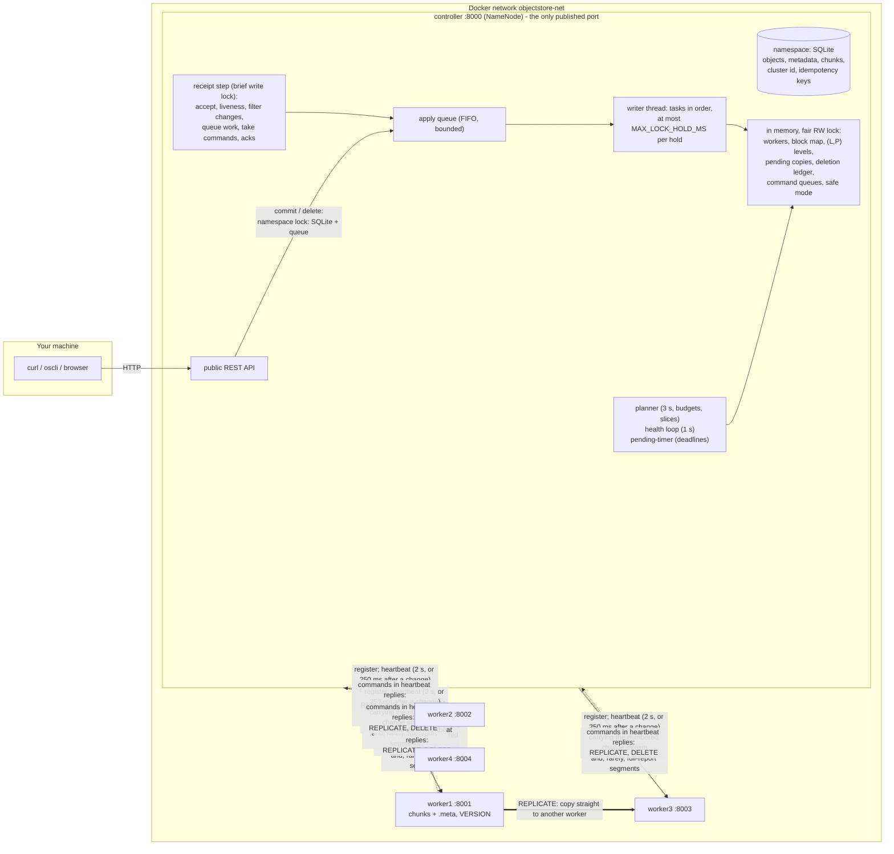

# Mini Distributed Cloud Object Store

A small S3-like object store built as a faithful, miniature re-creation of **HDFS**. Clients upload
arbitrary binary objects (documents, images, video, audio, archives, anything) to a single
**controller** (the NameNode), which splits them into **1 MB chunks** (blocks) and stores **two
copies of every chunk on different storage workers** (DataNodes). Like HDFS, the controller keeps
only the namespace on disk; where every copy lives is held in memory and rebuilt from the workers'
change streams and block reports. It detects dead, stale, partitioned and restarted workers and corrupted data, keeps
serving objects from good copies, has workers copy chunks directly to each other to restore the
replication factor, and survives its own crash at any instruction.

| | |
|---|---|
| Controller nodes | 1 (the NameNode) |
| Storage / worker nodes | 4 (DataNodes), each with its own persistent Docker volume |
| Clients | 1 or more: `curl`, the bundled `oscli` CLI (also runs as a container), a browser dashboard |
| Chunk size | 1 MB (1,048,576 bytes) |
| Replication factor | 2, copies always on different workers |
| Deployment | Docker Compose (no Kubernetes); every service restarts by itself after a crash |
| Stack | Java 21, Spring Boot 4.1, Maven, SQLite (controller namespace) |

**Contents:**
[Quick start](#quick-start) ·
[Architecture](#architecture) ·
[HDFS mapping](#what-is-re-created-from-hdfs) ·
[Using the system](#using-the-system) ·
[Client REST API](#client-rest-api) ·
[Worker protocol](#the-worker-protocol) ·
[Configuration](#configuration) ·
[Demonstrations](#demonstrations) ·
[How it works](#how-it-works) ·
[Failure model](#failure-model) ·
[Edge cases](#edge-case-catalogue) ·
[Guarantees and limits](#guarantees-and-limits) ·
[Testing](#testing) ·
[Requirements traceability](#requirements-traceability) ·
[Decisions](#decisions) ·
[Future work](#future-work) ·
[Repository layout](#repository-layout) ·
[Troubleshooting](#troubleshooting)

---

## Quick start

**Prerequisites:** Docker Engine or Docker Desktop with Compose v2, plus `bash`, `curl`, `make` and
`jq`. A JDK is **not** needed: everything is built inside Docker. (Python 3 is needed only for the
chaos test.)

```bash
make up          # build the images, start 6 containers, wait until all are healthy
make demo        # run the seven demonstrations; ends with "7/7 PASS"
```

Then open the dashboard at <http://localhost:8000/dashboard>, or store something yourself:

```bash
./oscli upload samples/sample.jpg --meta owner=alice     # prints the new object, including its id
./oscli where  <object-id>                               # which workers hold which chunk
./oscli download <object-id> .demo/copy.jpg              # verifies the checksum while downloading
make fsck                                                # end-to-end consistency check
```

| Command | What it does |
|---|---|
| `make up` | `docker compose up --build -d --wait`, then prints the container table |
| `make down` / `make down-v` | stop the containers keeping all data / wiping all data |
| `make ps` / `make logs` / `make status` / `make fsck` | container table / all logs / cluster status JSON / fsck |
| `make stop W=worker2` / `make start W=worker2` | stop a worker (it goes STALE, then DEAD) / bring it back |
| `make pause W=worker2` / `make unpause W=worker2` | freeze a worker (STALE only, if short) |
| `make corrupt W=worker3 C=<chunk_id>` | overwrite 4 bytes inside a stored chunk file |
| `make demo` | the seven demonstrations, self-checking (about 2 minutes) |
| `make test` | 233 unit and in-process system tests (local Maven, or a Maven container) |
| `make test-scale` | the scale test: 500,000 chunks, 8 workers, no HTTP (about a minute) |
| `make scenarios` | the acceptance-criteria scripts against Docker (about 15 minutes; wipes data) |
| `make chaos` | the chaos test: 5 minutes of load and disruption with network faults, then convergence checks |

If port 8000 is taken: `CONTROLLER_PORT=9000 make up` and `BASE=http://localhost:9000 make demo`.

---

## Architecture



**Threads.**

| Process | Thread | Job |
|---|---|---|
| controller | HTTP request threads (virtual) | The receipt step for heartbeats; the public API. Uploads and deletes take the namespace lock for "SQLite + queue"; readers take the read lock. |
| controller | `writer` | The **only** thread that applies queued tasks to the block map |
| controller | `planner-loop` (3 s) | Under-replication levels, cleanup and postponed sets, ledger retries, the rolling invariant check |
| controller | `pending-timer` | Turns the deadlines of pending copies and delivered DELETEs into tasks |
| controller | `health-loop` (1 s) | STALE transitions; queues `MarkDead` |
| worker | `link` | Registration, heartbeats carrying the change stream, full-report segments |
| worker | `block-scanner` | Rate-limited verification and disk ↔ index reconciliation |
| worker | `disk-check` | Volume probe |
| worker | command tasks (virtual) | `REPLICATE` (worker to worker) and `DELETE`; `CMD_FAILED` when a copy cannot be made |

**The controller decides; workers act.** The controller keeps the namespace (which objects exist,
their metadata, which chunks they consist of) durably in SQLite. Everything about *where* copies
are and *how healthy* workers are lives in memory and is rebuilt from what the workers report,
exactly like the HDFS NameNode's block map. Repairs and deletions are commands the controller hands
out in heartbeat replies; workers execute them, copying chunks **directly to each other**.

**Workers are DataNodes.** Each stores chunk files with a `.meta` sidecar holding the checksum,
verifies every chunk it serves, scans its disk for silent corruption, checks that its volume is
writable, and tells the controller about every change to its disk in one numbered change stream
that travels on heartbeats and on its answers to the controller's chunk uploads, each change kept
until the controller acknowledges it. It knows nothing about objects.

| Module | What it is |
|---|---|
| [`common/`](common) | The wire contract: protocol messages, SHA-256 and chunk-id helpers, JSON error handling, fault-injecting HTTP clients |
| [`worker/`](worker) | The DataNode: chunk store with sidecars and an in-memory index, change log, controller link (registration, heartbeats, report segments), command executor, block scanner, disk check |
| [`controller/`](controller) | The NameNode: public API, namespace, cluster state, registry and receipt step, change applier, replication monitor, safe mode, fsck, dashboard |
| [`client/`](client) | `oscli`, a command-line client with idempotent, retrying uploads |
| [`system-tests/`](system-tests) | The real controller and four real workers in one JVM, for end-to-end tests |
| [`tests/`](tests) | Docker scenario scripts per acceptance-criteria block, and the chaos test |

---

## What is re-created from HDFS

| HDFS | Here |
|---|---|
| NameNode persists the namespace (fsimage + edit log) | SQLite (WAL, `synchronous=FULL`): `objects`, `object_metadata`, `chunks`, `idempotency_keys`, `cluster_meta`, plus `upload_intents` and `deleted_objects` (see [orphans](#orphans-and-the-safety-valve)) |
| NameNode keeps block locations and DataNode state **in memory**, rebuilt from reports | [`ClusterState`](controller/src/main/java/com/objectstore/controller/cluster/ClusterState.java): workers, block map and its reverse index, pending copies, command queues |
| `clusterID` in each DataNode's `VERSION` file; mismatched DataNodes are refused | `cluster_id` in `cluster_meta` and in `/data/VERSION` on each worker |
| DataNode registration; the NameNode tells unknown or dead DataNodes to re-register (`DNA_REGISTER`) | `POST /internal/workers/register`; other messages answer 404 `unknown_worker` and the worker re-registers |
| `BPServiceActor`: one thread per NameNode for registration, heartbeats and reports | the worker's `link` thread, on its own HTTP client with a short time-out (`HEARTBEAT_HTTP_TIMEOUT`) |
| Stale DataNode: avoided for reads and writes, replicas still count | `STALE` after 6 s of silence |
| Stale ratio: if more than half are stale, stop avoiding them for writes | `STALE_RATIO = 0.5` |
| Dead DataNode: its replicas leave the block map | `DEAD` after 12 s of silence |
| Incremental block reports (`blockReceivedAndDeleted`) and full block reports | one numbered change stream per worker (`RECEIVED`, `DELETED`, `BAD`, `CMD_FAILED`), kept until acknowledged, on heartbeats and PUT answers; full reports after registering, when asked and every 300 s (a rare safety net), in segments on heartbeats, with a baseline and hold-back |
| `.meta` checksum file per block; DataNode verifies on read and transfer | `<chunk_id>.meta`; the worker verifies on GET and before every REPLICATE |
| DataNode block scanner (rate-limited, with disk/index reconciliation); `reportBadBlocks` | worker scanner: at most one pass per 10 s, reading at most 32 MiB/s; the controller also marks a copy corrupt when a read proves it bad |
| Disk checker; the DataNode shuts down on volume failure | worker disk check every 30 s; on failure the process exits, goes DEAD and is repaired |
| RedundancyMonitor over `LowRedundancyBlocks` priority queues | the planner every 3 s over levels `(L, P)` (live, pending copies; any RF), kept up to date on every change, with weighted quotas and round-robin per level |
| PendingReconstructionBlocks with a time-out | pending copies with a deadline on the `pending-timer` thread: 15 s, then planned again with another target |
| `DNA_TRANSFER`: DataNode copies directly to DataNode | `REPLICATE` command in the heartbeat reply; the worker PUTs to the target worker |
| `DNA_INVALIDATE` | `DELETE` command |
| `max-streams` per DataNode | `MAX_STREAMS = 2` copies in flight per source |
| Excess replicas trimmed, postponed while replicas sit on stale nodes | `EXCESS` state; postponed while any holder is STALE or has not completed a full report |
| A corrupt replica is deleted only after a good one is restored | a `CORRUPT` copy is deleted only once RF live copies exist |
| Safe mode: read-only until 99.9 % of blocks are reported, plus an extension | `SAFE_MODE_THRESHOLD = 0.999`, `SAFE_MODE_EXTENSION = 5 s`, `SAFE_MODE_TIMEOUT = 30 s` |
| Start-up delay before deleting blocks | no orphan deletion during the first `ORPHAN_GC_DELAY = 60 s` after a controller start |
| Write-pipeline recovery: replace a failed DataNode mid-write | an upload replaces a failed target and retries that chunk |
| `completeFile` only after blocks reach minimum replication | 201 only after both copies are fsynced **and** the namespace commit is durable |
| `hdfs fsck` | `GET /api/v1/fsck` |

**Deliberately not re-created**

| HDFS feature | Why not |
|---|---|
| Rack awareness | One host, one "rack". |
| Client → DN1 → DN2 write pipeline | The assignment requires that clients never see workers. The controller acts as the HDFS client and writes both copies in parallel. |
| Generation stamps, leases, append | Chunks are **immutable and never reused** (ids embed a fresh UUID), so stale versions and competing writers cannot occur. |
| NameNode high availability (standby, journal nodes, ZooKeeper failover) | The assignment fixes one controller. We guarantee no loss and automatic recovery, not availability while it is down. |
| Balancer, erasure coding, storage policies, security | Out of scope. |

---

## Using the system

### With the CLI

`./oscli` runs the client inside the `client` container by default (so only Docker is needed);
the project directory is mounted there, so **file arguments must be paths inside this directory**.
`OSCLI_MODE=local ./oscli …` runs it with a local JVM instead (after
`mvn -pl client -am package -DskipTests`), where any path works.

```text
Usage: oscli [--base URL] <command> [arguments]

  upload PATH [--name NAME] [--type MIME] [--key KEY] [--meta key=value ...]
  download ID OUT_PATH      fetch an object and verify it against its checksum
  meta ID                   show system + custom metadata and chunk locations
  patch ID [key=value ...] [--remove key ...]
  list [--limit N] [--offset N]
  delete ID
  where ID                  table: which workers hold each chunk
  status                    cluster overview (workers, replication health, repairs)
```

The client is built for an unreliable service: every upload carries an `Idempotency-Key` (random,
or `--key`), and connection errors and 503 answers (safe mode, too few workers, a chunk briefly
without a readable copy) are retried with back-off 0.5, 1, 2, 4, 5, 5 … s for up to
`OSCLI_RETRY_SECONDS` (default 60). A download that breaks off is retried; a completed download is
verified against the `ETag`. Exit codes: `0` success · `1` the server answered with an error ·
`2` unreachable, or the transfer kept breaking · `3` downloaded bytes do not match the checksum ·
`64` wrong usage.

### With curl

```bash
API=http://localhost:8000/api/v1
curl -H "Idempotency-Key: my-upload-1" -F "file=@report.pdf" -F 'metadata={"owner":"alice"}' $API/objects   # 201
curl -o report.pdf $API/objects/$ID                                         # 200, the original bytes
curl $API/objects/$ID/metadata                                              # 200, system + custom metadata
curl -X PATCH -H 'Content-Type: application/json' -d '{"owner":"team","old":null}' $API/objects/$ID/metadata
curl "$API/objects?limit=50&offset=0"                                       # 200, newest first
curl -X DELETE $API/objects/$ID                                             # 204
curl $API/cluster/status                                                    # 200, the cluster at a glance
curl $API/fsck                                                              # 200, consistency check
```

### Dashboard

<http://localhost:8000/dashboard> polls the status every 2 s: a safe-mode banner; KPIs (objects,
chunks, copies, under-replicated, pending copies, missing chunks, corrupt and excess copies,
invariant violations); worker cards (ALIVE green, STALE amber, DEAD red; process id, last
heartbeat, copies, free space, queued commands, copies being sent); the chunk-by-worker grid of the
newest object (`OK`, `C` corrupt, `E` excess); an **fsck** button; and the monitor's last 20 events.

---

## Client REST API

Base path `/api/v1`. Structured data is JSON with `snake_case` keys; object data is binary.

| Method | Endpoint | Purpose | Success |
|---|---|---|---|
| `POST` | `/api/v1/objects` | Upload an object | `201` (`200` for an idempotent replay) |
| `GET` | `/api/v1/objects/{object_id}` | Download an object | `200` |
| `GET` | `/api/v1/objects/{object_id}/metadata` | Retrieve metadata | `200` |
| `PATCH` | `/api/v1/objects/{object_id}/metadata` | Update custom metadata | `200` |
| `DELETE` | `/api/v1/objects/{object_id}` | Delete an object | `204` |
| `GET` | `/api/v1/objects` | List stored objects | `200` |
| `GET` | `/api/v1/cluster/status` | Cluster overview *(extra)* | `200` |
| `GET` | `/api/v1/fsck` | Consistency check *(extra)* | `200` |
| `GET` | `/health`, `/dashboard` | Liveness probe, dashboard page *(extra)* | `200` |

### Upload — `POST /api/v1/objects`

`multipart/form-data` with a required `file` part and an optional `metadata` field (a JSON object of
custom key/value pairs). The controller assigns a UUID. The name is the uploaded file name (or
`unnamed`); the content type is the one declared for the part, or inferred from the extension if
none or only `application/octet-stream` was declared. An empty file is a valid object (0 chunks).

- **`Idempotency-Key`** (optional header, 1–128 visible ASCII characters): if an earlier upload with
  the same key succeeded, the answer is `200` with that object and `Idempotent-Replay: true`, even
  in safe mode, and nothing is stored again. The same key with a file of a different size is
  `409 conflict`. Two concurrent uploads with one key create exactly one object.
- **201 means durable**: every chunk is fsynced on two workers and the namespace commit is durable
  (`synchronous=FULL`). The object survives a controller crash and the loss of any one worker.
- Refused before the body is read: `503 safe_mode` (with `Retry-After: 5`) and
  `503 insufficient_workers` (fewer than 2 workers can take writes).

### The object description

Returned by upload, `GET …/metadata` and `PATCH …/metadata`:

```json
{
  "object_id": "c25c8bbf-b601-49a4-a20d-57bb7c664211",
  "name": "report.pdf",
  "size": 1500000,
  "content_type": "application/pdf",
  "checksum": "5320dde6be765f4e1cb2d03fbc143cf9aed165f15b17aaa7782a4bf506ebaa66",
  "chunk_count": 2,
  "created_at": "2026-11-16T16:43:50.268Z",
  "updated_at": "2026-11-16T16:43:50.594Z",
  "replication_ok": true,
  "custom_metadata": { "course": "cloud-computing", "owner": "team" },
  "chunks": [
    {
      "chunk_id": "c25c8bbf-b601-49a4-a20d-57bb7c664211-00000",
      "index": 0,
      "size": 1048576,
      "checksum": "cb33b3f01ba887ca83d0e94a8815114a9697fc1840a8b51ed03293f2fe805c7a",
      "locations": [
        { "worker_id": "worker1", "status": "OK", "worker_status": "ALIVE" },
        { "worker_id": "worker4", "status": "OK", "worker_status": "ALIVE" }
      ]
    }
  ]
}
```

`checksum` is the SHA-256 of the whole object; each chunk has a unique id (`<object_id>-<index>`),
its `index` (order in the object), size, SHA-256 and `locations`. A location's `status` is the
copy's state (`OK`, `CORRUPT`, `EXCESS`), `worker_status` the worker's (`ALIVE`, `STALE`).
`replication_ok` is true when every chunk has at least 2 live copies.

### Download, metadata, delete, list

- **Download** streams the original bytes with the stored `Content-Type`, `Content-Length`,
  `Content-Disposition`, `ETag: "<sha256>"` and `X-Object-Id`. `404` if unknown; `503
  chunk_unavailable` if some chunk has no readable copy right now (decided before the first byte).
- **PATCH metadata**: a string sets a key, `null` removes it; only the metadata tables change.
  Keys: 1–64 characters from `A-Z a-z 0-9 _ . -`; values: strings of at most 1024 characters; at
  most 64 keys. Anything else is `400 invalid_metadata`. `503 safe_mode` in safe mode.
- **DELETE**: `204`; the namespace row is deleted durably and every known copy gets a DELETE
  command (workers delete the files with their next heartbeat, within ~2 s), and so does the target
  of any copy still on its way. Copies the controller could not know about (on a DEAD worker)
  become garbage and are collected from the worker's changes or its next full report.
  `404` if unknown, `503 safe_mode` in safe mode.
- **List**: `limit` 1–500 (default 50), `offset` ≥ 0; newest first; `{items, total, limit, offset}`.

### Status codes and errors

Every error is JSON: `{"error": "<code>", "detail": "<sentence>"}`.

| Status | When | `error` codes |
|---|---|---|
| `200` | download, metadata, list, status, fsck; an idempotent upload replay | |
| `201` | object created | |
| `204` | object deleted | |
| `400` | no `file` part, not multipart, bad `limit`/`offset`, invalid metadata, bad `Idempotency-Key` | `bad_request`, `invalid_metadata` |
| `404` | object not found; unknown route | `object_not_found`, `not_found` |
| `409` | an `Idempotency-Key` reused for a file of a different size | `conflict` |
| `500` | unexpected server error (stack trace in the log only) | `internal_error` |
| `503` | safe mode (with `Retry-After: 5`), too few writable workers, a chunk that could not be stored twice, a chunk with no readable copy | `safe_mode`, `insufficient_workers`, `upload_failed`, `chunk_unavailable` |

Also used where they are the precise answer: `405 method_not_allowed`, `413 payload_too_large`,
`415 unsupported_media_type`.

### Cluster status — `GET /api/v1/cluster/status`

`safe_mode`, `cluster_id`; per worker `state`, `boot_id` (8 chars), `has_reported`, `last_seen_s_ago`,
`chunk_count`, `queued_commands`, `pending_as_source`, `stats{chunks, used_bytes, free_bytes,
active_transfers}`; `replicas{ok, corrupt, excess}`, `under_replicated`, `over_replicated`,
`missing_chunks`, `pending_replications`, `blocked` (chunks the last monitor tick could not
schedule); `counters{invariant_violations, orphan_gc_refused, stale_messages, duplicates, blocked,
changes_gap, apply_queue_full, writer_task_failures, namespace_reconciled, upload_commit_wait_timeouts, …}`;
`repair_log`, the monitor's last 200 events (`replicate`, `copied`, `failed`, `timeout`, `trimmed`,
`invalidated`, `deleted`, `restored`, `orphan`, `unrecoverable`); and the writer's health:
`lock_max_hold_ms` (the longest continuous write-lock hold since the previous status read, also per
holder in `lock_max_hold_by`; reading resets it), `apply_queue_depth`, `apply_oldest_task_age_ms`,
`writer_busy_ratio` (share of the time since the previous read that the writer held the lock),
`report_sessions_open`, `ledger{waiting, queued, delivered}`, `levels{"L,P": size}` (chunks needing
copies by priority level), `cleanup_size` and `postponed_size`. Every number is a counter: the
status costs O(workers + levels), however many chunks there are.

### fsck — `GET /api/v1/fsck`

Takes the namespace lock, queues a barrier for the writer and waits for it (every namespace change
queued before is applied), reads the `chunks` table and snapshots the block map, and releases the
lock. Then it asks every ALIVE worker, in parallel, for its chunks with checksums **recomputed from
the files**, compares that with the snapshot and the namespace, and runs the invariant checks plus
I7 (memory mirrors the `chunks` table). `quiescent` also requires an empty apply queue, an empty
deletion ledger, no report session open and no worker being purged.

```json
{"status": "HEALTHY",
 "objects": {"total": 12, "healthy": 12, "under_replicated": 0, "corrupt_replicas": 0, "missing": 0},
 "disk_vs_map": {"on_disk_not_in_map": [], "in_map_not_on_disk": [], "checksum_mismatch": []},
 "orphans_on_disk": 0, "unreachable_workers": [], "invariant_violations": [], "quiescent": true}
```

`CORRUPT` if some object has a chunk without any live copy; `DEGRADED` if anything is
under-replicated, a copy is corrupt, a worker is unreachable, an invariant is violated, or (while
quiescent) disks and the map differ or orphans exist; otherwise `HEALTHY`. `quiescent` means no
pending copies, no queued commands and not in safe mode; only then are differences meaningful.

---

## The worker protocol

### Endpoints

| Method | Endpoint | Served by | Purpose |
|---|---|---|---|
| `POST` | `/internal/workers/register` | controller | Register a worker (process) |
| `POST` | `/internal/workers/heartbeat` | controller | Liveness and statistics, the worker's next changes and at most one full-report segment; receive commands and acknowledgements |
| `PUT` | `/internal/chunks/{chunk_id}` | worker | Store a chunk (from the controller, or from another worker for a repair); the controller's PUT also acknowledges and collects changes |
| `GET` | `/internal/chunks/{chunk_id}` | worker | Retrieve a chunk, verified against its `.meta` |
| `DELETE` | `/internal/chunks/{chunk_id}` | worker | Delete a chunk (idempotent: always 204) |
| `GET` | `/internal/workers/{worker_id}/chunks` | worker | Every chunk on disk with a freshly computed checksum (fsck) |

There are no separate report endpoints: full and incremental reports both travel on heartbeats.

Worker answers: **PUT** (raw bytes, header `X-Checksum: <sha256>`; from the controller also
`X-Change-Ack: <boot_id>:<n>`) → `201` written · `200` identical content already there and verified
(idempotent; rotten stored bytes are replaced and answer `201`) · `400 bad_request` (malformed id, missing header) · `400
checksum_mismatch` (nothing written) · `409 conflict` (the id holds different content) · `413` (more
than one chunk) · `507 insufficient_storage`. **GET** → `200` bytes with `X-Checksum` · `404
chunk_not_found` · `409 chunk_corrupt` (the bytes no longer match `.meta`; never served).
**DELETE** → `204`. **List** → `200 {"worker_id", "chunks": [{"chunk_id", "size", "checksum"}]}` ·
`404 unknown_worker` for another worker's id. Chunk ids must match
`^[0-9a-f]{8}-[0-9a-f]{4}-[0-9a-f]{4}-[0-9a-f]{4}-[0-9a-f]{12}-\d{5}$`, so no request can reach a path
outside `/data/chunks`.

### The envelope and the acceptance rules

Every heartbeat carries `{"worker_id", "boot_id", "seq", "sent_at", "stats", "changes", "segment"}`:
`boot_id` is a UUID generated once per worker *process*; `seq` numbers the heartbeats; `sent_at` is
the wall-clock time of the send. The controller checks, in this order:

| Condition | Answer | Effect |
|---|---|---|
| worker unknown, or DEAD | 404 `unknown_worker` | the worker registers again (HDFS `DNA_REGISTER`) |
| `boot_id` is not the current process | 409 `stale_boot` | ignored: a message from a dead old process |
| sent more than `MAX_MESSAGE_AGE` ago | 409 `too_old` | ignored; the worker resends it at once with a fresh `sent_at` |
| `seq` ≤ the last one | 200 `{"ignored":"duplicate", "changes_received_up_to"}` | only the acknowledgement is echoed: no commands, nothing applied |
| otherwise | the receipt step (below) | |

**Registration** carries `url`, `boot_id`, the `cluster_id` from `/data/VERSION` (or `null` for a
new volume), `attempt` (a per-process counter, +1 on every registration attempt), `change_seq` (the
last change number of the process, taken together with the hold of the report that follows), the
last heartbeat `seq` and statistics. The controller checks, in order: a `cluster_id` that is not its
own → 409 `cluster_id_mismatch` (the worker keeps its data and retries only every 60 s); sent more
than `MAX_MESSAGE_AGE` ago → 409 `too_old`; the duplicate-worker refusal (three new boot ids for one
id within a minute look like two containers with the same `WORKER_ID`: newcomers get 409
`duplicate_worker` for 60 s); the same `boot_id` with an `attempt` below the last accepted one (a
delayed old request) → 409 `stale_registration`; the same `attempt` again (its reply was lost) → ok,
nothing reset. Otherwise the registration is accepted and starts a new **epoch** for the worker:
`received = applied = change_seq`, the command queue is cleared, pending copies to or from it are
dropped, its upload receipts and any open report session are forgotten, and its replicas are kept
until its full report confirms or removes them. With `cluster_id: null`, the worker records the
controller's cluster id durably in `VERSION` before anything else.

### The change stream

Every change to a worker's disk gets the next number in its process (the first is 1) and is kept in
the worker's `ChangeLog` until the controller acknowledges it:

| Change | Meaning |
|---|---|
| `RECEIVED(chunk, size, checksum)` | the worker now holds verified bytes of `chunk` with this checksum (also for an identical re-upload) |
| `DELETED(chunk)` | the worker does not hold `chunk` (logged even if it was already absent) |
| `BAD(chunk)` | the worker's copy failed verification (on read, before a transfer, or by the scanner) |
| `CMD_FAILED(cmd_id, chunk, target, reason)` | a `REPLICATE` could not be completed: no local copy, a corrupt one, or the PUT failed |

Changes travel on two channels, each carrying a contiguous run:

- **Heartbeats**: up to `MAX_CHANGES_PER_MESSAGE` changes after the last acknowledgement. The worker
  heartbeats every `HEARTBEAT_INTERVAL`, but `HEARTBEAT_MIN_GAP_MS` after a change (a new change
  wakes it early).
- **PUT answers**: the controller's `PUT /internal/chunks/{id}` carries `X-Change-Ack:
  <boot_id>:<received>`; the worker forgets everything up to `received` and answers with
  `{chunk_id, size, checksum, changes: {boot_id, items}}`, at most `MAX_CHANGES_PER_PUT_ANSWER`
  changes, which usually include the `RECEIVED` of the chunk just written. Another boot id, or a
  worker-to-worker PUT, gets no changes.

**The receipt step** (one brief block under the cluster lock, per heartbeat or PUT answer): changes
up to the worker's `received` are dropped (duplicates, overlaps); if the first remaining one is not
`received + 1`, that is a **gap**: nothing from the message is accepted, a full report is requested
and `changes_gap` counted, so the acknowledgement never moves past a gap. Otherwise the longest
contiguous run is applied and `received` moves to its end. The reply carries
`changes_received_up_to = received`; the worker forgets what it acknowledges. If the worker's log
holds more than `CHANGE_LOG_MAX` unacknowledged changes, it drops them all and sends a full report
instead. Only heartbeats count for liveness.

**Upload receipts.** A `RECEIVED` for a chunk of an upload that has not committed yet becomes an
upload receipt `(chunk, worker, epoch)`. At commit, a receipt becomes the replica; a copy without one
(its `RECEIVED` is still on its way) becomes an **UPLOAD pending copy**: it counts against repair,
downloads may read from it (after every live copy), and it ends when its `RECEIVED` arrives or, after
`PENDING_TIMEOUT`, expires into normal repair. A 2xx answer to a PUT never creates a replica by
itself.

### Full reports

A full report lists the worker's in-memory index (with each chunk's size, sidecar checksum and
whether it is known bad), sorted by chunk id, in segments of `REPORT_SEGMENT_SIZE` entries, one
segment per heartbeat, stop-and-wait (segment *i+1* only after *i* was acknowledged). Each segment
carries the `report_id` (new for every report), its `index`, `last` and the **baseline** `M`: the
last change number the listing includes. Reports are sent after registering, every
`FULL_REPORT_INTERVAL`, when the controller asks (a request during a report is ignored), and after a
change-log overflow (which abandons any report in progress and starts a new one).

- **Hold-back:** while a report with baseline `M` is in progress, no change above `M` leaves the
  worker on any channel. So when the last segment arrives the controller sets `received =
  max(received, M)`, and the report is complete: every copy the report did not list is removed
  (each listed copy is *marked* with the report's session; unmarked ones go), and orphan GC runs.
- **Segments of an old report** are re-acknowledged, never applied twice; a segment that skips
  ahead is ignored.
- A listed chunk the namespace does not know is an upload receipt (if its upload is in progress),
  known garbage (a failed upload or a deleted object) or an orphan; see
  [orphans](#orphans-and-the-safety-valve).

**Commands** in heartbeat replies:

```json
{"cmd_id": "…", "type": "REPLICATE", "chunk_id": "…", "checksum": "…", "target_url": "http://worker3:8003", "expires_at": 1763350030.0}
{"cmd_id": "…", "type": "DELETE", "chunk_id": "…", "reason": "excess|corrupt|orphan|object_deleted|upload_failed", "expires_at": 1763350030.0}
```

A worker executes a `cmd_id` at most once and drops a command whose `expires_at` has passed, both
on arrival and right before running it. A lost heartbeat reply loses its commands: a REPLICATE
ends by the pending time-out and is planned again; a DELETE is sent again by the deletion ledger
until the worker's `DELETED` change confirms it (below).

### The deletion ledger

Every DELETE is created by the controller's **deletion ledger** and tracked until the worker
confirms it, so deletions complete without relying on full reports:

- **One entry per (chunk, worker):** `reason` (`excess`, `corrupt`, `orphan`, `object_deleted`,
  `upload_failed`), `state`, `cmd_id`, `deadline`, `attempts`.
- **WAITING → QUEUED** when the worker is ALIVE, has reported and its command queue has room: tried
  when the entry is created and when the worker completes a report, otherwise every monitor tick
  (at most `CLEANUP_BUDGET` entries).
- **QUEUED → DELIVERED** when a heartbeat reply hands the command out; `deadline = now +
  PENDING_TIMEOUT`. **Completed** when the worker's `DELETED(chunk)` is applied. A deadline that
  passes sends it again (`[ledger] DELETE … sending it again`, `attempts + 1`).
- **A worker DEAD or re-registering:** its queue is cleared and its entries wait for the new
  process (its `excess`/`corrupt` entries are dropped: its copies are judged again after its report).
- **Cancelling:** a WAITING or QUEUED excess/corrupt deletion is cancelled as soon as its chunk
  falls below RF; a DELIVERED one cannot be called back (I5).
- **Command queues never drop a command.** Each worker's queue has an O(1) dedupe index; the cap
  `MAX_COMMANDS_PER_WORKER` is kept by the ledger (entries wait) and the monitor (no REPLICATE from
  a source whose queue is full).
- **Garbage is deleted as soon as it is seen:** a `RECEIVED` for a chunk of a deleted or failed
  object (a repair landing after a delete, say) gets a DELETE at once, once orphan GC is allowed.
  When orphan GC becomes allowed (safe mode off and `ORPHAN_GC_DELAY` after the start), every worker
  is asked for a full report once, so leftovers seen before are collected without waiting for
  `FULL_REPORT_INTERVAL`.

---

## Configuration

Everything is an environment variable, set in [`docker-compose.yml`](docker-compose.yml).

| Variable | Default | Where | Meaning |
|---|---|---|---|
| `HEARTBEAT_INTERVAL` | 2 | worker | heartbeat period (s) |
| `STALE_AFTER` | 6 | controller | silence → STALE |
| `DEAD_AFTER` | 12 | controller | silence → DEAD |
| `STALE_RATIO` | 0.5 | controller | above this fraction of STALE workers, stop avoiding STALE workers for writes |
| `HEALTH_INTERVAL` | 1 | controller | liveness check period |
| `MONITOR_INTERVAL` | 3 | controller | replication monitor period |
| `PENDING_TIMEOUT` | 15 | controller | a pending copy times out, and a delivered DELETE not yet confirmed is sent again, after this |
| `TARGET_BACKOFF` | 30 | controller | after a failed copy, avoid that (chunk, target) pair for this long |
| `MAX_STREAMS` | 2 | controller | copies in flight per source worker |
| `COMMAND_TTL` | 30 | controller | a command carries `expires_at = issued + TTL` |
| `MAX_COMMANDS_PER_WORKER` | 1000 | controller | queue cap; never exceeded and nothing is dropped (deletions wait in the ledger) |
| `CLEANUP_BUDGET` | 2000 | controller | waiting ledger deletions re-checked per monitor tick |
| `MAX_MESSAGE_AGE` | 10 | controller | reject worker messages sent longer ago than this |
| `SAFE_MODE_THRESHOLD` | 0.999 | controller | fraction of chunks with a reported OK copy needed to leave safe mode |
| `SAFE_MODE_EXTENSION` | 5 | controller | stay in safe mode this long after the threshold is reached |
| `SAFE_MODE_TIMEOUT` | 30 | controller | leave safe mode after this regardless |
| `ORPHAN_GC_DELAY` | 60 | controller | no orphan deletion during the first N s after a controller start |
| `ORPHAN_GC_MAX_FRACTION` | 0.5 | controller | refuse orphan GC if one report would delete more than this fraction of a worker's chunks (when > 10) |
| `MIN_FREE_BYTES` | 16777216 | controller | minimum free space for a write or repair target |
| `FULL_REPORT_INTERVAL` | 300 | both | full report period: rare, a safety net only (the controller asks for an overdue one at 2×) |
| `HEARTBEAT_MIN_GAP_MS` | 250 | worker | earliest next heartbeat when changes or report segments are waiting |
| `CHANGE_LOG_MAX` | 10000 | worker | unacknowledged changes kept; on overflow all are dropped and a full report starts |
| `MAX_CHANGES_PER_MESSAGE` | 2000 | worker | changes per heartbeat |
| `MAX_CHANGES_PER_PUT_ANSWER` | 256 | worker | changes per answer to a controller PUT |
| `REPORT_SEGMENT_SIZE` | 2000 | worker | entries per full-report segment |
| `SCAN_INTERVAL` | 10 | worker | at most one block scanner pass per this many seconds |
| `SCAN_MAX_BYTES_PER_SEC` | 33554432 | worker | block scanner read rate limit (32 MiB/s, a token bucket refilled each second) |
| `DISK_CHECK_INTERVAL` | 30 | worker | volume probe period |
| `HEARTBEAT_HTTP_TIMEOUT` | 3 | worker | heartbeat request time-out (below `STALE_AFTER`) |
| `CONNECT_TIMEOUT` | 2 | both | HTTP connect time-out |
| `READ_TIMEOUT` | 10 | both | HTTP read time-out for chunk transfers |
| `INVARIANT_CHECKS` | 1 | controller | run the rolling invariant check every planner tick (the full check runs in fsck) |
| `PLANNER_VISIT_BUDGET` | 2000 | controller | chunks visited in the under-replication levels per planner tick |
| `POSTPONED_BUDGET` | 1000 | controller | postponed chunks re-checked per tick |
| `ROLLING_CHECK_CHUNKS` | 1000 | controller | chunks checked by the rolling invariant check per tick |
| `MAX_LOCK_HOLD_MS` | 5 | controller | longest continuous write-lock hold by the writer before it yields (≥ 1) |
| `APPLY_QUEUE_CAPACITY` | 10000 | controller | tasks; when full, the receipt step acknowledges nothing (the worker resends) |
| `UPLOAD_COMMIT_WAIT` | 10 | controller | how long an upload or delete waits for its task before answering anyway |
| `DOWNLOAD_SETTLE_WAIT` | 5 | controller | how long a download waits for a just-committed chunk to be readable in memory |
| `FAULT_DELAY_MS` | 0 | both | fault injection: random delay 0..N ms before each internal call |
| `FAULT_DROP_RATE` | 0 | both | fault injection: probability a call is lost (half before sending, half after: a lost answer) |
| `FAULT_DUP_RATE` | 0 | both | fault injection: probability a call is sent twice |
| `CHUNK_SIZE` | 1048576 | both | bytes per chunk; workers reject larger chunk bodies |
| `REPLICATION_FACTOR` | 2 | controller | live copies wanted per chunk |
| `DB_PATH` | `/data/meta.db` | controller | SQLite namespace |
| `DATA_DIR` | `/data` | worker | volume mount: `chunks/`, `VERSION` |
| `WORKER_ID` | *(required)* | worker | `worker1` … `worker4`; also the container name |
| `CONTROLLER_URL` / `ADVERTISE_URL` | `http://controller:8000` / `http://<WORKER_ID>:<PORT>` | worker | where to register / how the controller and peers reach this worker |
| `MAX_UPLOAD_SIZE` | `10GB` | controller | largest accepted object |
| `PORT`, `LOG_LEVEL` | 8000 / 8001–8004, `INFO` | both | |

All services have `restart: unless-stopped` (a crashed process comes back by itself; `docker
stop` still keeps it stopped) and `stop_grace_period: 5s`. [`docker-compose.chaos.yml`](docker-compose.chaos.yml)
turns fault injection on (300 ms, 5 % drops, 5 % duplicates).

Log tags: controller `[api]`, `[upload]`, `[download]`, `[registry]`, `[report]`,
`[monitor]`, `[safemode]`, `[integrity]`, `[invariant]`, `[fsck]`; worker `[link]` (registration,
heartbeats, report segments, change-log overflow), `[cmd]`, `[store]`, `[scanner]`, `[diskcheck]`,
`[version]`.

---

## Demonstrations

`make demo` runs all seven and checks every claim; it ends with:

```text
 PASS  1/7  Object storage - upload an object, retrieve it, verify it is identical
 PASS  2/7  Chunking and distribution - an object larger than 1 MB
 PASS  3/7  Replication - every chunk has two copies; where they are
 PASS  4/7  Metadata - custom metadata on upload; read and modify it without re-uploading
 PASS  5/7  Worker failure - docker stop worker2, then docker start worker2
 PASS  6/7  Data integrity - corrupt stored data on purpose
 PASS  7/7  Controller crash - docker kill controller in the middle of an upload
 7/7 PASS
```

Nothing in the script waits for a fixed time: every wait polls until the expected state is reached.
The sections below show what each demonstration does and how to do it by hand
(`API=http://localhost:8000/api/v1`, scratch files in `.demo/`).

### 1. Object storage

```bash
head -c 307200 /dev/urandom > .demo/small.bin
ID=$(curl -s -F "file=@.demo/small.bin" $API/objects | jq -r .object_id)
curl -s -o .demo/small.out $API/objects/$ID
shasum -a 256 .demo/small.bin .demo/small.out        # identical; equal to the ETag and to .checksum
```

A real image (`samples/sample.jpg`) is stored as `image/jpeg` and served back with that type.

### 2. Chunking and distribution

```bash
head -c 3500000 /dev/urandom > .demo/big.bin
BIG=$(./oscli upload .demo/big.bin | jq -r .object_id)
./oscli where $BIG
```

```text
IDX  CHUNK_ID                                       SIZE  COPIES
0    6f7b94b7-ed56-4c5b-8a49-8770976575d7-00000  1048576  worker1(OK)  worker4(OK)
1    6f7b94b7-ed56-4c5b-8a49-8770976575d7-00001  1048576  worker1(OK)  worker2(OK)
2    6f7b94b7-ed56-4c5b-8a49-8770976575d7-00002  1048576  worker2(OK)  worker3(OK)
3    6f7b94b7-ed56-4c5b-8a49-8770976575d7-00003   354272  worker3(OK)  worker4(OK)

copies per worker: worker1=2  worker2=2  worker3=2  worker4=2
```

3,500,000 bytes become three 1 MiB chunks and one of 354,272 bytes; on disk there are 8 chunk
files, 2 per worker, each with its `.meta` sidecar.

### 3. Replication

Each chunk has exactly two copies on two different workers, both `OK`; both files hash to the
checksum recorded at upload; `replicas.ok = 2 × chunks` and nothing is under- or over-replicated.

### 4. Metadata

```bash
MID=$(curl -s -F "file=@.demo/big.bin;filename=report.pdf;type=application/pdf" \
           -F 'metadata={"owner":"ansh","course":"cloud-computing"}' $API/objects | jq -r .object_id)
curl -s -X PATCH -H 'Content-Type: application/json' -d '{"owner":"team","tag":"v1"}' $API/objects/$MID/metadata
./oscli patch $MID --remove tag
```

Keys are added, updated and removed; `updated_at` moves forward; size, checksum and chunk layout
stay the same; no worker is contacted.

### 5. Worker failure

```bash
docker stop worker2
```

| Time | What happens |
|---|---|
| ~6 s of silence | `worker2` is **STALE**: avoided for reads and writes, but its copies still count; nothing is re-replicated (a GC pause or a network blip must not trigger mass copying) |
| ~12 s of silence | **DEAD**: `[registry] worker2 DEAD after 12.0s - N replicas removed`; `under_replicated` > 0; downloads keep working from the other copies |
| within ~3 s | the monitor orders copies: `[monitor] REPLICATE chunk=… copies=1 worker1->worker4` |
| within ~2 s more | the source picks the command up with its heartbeat and copies the chunk **directly to the target**: `[cmd] replicate ok chunk=…` in the source's log; the target's `RECEIVED` change confirms it: `[monitor] copied …` |

```bash
docker start worker2
```

It registers again, sends a full report listing the chunks still on its volume, and those
chunks now have 3 copies. Once every holder is ALIVE and has reported, the monitor marks the copy on the
busiest worker `EXCESS` and orders its deletion: `[monitor] trimmed …`. Every chunk ends with exactly
two copies; at no point did any chunk have fewer than one.

### 6. Data integrity

```bash
make corrupt W=worker1 C=<chunk_id>        # 4 bytes overwritten inside the data file
./oscli download <object_id> .demo/x.bin   # still byte-identical
```

- **Found on read:** the worker re-hashes a chunk before serving it, refuses with
  `409 chunk_corrupt` and reports it bad; the controller marks the copy `CORRUPT` and reads the
  other copy. The client gets correct data.
- **Found without anyone reading:** the worker's block scanner (every 10 s) re-hashes every chunk:
  `[scanner] CORRUPT chunk=…`, reported to the controller as a `BAD` change with the next heartbeat.
- **Restored, HDFS-style:** the corrupt copy is kept as a last resort while a healthy holder copies
  the chunk to a third worker; only after that copy is confirmed is the corrupt one deleted
  (`replicate` → `copied` → `invalidated` in the monitor log).

### 7. Controller crash

```bash
./oscli upload .demo/crash.bin --key demo7 &      # a 100 MB upload
docker kill controller                            # while its chunks are being written
docker start controller
```

The client's connection drops; it keeps retrying with the same `Idempotency-Key`. The restarted
controller is in **safe mode** (writes refused with `503 safe_mode`, nothing repaired or deleted)
until the workers have re-registered and reported. The retried upload then succeeds and **exactly
one object** exists. The chunks the killed attempt had written are orphans: workers keep listing
them, and once `ORPHAN_GC_DELAY` has passed since the controller start, the next full report gets
them deleted. `fsck` is `HEALTHY`.

---

## How it works

### State and invariants

The controller's in-memory state ([`ClusterState`](controller/src/main/java/com/objectstore/controller/cluster/ClusterState.java)):
workers (state, boot id, epoch, `received` / `applied` change numbers, the open report session,
statistics, command queue), a mirror of the `chunks` table, the **block map** (chunk → worker →
copy) with its exact reverse index, pending copies (REPAIR from a source, or UPLOAD awaiting its
`RECEIVED`), upload receipts, uploads in progress, recent failures, safe mode and counters. A copy is
`OK`, `CORRUPT` or `EXCESS`, carries the mark of the last report session that listed it, and
remembers whether a DELETE for it was queued or already delivered. Every copy comes from the
worker's own change stream or report, so all are confirmed.

**Live copies** of a chunk are its `OK` copies on non-DEAD workers (a STALE worker's copies still
count, as in HDFS). The status, `replication_ok`, the dashboard and fsck call a chunk
under-replicated when it has fewer than 2 live copies (a copy that is merely on its way does not
protect anything yet; those are shown as `pending_replications`), over-replicated with more than 2,
missing with none. The monitor *schedules* a copy when `live + pending < 2`, so it never orders the
same copy twice.

`checkInvariants()` runs every monitor tick and from fsck; a violation is counted, logged as
`ERROR [invariant] …` and never thrown:

| | Invariant |
|---|---|
| I1 | every worker in the block map is known and not DEAD |
| I2 | the reverse index is exactly the inverse of the block map |
| I3 | every chunk in the block map, the pending copies and the reverse index is known |
| I4 | a REPAIR pending copy is between non-DEAD workers, to a worker without the chunk, and a source has at most `MAX_STREAMS`; an UPLOAD pending copy has no source and a non-DEAD target |
| I5 | a copy whose DELETE was delivered is `EXCESS` or `CORRUPT`, never `OK` |
| I6 | no excess or corrupt DELETE is queued for a chunk with fewer than 2 live copies |
| I7 | the in-memory chunk table equals the database's (fsck only) |
| I8 | a chunk never has two pending copies to the same worker |
| I9 | a chunk is in exactly one level iff it is known and `L + P < RF`, and that level is its `(L, P)`; the cleanup and postponed sets hold only known chunks and are disjoint |
| I10 | every counter (copies by state, `safeCount`, missing, `pendingFrom`, `pendingTo`, level sizes) equals its recomputation |
| I11 | for every worker, `applied ≤ received` |
| I12 | at most one ledger entry per (chunk, worker); every DELETE in a command queue has a QUEUED ledger entry with its `cmd_id`; an `excess`/`corrupt` entry points to an `EXCESS`/`CORRUPT` copy or to none |
| I13 | no upload receipt belongs to an old epoch or to an object that is not being uploaded |

### The concurrency rule

All cluster state is guarded by **one fair read-write lock** (the HDFS namesystem lock).
**No network I/O, no SQLite access and no sleeping happen while it is held**, read or write; a guard
on every database connection enforces the SQLite part (`SqliteGuard`).

- **Readers** take the read lock: download candidates, metadata views, status, placement, fsck
  snapshots.
- **One writer.** Everything that changes the block map is a task on one bounded FIFO queue
  (`APPLY_QUEUE_CAPACITY`), applied by one thread, `writer`, in batches of at most
  `MAX_LOCK_HOLD_MS` per write-lock hold. A long task (a DEAD purge, a report completion, a large
  commit or delete) works in steps of at most ~1000 items and answers `MORE`: the writer releases
  the lock briefly and resumes **that** task before any other, so a continuation keeps its queue
  position (a purge finishes before the worker's next registration; a report completes before the
  worker's newer changes). The state satisfies every invariant at every step. A task that throws is
  logged and counted (`writer_task_failures`) and the writer carries on.
- **Brief writers** that only queue work: the heartbeat's receipt step (O(message)), the health
  loop's STALE marking, `beginUpload`; the planner works under the write lock in slices of at most
  `MAX_LOCK_HOLD_MS`.
- **Epochs.** Each worker's epoch grows on every accepted registration and on DEAD; every task about
  a worker carries the epoch it was created in and is dropped if that epoch has ended.
- **The namespace lock** is held across "SQLite transaction + putting the matching task on the
  queue" for upload commits and deletes, so the queue order of namespace changes is the database's.
  Lock order: never the cluster lock while holding the namespace lock; the writer never takes it;
  putting a task on the queue takes no cluster lock. If a `CommitObject` or `DeleteObject` task
  fails, a *reconcile helper* (a virtual thread) takes the namespace lock, reads that object's rows,
  and queues `ApplyObjectMirror`, which makes the mirror match (`namespace_reconciled`).

| Task | Queued by | Applies |
|---|---|---|
| `ApplyChanges`, `ApplySegment`, `CompleteReport` | the receipt step, PUT answers | the change stream and full reports |
| `Register` | registration (the HTTP thread waits) | the registration checks, a new epoch |
| `MarkDead` | the health loop | re-checks (a heartbeat meanwhile, or a new epoch, cancels it), then DEAD and a stepped purge |
| `CommitObject` / `EndUpload` | an upload (waits up to `UPLOAD_COMMIT_WAIT`) | the mirror and the copies / garbage and DELETEs |
| `DeleteObject` | a delete (waits up to `UPLOAD_COMMIT_WAIT`) | DELETEs to every holder and pending target; the chunks are forgotten |
| `MarkCorrupt` | a download | a copy proven bad becomes `CORRUPT`, if still OK in the same epoch |
| `ApplyObjectMirror` | the reconcile helper | the mirror of one object matches the database again |
| `Barrier` | fsck, tests | nothing; its completion means everything before it is applied |

If the controller itself was paused or starved (more than `STALE_AFTER / 2` between health passes),
every worker's `last_seen` is refreshed before liveness is evaluated
(`[registry] controller stalled 20.0s - liveness grace applied`), so a frozen controller never
declares the whole cluster dead.

### Liveness

ALIVE → STALE after 6 s of silence (the health loop) → DEAD after 12 s, as a queued `MarkDead`
task that checks again when it runs: a heartbeat that arrived meanwhile cancels it. DEAD starts a new
epoch (work queued for the old one is dropped), forgets the worker's upload receipts and any open
report session, clears its command queue, drops the copies it was sending or receiving, and then
removes every copy it held, in steps (the worker is *purging* meanwhile). The next message from it is
answered 404, it registers again (its `Register` task runs after the purge), and its full report puts
back whatever is still on its disk.

### Applying changes and reports

([`ChangeApplier`](controller/src/main/java/com/objectstore/controller/cluster/ChangeApplier.java);
every step carries the worker's epoch and is skipped if the epoch has ended.)

- **`RECEIVED`** of a known chunk: a size or checksum that differs from the namespace makes the copy
  `CORRUPT`; otherwise it is `OK` (also from `CORRUPT`: these are freshly verified bytes; `EXCESS`
  stays `EXCESS`), and any pending copy of the chunk to that worker completes (`copied`). Of an
  unknown chunk: an upload receipt if its upload is in progress; a DELETE if it is known garbage and
  orphan GC is allowed; otherwise nothing (the next full report decides).
- **`DELETED`** removes the copy (`trimmed`, `invalidated` or `deleted`) and any upload receipt;
  **`BAD`** makes the copy `CORRUPT`; **`CMD_FAILED`** ends the pending copy started by that command
  at once (`failed`) and avoids that target for `TARGET_BACKOFF`.
- **Report segment:** each listed copy is added or kept (a bad or mismatched one is `CORRUPT`, a
  verified one `OK` unless its DELETE was already delivered) and *marked* with the session; unknown
  chunks become receipts, known garbage or orphans. A change up to the baseline that arrives after
  the segment that listed its chunk is older than the listing and is skipped.
- **Report completion:** orphan GC (if allowed), then every copy of the worker without this
  session's mark is removed (`[report] missing …`). Hold-back guarantees that such a copy was
  deleted before the listing was taken. A copy created at commit from a receipt takes the receipt's
  mark, so an upload during a report is not lost.

### Orphans and the safety valve

A chunk on a worker that the namespace does not know is an **orphan**. Orphans are deleted only
after safe mode and `ORPHAN_GC_DELAY` (60 s) after a controller start, and are split in two:

- **Known garbage:** chunks of an upload that never committed, or of a deleted object. Before an
  upload writes its first chunk it records an *upload intent* durably, and the commit transaction
  removes it; a delete leaves a *tombstone* in its transaction. Both survive a controller crash, so
  the leftovers of a failed upload, of an upload cut short by a crash, and the copies of a deleted
  object on a worker that was down at the time are always recognised and deleted.
- **Unaccountable:** chunks of an object the controller has never heard of. This should not happen,
  so if more than 10 of them would be deleted from one worker and they are more than half its
  chunks (`ORPHAN_GC_MAX_FRACTION`), nothing is deleted and `[report] orphan GC refused` is logged:
  that pattern points to a bug or a restored old database, not to garbage.

### The priority index

Every chunk that needs copies is in exactly one **level** `(L, P)` with `L + P < RF`, where `L` is
its OK copies on non-DEAD workers and `P` its pending copies (repair and upload): `RF·(RF+1)/2`
levels, in priority order `L` ascending, then `P` (HDFS `LowRedundancyBlocks`, for any RF). Levels
with `L = 0` have no source and are never scheduled (`unrecoverable` is logged once, `recoverable`
when a copy returns). Chunks with more than RF live copies and nothing pending, or a corrupt or
surplus copy without a deletion while RF live copies exist, are in the **cleanup** set; those whose
holders are not all current are **postponed**.

There is one way to change it: every method that changes a copy, a pending copy, a ledger entry or
the chunk mirror marks the chunk **dirty**, and before every write-lock release (and at every writer
yield) each dirty chunk is recomputed from scratch, O(copies of the chunk), moving it between levels
and sets and moving the counters by the difference: copies by state, under-/over-replicated and
missing chunks, `safeCount` (safe mode in O(1)), `pendingFrom` / `pendingTo` per worker. The status
endpoint reads only counters: O(workers + levels).

### The planner

Every `MONITOR_INTERVAL` (thread `planner-loop`), under the write lock in slices of at most
`MAX_LOCK_HOLD_MS`:

1. **Safe mode** from `safeCount` (O(1)); while it is on, nothing else runs.
2. **Free streams:** `MAX_STREAMS − pendingFrom` for every ALIVE, reported worker whose command
   queue is not full; none free: no repair this tick.
3. **Under-replication:** the schedulable levels (`L ≥ 1`) in priority order; level *k* of *K*
   non-empty ones gets the weight `2^(K−1−k)` and that share of `PLANNER_VISIT_BUDGET` (unused quota
   passes on). Chunks are visited from the head of each level: an undelivered surplus deletion is
   cancelled first (the copy counts again); otherwise up to `RF − L − P` copies are ordered, each
   from a source with a free stream (an ALIVE, reported holder that did not recently fail with this
   chunk) to a target (a write-eligible worker with no copy in any state, the least loaded). A
   visited chunk still in its level goes to the tail (round-robin), so blocked chunks never starve
   the others; with no stream left, the step stops.
4. **Cleanup** (at most `CLEANUP_BUDGET`): a postponed chunk (a holder STALE or not reported) waits;
   otherwise surplus copies are marked `EXCESS` on the busiest workers and deleted through the
   ledger, and a `CORRUPT` copy is deleted once RF good copies exist.
5. **Postponed** (at most `POSTPONED_BUDGET`, rotating): chunks whose holders are current again
   return to cleanup (at once when a worker becomes ALIVE or completes a report).
6. The ledger queues waiting deletions (at most `CLEANUP_BUDGET`); every 10th tick, overdue workers
   are asked for a full report; once orphan GC is allowed, every worker is asked for one, once.
7. **Rolling invariant check** on `ROLLING_CHECK_CHUNKS` chunks of a ring of all chunks: I2, I3,
   I5, and the chunk's index entry (I9, I10). A mismatch is logged, counted (`index_mismatches`)
   and repaired by recomputing the chunk. The full check (every invariant, every counter) runs in
   fsck and in the tests.

When RF is larger than the eligible workers, the chunks are `blocked`: one warning per minute, no
spinning.

**Pending copies** end by the target's `RECEIVED` (or a report listing the copy), by `CMD_FAILED`, by
their source or target becoming DEAD or re-registering, by the chunk being deleted, or by their
deadline: the `pending-timer` thread holds the deadlines of pending copies and of delivered ledger
DELETEs and queues `ExpirePending` / `LedgerDeadline` for the writer. A repair that times out avoids
that (chunk, target) pair for `TARGET_BACKOFF`.

### Placement

A worker is **write-eligible** if it is ALIVE (or STALE while more than half the workers are STALE),
has sent a full report, and has at least `MIN_FREE_BYTES` free. An upload's chunk `i` goes to the
ring of write-eligible workers (sorted by id) starting at position `(offset + i) mod n`, where the
offset comes from the object id; the copies go to consecutive positions, so they are always on
different workers and spread evenly.

### The upload path

Per chunk: choose two targets, recording each target's epoch, and PUT in parallel with
`X-Change-Ack`; the changes in each answer go through the receipt step (normally including the
chunk's `RECEIVED`, which becomes an upload receipt). A target that fails is excluded for the rest
of the upload and the next worker on the ring takes its place (pipeline recovery). If two copies are
impossible: `503 upload_failed`, and an `EndUpload` task queues a DELETE (`upload_failed`) for every
copy written or possibly written. Finally, under the namespace lock: the idempotency check and the
namespace transaction (object, metadata, chunks, idempotency key), and `CommitObject` is queued; the
upload then waits for it, at most `UPLOAD_COMMIT_WAIT` (on time-out it still answers `201`: the
object is durable; `upload_commit_wait_timeouts`). `CommitObject` puts the chunks in the mirror and,
for each target still in the same epoch, turns its receipt into the replica or gives it an UPLOAD
pending copy until its `RECEIVED` arrives; a target that died or re-registered meanwhile gets
nothing, and the monitor simply repairs that chunk.

### The download path

Every chunk must have a readable copy before the first byte is sent. A chunk that is in the database
but not yet in memory (its `CommitObject` is still queued), or that has no candidate yet, is waited
for (polling every 100 ms with no lock held, at most `DOWNLOAD_SETTLE_WAIT`); then `503
chunk_unavailable`, or `404` if the object was deleted meanwhile. Then each chunk is read with
candidates computed at that moment (ALIVE before STALE, no recent data error first, least loaded
first, then ALIVE targets of UPLOAD pending copies, so an object can be read right after its 201),
and each answer is classified:

| Worker's answer | Meaning | Action |
|---|---|---|
| connection error, time-out, 5xx, 404 | transient | note the error; next candidate |
| 409 `chunk_corrupt` | the worker's own check failed: disk corruption | mark `CORRUPT`; next |
| 200, wrong length | truncated transfer | next candidate |
| 200, the worker's checksum differs from ours | disk corruption | mark `CORRUPT`; next |
| 200, bytes do not hash to the worker's (correct) checksum | corrupted in transit | retry the same copy once, then next |
| 200, all checks pass | good | send it |

A transient error never marks a copy corrupt. If every candidate fails, the candidates are
recomputed after a second for one more round; if that fails too, the connection is dropped (the
client sees fewer bytes than `Content-Length` and retries).

### Safe mode

After every controller start: no writes (`503 safe_mode`, `Retry-After: 5`), no repairs, no
deletions, until 99.9 % of the chunks have an OK copy on a worker whose full report has been
processed, plus 5 s; at the latest after 30 s. Reads work as soon as reports arrive.

### On the worker

- **Store:** PUT checks the id, the size, free space (`507 insufficient_storage`) and the checksum;
  writes data and `.meta` to unique temporary names, fsyncs both, renames them, fsyncs the
  directory, then reports `received`. A PUT of a chunk that already exists verifies the stored data:
  if it matches, the chunk is announced again (`200`); if it is rotten, it is replaced by the new,
  verified bytes (`201`). GET verifies the data against `.meta`. DELETE removes both and reports
  `deleted`. At start-up, one walk of the directory removes temporary files, rebuilds a missing
  sidecar from its (already verified) data, drops a stray sidecar, and fills an **in-memory index**
  (size and checksum per chunk, with running totals), so statistics are O(1) and listings need no
  disk walk. Chunks whose data failed verification in this process are kept in a *known bad* set.
- **VERSION:** a volume whose `worker_id` is another worker's makes the worker refuse to register
  and its health check fail (`misconfigured`), so the data stays untouched.
- **Executor:** at most 4 commands at a time; REPLICATE reads the local copy, verifies it against
  the sidecar and the command's checksum (bad bytes are reported, never sent) and PUTs it to the
  target.
- **Scanner:** at most one pass per `SCAN_INTERVAL`. Each pass first **reconciles** the index with
  the directory (names only; files modified in the last 5 s are skipped): a chunk file copied in by
  hand is indexed (its sidecar rebuilt if missing) and reported `received`; an indexed chunk whose
  file was deleted by hand is reported `deleted`. Then it **verifies** every indexed chunk against its
  sidecar at most at `SCAN_MAX_BYTES_PER_SEC`: a chunk that fails is reported `bad` exactly once
  (it becomes known bad); one that verifies again (its file was replaced) is no longer known bad. It
  never deletes.
- **Disk check:** every 30 s, write/fsync/read/delete `/data/.probe`; on failure the process exits.

---

## Failure model

**Must be handled** (no acknowledged data or metadata lost, no wrong data served, automatic
convergence):

- **Processes:** a controller crash at any instruction (`docker kill`, `docker stop`, OOM); a
  controller pause; a worker crash, stop, restart (fast or slow), pause, permanent loss, loss of its
  volume.
- **Network:** messages delayed by any amount, lost (request or answer), duplicated, reordered;
  full partition of a worker; asymmetric partitions; time-outs where the remote side still acted.
- **Storage:** bit rot in a chunk or its `.meta`; partially written files after a crash; a full
  disk; a volume that becomes unwritable.
- **Concurrency:** any interleaving of requests, heartbeats, reports, monitor ticks and commands.
- **Misconfiguration:** a worker volume from another cluster or worker; two containers with the
  same `WORKER_ID`; the controller's database wiped while workers keep data.

**Out of scope:** malicious or Byzantine nodes; losing *every* copy of a chunk at once (RF = 2
survives one simultaneous loss, not two); losing the controller's disk; clock skew between
containers (they share the host clock; a multi-host deployment needs NTP); serving requests while
the controller is down (clients retry until it is back).

---

## Edge-case catalogue

**Edge cases of the event-driven design** (each has a test named after its row)

| # | Case | Behaviour | Test |
|---|---|---|---|
| 1 | Full report sent while newer changes travel on PUT answers | Baseline `M` + hold-back on the worker + `received = max(received, M)` on the last segment | `ReceiptTest.edge1_theLastSegmentMovesReceivedToTheBaseline` |
| 2 | Gap in change numbers | Never acknowledge past it, queue nothing from that message, request a full report | `ReceiptTest.edge2_aGapRequestsAReportAndNeverAcknowledgesPastIt` |
| 3 | Delayed old registration | Age check + attempt number | `RegistrationTest.edge3_aDelayedOlderAttemptIsRefusedAsStale` |
| 4 | Heartbeat arrives between queuing `MarkDead` and applying it | Re-check at apply; nothing happens | `MarkDeadTest.edge4_aHeartbeatBetweenQueuingAndApplyingMarkDeadCancelsIt` |
| 5 | Tasks queued for an epoch that has ended | Dropped at apply | `RegistrationTest.edge5_workQueuedForAnEndedEpochIsDropped`<br/>`WriterTest.edge5_aTaskForAnEndedEpochIsDropped` |
| 6 | A long task (purge, report completion, big commit or delete) interleaved with the same worker's next task | Continuation keeps its queue position | `WriterTest.edge6_aContinuationRunsBeforeTheNextTaskAndReleasesTheLockBetweenSteps` |
| 7 | Commit and delete of the same object racing between SQLite and the queue | `NamespaceLock` across "transaction + queue" | `NamespaceSystemTest.edge7_aDeleteRacingTheCommitOfTheSameObjectNeverLeavesItsChunksInMemory` |
| 8 | Upload receipts surviving a worker restart or DEAD | Receipts carry the epoch and are purged on re-registration and DEAD | `NamespaceSystemTest.edge8_anUploadWhoseTargetRestartsBeforeTheCommitIsRepaired`<br/>`RegistrationTest.edge8_acceptingStartsANewEpochAndForgetsWhatWasInFlight` |
| 9 | An upload copy whose change is held back, filtered, or lost | UPLOAD pending copy: no needless repair; reads may use it; it expires into normal repair | `ChangeStreamSystemTest.edge9_anUploadDuringAFullReportIsRecordedWhenTheReportCompletesWithoutAnExtraCopy`<br/>`ReceiptTest.edge9_aCommitRecordsACopyWhosePutAnswerWasLostFromItsReceipt` |
| 10 | A duplicate PUT (`EXISTS`) never re-announced, or rotten data accepted as existing | Verify, rewrite if rotten, always `RECEIVED` | `ChunkStoreTest.edge10_writingAnExistingChunkWhoseDataIsRottenRewritesItReannouncesItAndCreatesIt`<br/>`ChunkStoreTest.edge10_writingAnExistingChunkWithGoodDataReannouncesIt` |
| 11 | PUT answers growing with the backlog | `X-Change-Ack` on every controller PUT + `MAX_CHANGES_PER_PUT_ANSWER` | `WorkerApiTest.edge11_aPutAnswerIsBoundedAndRespectsTheHold` |
| 12 | PUT answer from a restarted worker process | Boot mismatch → changes ignored | `ReceiptTest.edge12_aPutAnswerFromAnotherBootIsIgnored`<br/>`WorkerApiTest.edge12_aPutAnswerForAnotherBootCarriesNoChanges` |
| 13 | A copy landing for a deleted or failed object | Immediate ledger DELETE | `DeletionLedgerTest.edge13_aCopyLandingForADeletedObjectGetsALedgerDeleteAtOnce` |
| 14 | A lost DELETE for a deleted object, now that full reports are rare | The ledger re-sends until `DELETED` | `DeletionLedgerTest.edge14_aDeliveredDeleteThatIsNotConfirmedInTimeIsSentAgain`<br/>`LedgerSystemTest.edge14_deletionsCompleteEvenWhenHalfTheHeartbeatRepliesAreLost` |
| 15 | Command-queue cap dropping DELETEs (today's behaviour) | Never drop; the ledger waits | `DeletionLedgerTest.edge15_deletingAnObjectWith50000ChunksNeverOverfillsAQueueAndDropsNothing`<br/>`DeletionLedgerTest.edge15_waitingAndQueuedEntriesCanBeCancelledButADeliveredOneCannot` |
| 16 | Upload rollback relying on best-effort HTTP DELETEs | Ledger DELETEs | `DeletionLedgerTest.edge16_aFailedUploadIsRolledBackWithLedgerDeletesNotBestEffortCalls` |
| 17 | Orphans seen before GC is allowed, with rare full reports | Request a report from every worker once when GC becomes allowed | `LedgerSystemTest.edge17_aControllerKilledDuringAnUploadHasItsLeftoversCollectedAfterTheGcDelay` |
| 18 | A file deleted or added by hand, with rare full reports | Scanner reconciliation | `BlockScannerTest.edge18_aFileAddedByHandIsIndexedAndReportedReceivedWithItsSidecarRebuilt`<br/>`BlockScannerTest.edge18_aFileRemovedByHandIsReportedDeletedWithinOnePass` |
| 19 | `BAD` changes `≤ M` dropped when the report sets `received = M` | Report entries carry `bad` | `ProtocolTest.edge19_aReportEntryMarkedBadMakesTheCopyCorrupt` |
| 20 | `CMD_FAILED ≤ M` dropped the same way | The pending time-out covers it (documented) | `PendingTimerTest.edge20_aCmdFailedDroppedByTheReportBaselineIsCoveredByThePendingTimeOut` |
| 21 | Changes `≤ M` interleaved with segments | Marks set only by segments, removal at completion; property test | `ReportInterleavingTest.edge21_afterAnyInterleavingTheBlockMapEqualsTheDisk` |
| 22 | Commit converting a receipt during an open report session | The replica takes the receipt's `seenInSession` mark | `ReceiptTest.edge22_aCommitDuringAnOpenSessionKeepsTheReceiptsMark` |
| 23 | Blocked chunks starving others | Weighted quotas across levels, rotation within a level, early stop | `PlannerTest.edge23_tenThousandBlockedChunksDoNotStarveALowerPriorityLevelAndTheyRotate` |
| 24 | Chunks with no live copy | Levels with `L = 0` are never scheduled; log `unrecoverable` once | `PlannerTest.edge24_chunksWithoutALiveCopyAreNeverScheduled` |
| 25 | RF larger than the eligible workers | `insufficient_workers` / `blocked`; no spin | `PlannerTest.edge25_rfLargerThanTheWorkersBlocksWithOneWarningPerMinuteAndNoSpin` |
| 26 | Index drift | Single `markDirty`/`flushDirty` path; rolling check that repairs and counts; full check in fsck | `ClusterStateTest.edge26_theRollingCheckFindsCountsAndRepairsADriftedIndexEntry`<br/>`NeededReplicationPropertyTest.edge26_theIndexAndEveryCounterEqualARecomputationAfterEveryOperation` |
| 27 | A postponed trim after its holder recovers | Re-checked on ALIVE / report-complete and by budget | `ReplicationPlannerTest.edge27_surplusCopiesAreTrimmedOnlyWhenEveryHolderIsCurrent` |
| 28 | Extra copy when an UPLOAD pending copy and a repair both land | Normal trimming | `PlannerTest.edge28_anUploadCopyAndARepairThatBothLandAreTrimmedBackToRf` |
| 29 | A heartbeat waiting behind the writer | Writer holds ≤ `MAX_LOCK_HOLD_MS`; fair lock; the receipt step is O(message) | `LockFairnessTest.edge29_heartbeatsAndReadersAreNotStarvedByTheWriter` |
| 30 | Apply queue full | No acknowledgement, liveness still updated; PUT-answer changes not queued → the UPLOAD pending copy covers it | `ReceiptTest.edge30_aFullQueueAcknowledgesNothingButLivenessIsStillUpdated` |
| 31 | Writer task throws | Caught; counted; namespace tasks reconcile via the helper | `WriterTest.edge31_aFailingTaskDoesNotStopTheWriterAndAFailedNamespaceTaskIsReconciled` |
| 32 | Reads during partially applied tasks | Read lock; bounded download settle wait; fsck barrier | `MarkDeadTest.edge32_theInvariantsHoldBetweenThePurgeSteps` |
| 33 | A report request arriving while a report is in progress | Ignored by the worker | `ControllerLinkTest.edge33_aReportRequestArrivingDuringAReportIsIgnored`<br/>`ReceiptTest.edge33_aReportRequestIsHeldBackWhileTheWorkerIsReporting` |
| 34 | Change-log overflow during a report | Abandon it, start a new report (new `report_id`, new baseline) | `ControllerLinkTest.edge34_aChangeLogOverflowDuringAReportStartsANewReportAndNothingNewerLeaves` |
| 35 | Controller restart during a report | The worker gets 404, re-registers, starts a new report | `RegistrationTest.edge35_aControllerRestartDuringAReportMeansANewRegistrationAndANewReport` |
| 36 | A duplicate or reordered heartbeat carrying changes or a segment | hb-seq duplicate → only acknowledgements echoed; change numbers and segment indexes make every other order harmless | `ReceiptTest.edge36_aReorderedOlderHeartbeatOnlyEchoesTheAcknowledgement` |
| 37 | `too_old` on a heartbeat carrying changes | Not queued; resent fresh | `ReceiptTest.edge37_aHeartbeatThatArrivesTooLateQueuesNothing` |
| 38 | A worker restarting between a REPLICATE's PUT and its `RECEIVED` | The new process's report lists the file → OK replica completes nothing (the pending copy was dropped at re-registration) → possibly an extra copy → trimmed | `PlannerTest.edge38_aTargetRestartingBetweenItsPutAndItsReceivedOnlyCausesASurplusThatIsTrimmed` |
| 39 | `CMD_FAILED` after a time-out where the PUT actually landed | Repair re-planned elsewhere; extra copy trimmed | `PendingTimerTest.edge39_aCopyThatLandedAfterItsCmdFailedOnlyCausesASurplusThatIsTrimmed`<br/>`PendingTimerTest.edge39_cmdFailedEndsAPendingCopyAtOnce` |
| 40 | `UPLOAD_COMMIT_WAIT` exceeded | Answer `201` anyway (durable); counted; the download settle wait covers it | `NamespaceSystemTest.edge40_aDownloadRightAfter201WhileTheWriterIsSlowSucceedsWithinTheSettleWait` |
| 41 | RF = 1 | Only level `(0,0)`; nothing scheduled; trimming still works | `PlannerTest.edge41_withRfOneNothingIsEverScheduledButSurplusCopiesAreTrimmed` |
| 42 | Duplicate `WORKER_ID` | Unchanged detection; registration is now a task | `ProtocolTest.edge42_threeBootIdsInAMinuteLookLikeADuplicateWorkerId` |

**Liveness and network**

| Situation | Behaviour |
|---|---|
| Worker silent 6–12 s (GC pause, `docker pause`, network blip) | STALE, then ALIVE again. Its copies still count; no repair; trimming its chunks is postponed. |
| More than half the workers STALE at once | STALE workers become write-eligible again, so uploads keep working. Still no repair until DEAD. |
| Worker partitioned (`docker network disconnect`) | DEAD after 12 s → copies forgotten → repaired from the other copies. On reconnect: 404 → re-register → full report → surplus trimmed. |
| Worker reaches the controller but not other workers | Copies from or to it time out → that (chunk, target) pair is avoided → other pairs chosen. Reads try it last. |
| Controller cannot reach a worker for data, but heartbeats arrive | Uploads replace it chunk by chunk; reads fall back; repairs avoid it. |
| Very late heartbeat from a dead worker | Rejected as `too_old` or by sequence number; it never revives a DEAD worker. |
| Heartbeat answer lost | Its commands are lost: a REPLICATE is re-planned after `PENDING_TIMEOUT`; the ledger sends a DELETE again after `PENDING_TIMEOUT` until the worker confirms it. |
| Heartbeat answer lost (changes, segment) | The worker sends the same changes and segment again on its next heartbeat; change numbers and segment indexes make the repeat harmless (only re-acknowledged). |
| Old or reordered heartbeat delivered after a newer one | Lower heartbeat `seq` → `duplicate`: only the acknowledgement is echoed. |
| A gap in a worker's change numbers | Nothing from that message is accepted, the acknowledgement never moves past the gap, and a full report is requested (`changes_gap`). |
| A delayed old registration of the same process | Older `attempt` → `stale_registration`; the same attempt again → ok, nothing reset; sent too long ago → `too_old`. |
| A PUT answer from a restarted worker process | Its `boot_id` is not the current one: its changes are ignored. |
| An upload lands on a worker during its full report | Its `RECEIVED` is held back until the report completes; meanwhile the copy is an UPLOAD pending copy (no repair; readable); then the change records it. |
| Message from a dead old worker process | Different `boot_id` → `stale_boot`, ignored. |
| Command delivered twice | Heartbeat `seq` dedup on the controller, `cmd_id` dedup on the worker; PUT and DELETE are idempotent anyway. |
| Command executed very late | Dropped once `expires_at` has passed. Inside the TTL: a late REPLICATE makes an extra copy (trimmed later); a late orphan or object DELETE is harmless (ids are never reused). |

**Replication**

| Situation | Behaviour |
|---|---|
| A repair copy landed but the target's `RECEIVED` was lost | The target keeps the change until it is acknowledged, so it arrives later; if the pending copy timed out meanwhile, any extra copy is trimmed. |
| A REPLICATE fails at the source (no copy, corrupt copy, PUT failed) | The source appends `CMD_FAILED`: the pending copy ends at once and that target is avoided; the next tick plans another copy. |
| A late receipt after a time-out, while a second copy is in flight | Both copies are accepted; the surplus is trimmed on a later tick. |
| The source's copy turns out corrupt during REPLICATE | The worker reports it bad (`BAD`, `CMD_FAILED`) instead of sending it; another source is used at once. |
| The target already has different bytes under that id (409) | The copy times out; that pair is avoided; the stray file is an orphan → collected. |
| A holder dies while an excess DELETE is only queued | The DELETE is cancelled at once and the copy counts again; no new copy is needed. |
| A holder dies after the excess DELETE was delivered | It is not taken back (I5); the chunk is repaired normally. Residual risk: data loss only if every other copy is lost inside the command's TTL, the same window HDFS has. |
| Worker returns after being DEAD | Its full report re-adds its copies → 3 copies → EXCESS on the busiest worker → deleted → exactly 2. |
| Fast worker restart (< 12 s) | New boot id: a new epoch; its queue, its upload receipts and the copies to or from it are dropped, its copies kept and reconciled by its full report. No repair. |
| Worker returns with an empty volume | Its full report lists nothing → its copies are removed → repair. Its `VERSION` is gone too, so it adopts the cluster id again. |
| Both copies of a chunk gone (holders dead) | `missing_chunks`; `unrecoverable` recorded once; the download answers 503. Recovers automatically when a holder returns. |
| Only corrupt copies remain | Same as missing. Corrupt files are **kept** (never served) until a good copy exists. |
| No eligible target (e.g. 2 workers alive and both hold the chunk) | `blocked`; nothing spins; retried every tick. |

**The writer and the locks**

| Situation | Behaviour |
|---|---|
| A heartbeat arrives between queuing `MarkDead` and applying it | `MarkDead` checks again when it runs and does nothing. |
| Tasks queued for an epoch that has ended (DEAD, re-registration) | Dropped when applied (`stale_tasks_dropped`). |
| A long task (a DEAD purge, a report completion, a big commit or delete) and the same worker's next task | The long task yields the lock between steps but keeps its queue position: the next task runs after it. |
| An upload commit and a delete of the same object race | The namespace lock spans "SQLite + queue", so the queue order is the database's; a deleted object's chunks never stay in memory. |
| A heartbeat waiting behind the writer | The writer holds the fair lock for at most `MAX_LOCK_HOLD_MS` at a time; the receipt step is O(message). |
| The apply queue is full | The receipt step acknowledges nothing (liveness is still updated); the worker resends. |
| A writer task throws | Caught, logged, counted; a failed commit or delete is reconciled from the database by the helper. |
| Reads while a task is half applied | Readers use the read lock and see a consistent state at every step; a download waits (bounded) for a chunk committed but not yet in memory; fsck waits on a barrier. |
| An upload's commit task takes longer than `UPLOAD_COMMIT_WAIT` | The upload answers `201` anyway (the object is durable) and counts it; the download settle wait covers the gap. |

**Deletions**

| Situation | Behaviour |
|---|---|
| A copy lands for a deleted or failed object (a late repair, a timed-out upload PUT) | Its `RECEIVED` gets a ledger DELETE at once (once orphan GC is allowed). |
| A DELETE for a deleted object is lost, now that full reports are rare | The ledger sends it again after `PENDING_TIMEOUT` until the worker's `DELETED` arrives. |
| More deletions than `MAX_COMMANDS_PER_WORKER` | Nothing is dropped: the rest wait in the ledger and are queued as the queue drains. |
| An upload fails | Its copies get ledger DELETEs (`upload_failed`), not best-effort HTTP calls. |
| Orphans seen before orphan GC is allowed | When it becomes allowed, every worker is asked for one full report. |
| A holder is DEAD when its object is deleted | Its copies are garbage; the report it sends when it registers again lists them, and the ledger deletes them. |

**Data path**

| Situation | Behaviour |
|---|---|
| Worker fails mid-upload | Pipeline recovery replaces it for that chunk; only if no replacement exists: cleanup and `503 upload_failed`. |
| An upload PUT timed out but landed | That worker holds an extra file: a third copy (trimmed) if the object was committed, an orphan (collected) if not. |
| Client disconnects mid-upload | The multipart body is received completely before any chunk is written, so nothing was written; no metadata. |
| Client retries an upload whose answer was lost | Same `Idempotency-Key` → 200 with the original object; no duplicate. |
| Two concurrent uploads with one key | One commits; the others delete their chunks and return the winner (or 409 if the size differs). |
| Download while a holder dies or turns corrupt | Per-chunk fallback; the client gets identical bytes. |
| Download while the object is deleted | Chunks may vanish mid-stream → truncated body; `oscli` retries and gets 404. Accepted. |
| Bytes corrupted in transit | The hash differs from the worker's (correct) checksum → retried; the copy is **not** marked corrupt. |

**Controller crash and restart**

| Situation | Behaviour |
|---|---|
| Crash during an upload, before the commit | No metadata; written chunks are orphans → collected after `ORPHAN_GC_DELAY`. The client retries with the same key → a fresh upload. |
| Crash after the commit, before the 201 | The object exists; the client's retry with the same key gets 200 with it. |
| Crash during a delete, after the commit, before queueing DELETEs | Orphans → collected after the restart. |
| Crash during a repair or trim | Pending copies and queues are lost; workers finish or drop (TTL) what they hold; reports rebuild the state; the monitor re-plans; extra copies are trimmed. |
| Controller paused or frozen | Stall detection gives every worker a fresh `last_seen`; no mass false DEAD. |
| Controller down for a long time | Workers keep their data, heartbeat quietly, keep scanning and buffering reports (overflow → full report). Clients retry. On restart: safe mode → re-registration → reports → normal. |
| A worker dies while the controller is down | It never registers; after safe mode its chunks have 1 copy → repaired. |
| Controller database wiped (new cluster id) | Workers answer `cluster_id_mismatch`, keep all data and refuse to join, so orphan GC can never delete the old data. An operator must decide. |
| Controller restarts during safe mode | Safe mode starts again; nothing is deleted or repaired until reports arrive. |

**Misconfiguration and storage**

| Situation | Behaviour |
|---|---|
| Wrong volume mounted (`VERSION` names another worker) | The worker refuses to register; its data is untouched; its health check fails. |
| Two containers with the same `WORKER_ID` | Boot-id flips are detected → `ERROR [registry] duplicate WORKER_ID` and 409 `duplicate_worker` for 60 s. |
| Disk full | PUT answers 507 → pipeline recovery / repair back-off; the worker is not a target while it has less than `MIN_FREE_BYTES`. |
| Volume unwritable | The disk check fails → the worker exits → DEAD → repair. |
| One report would delete many "orphans" (a bug, a wrong database) | The safety valve refuses the GC and logs an ERROR. Chunks of failed uploads and deleted objects are not affected: they are known garbage. |
| `.meta` damaged | The copy is treated as corrupt: replaced, then deleted. |

---

## Guarantees and limits

**Guarantees**

- A `201` survives a controller crash and the loss of any single worker.
- Corrupt data is never served while a good copy exists.
- Once failures stop, the cluster converges to exactly 2 good copies of every chunk, no orphans,
  and disks that match the controller's block map.

**Limits**

- No service while the controller is down (it restarts in about a second; clients retry).
- Data loss if every copy of a chunk fails within one repair window (RF = 2 survives one loss).

---

## Testing

| Layer | How to run | What it covers |
|---|---|---|
| Unit tests | `make test` | chunk store, its index and sidecars, scanner reconciliation and rate limit; the change log (numbering, acknowledgement, hold-back, overflow, `beginHold` atomicity), PUT-answer piggyback, `CMD_FAILED`; cluster state and invariants; the protocol's acceptance rules, the receipt step (duplicates, overlaps, gaps, a full queue, segment dedupe, the baseline), registration attempts and epochs, and a property test of 10⁴ random interleavings of changes and report segments; liveness and stall detection; the single writer (FIFO, epochs, continuations, a failed namespace task reconciled without the writer touching SQLite), lock fairness while the writer applies 10⁶ changes, DEAD as a re-checked stepped task; the deletion ledger (every transition, cancellation, deadlines, DEAD and re-registration, a 50,000-chunk delete without overfilling a queue); the priority index (10⁴ random operation sequences for RF 1-4, each followed by a full recomputation), the planner (level order, no starvation with 10,000 blocked chunks, rotation, early stop, several copies per tick, `L = 0`, RF above the workers, RF 1), pending-copy deadlines and `CMD_FAILED`, safe mode's O(1) counter; the worker link against a stub controller (report requests during a report, overflow during a report, hold-back); the replication planner (repair, trim, invalidate, postpone, protect); placement; download classification (including corruption in transit); metadata rules; the CLI (retries, idempotency keys, exit codes) |
| In-process system tests | `make test` | [`system-tests`](system-tests): the real controller and four real workers in one JVM, real HTTP, timers scaled down tenfold. Cluster formation, STALE/DEAD/return, quick restarts, replay protection over raw HTTP, read-your-writes (100 uploads each downloaded right after its 201), an upload during a slow full report, scanner, orphan GC, safe mode after a controller restart, wiped controller database; worker-to-worker repair and trimming with a watchdog that no chunk ever drops below one OK copy, `MAX_STREAMS`, corrupt-copy replacement order, missing chunks, a copy target dying; pipeline recovery, `upload_failed`, idempotency (including 4 concurrent uploads with one key), a controller crash after a 201, deletes via commands; fsck |
| Scale test | `make test-scale` | [`ScaleTest`](controller/src/test/java/com/objectstore/controller/cluster/ScaleTest.java) (`@Tag("scale")`, `mvn -Pscale test`): 500,000 chunks, RF 2, 8 fake workers, no HTTP. A planner tick visits at most `PLANNER_VISIT_BUDGET` chunks and holds the lock at most `MAX_LOCK_HOLD_MS` + 5 ms; the DEAD purge of a worker holding 125,000 copies keeps every hold that short and heartbeat receipt p99 under 50 ms; 60 s of 5,000 changes/s keep the apply queue under 1,000 and the writer busy less than half the time; the full invariant check passes after each phase. |
| Scenario scripts | `make scenarios` | [`tests/scenarios/`](tests/scenarios): every acceptance criterion of blocks 6–9 against the real Docker stack: `docker stop/start/restart/pause/kill`, `docker network disconnect`, a wiped controller volume, network faults |
| Chaos test | `make chaos` | [`tests/chaos.py`](tests/chaos.py), below; with `FULL_REPORT_INTERVAL = 300`, so deletions and orphans must converge through the ledger, and it also requires `index_mismatches`, `writer_task_failures`, `namespace_reconciled` = 0, an empty apply queue and ledger, and no open report session |

**The chaos test** starts the stack with fault injection on every internal call (up to 300 ms
delay, 5 % of calls lost, 5 % duplicated), runs four concurrent clients for `CHAOS_MINUTES`
(default 5) uploading 0–5 MB objects with idempotency keys, downloading and verifying them,
deleting some and patching metadata, while a disruptor every 15–40 s stops, pauses or partitions one
worker (never more than one at a time), restarts, kills or pauses the controller, or corrupts a
random chunk file. Then it stops the disruption and requires: the status converged (nothing
under/over-replicated, missing or pending, no queued commands, no corrupt copies) within 180 s;
fsck `HEALTHY`, quiescent, no orphans, disks matching the map; every acknowledged object
downloadable with the right SHA-256; every deleted object 404 with no chunk on any disk; zero
invariant violations.

```bash
make up && python3 tests/chaos.py              # or: CHAOS_MINUTES=10 make chaos
```

### Measured results

| Run | Result |
|---|---|
| `make test` | 233 tests, 0 failures (common 18, worker 49, controller 122, client 15, system tests 29) |
| `make test-scale` | 500,000 chunks, 8 workers: longest planner hold 5.01 ms (visits ≤ 2,000 chunks per tick); DEAD purge of 125,000 copies in 0.1 s, writer's longest hold 5.54 ms, heartbeat receipt p99 3.03 ms; 60 s at 5,000 changes/s: apply queue depth ≤ 1, writer busy 5.6 % of the time |
| Scenario scripts | block 6: 34/34 · block 7: 32/32 · block 8: 24/24 · block 9: 7/7 (with `FULL_REPORT_INTERVAL = 300`) |
| `make demo` | 7/7 PASS, twice in a row on the same stack |
| Chaos, 3 runs in a row | each 8/8 checks passed (table below), `FULL_REPORT_INTERVAL = 300` |

| Chaos run | Uploads | Downloads | Deletes | Patches | Client retries | Disruptions | Problems | Converged | fsck HEALTHY |
|---|---|---|---|---|---|---|---|---|---|
| 1 | 1416 | 1421 | 341 | 745 | 37 | 8: controller restart; worker stop ×2, pause ×3, partition; a corrupted chunk | 0 | 8 s | 1 s |
| 2 | 1353 | 1389 | 339 | 672 | 59 | 8: controller kill, restart, pause; worker stop ×2, partition; 2 corrupted chunks | 0 | 16 s | 137 s |
| 3 | 1295 | 1276 | 312 | 616 | 103 | 8: controller kill ×2, restart ×2, pause; worker stop, partition; a corrupted chunk | 0 | 6 s | 14 s |

"fsck HEALTHY" counts from the end of convergence and includes the orphan delay: leftovers of
uploads cut short by a controller kill are collected `ORPHAN_GC_DELAY` after the last controller
start, from the one report every worker is asked for then (there is no 30 s report any more).
After every run, all acknowledged objects (983–1075) downloaded with the right SHA-256, every
deleted object (312–341) was gone from every disk, `invariant_violations`, `index_mismatches`,
`writer_task_failures` and `namespace_reconciled` were 0, and the apply queue, the deletion
ledger and the report sessions were empty.

---

## Requirements traceability

| § | Requirement | Implemented in | Shown by |
|---|---|---|---|
| 1 | Arbitrary binary objects across multiple nodes, chunked and replicated | `UploadService`, `DownloadService` | demos 1–3 |
| 2 | 1 controller, 4 workers, 1+ clients, 1 MB chunks, RF 2, Docker, persistent worker storage, no Kubernetes | `docker-compose.yml`, `Dockerfile` | `docker compose ps`; data survives restarts |
| 3 | Object id; name, size, type, created/modified time, checksum, chunk count, chunk information and locations; custom metadata | namespace tables; `ObjectViewAssembler` | `GET …/metadata`, demo 4 |
| 4 | 1 MB chunks, unique ids, order kept; 2 copies on different workers, spread; detect and restore lost replication | `UploadService`, `PlacementPolicy`, `ReplicationPlanner` | demos 2, 3, 5, 6 |
| 5 | The six client endpoints, JSON, binary with the right content type, status codes with JSON errors | `ObjectsController`, `GlobalExceptionHandler` | all demos |
| 6 | Internal APIs: register, heartbeat, PUT/GET/DELETE chunk, list a worker's chunks (extended with block reports) | `InternalWorkersController`, worker `ChunkController` | logs; scenario scripts |
| 7 | Detect unavailable workers; keep serving; detect and restore replication; `docker stop/start worker2` | `Registry`, `ChangeApplier`, `ReplicationPlanner`, worker `ControllerLink`/`CommandExecutor` | demo 5 |
| 8 | Detect corruption, never return it when a good copy exists, restore; intentional corruption | worker `ChunkStore` + `BlockScanner`, `DownloadService`, `ReplicationPlanner` | demo 6 |
| 9 | Build, start and interact instructions | this README, `Makefile`, `oscli`, `demo.sh` | Quick start |
| 10 | The demonstrations | `demo.sh` | `make demo` → `7/7 PASS` |

---

## Decisions

The implementation follows *Architecture & Project Flow v2*, *Implementation Specification v2* and
the HDFS amendment that supersedes their blocks 6–9. Every decision taken where those documents were
silent, contradicted each other, or did not fit the chosen stack:

**Stack and structure**

| Decision | Reason |
|---|---|
| Java 21 + Spring Boot 4.1 instead of Python + FastAPI | The project owner's choice. Every name visible from outside (endpoints, JSON keys, error codes, environment variables, states, log tags) is as specified. |
| One namesystem lock instead of "one asyncio event loop" | Java has threads, so the equivalent of "no `await` between read and write" is "no network I/O while holding the lock", which is exactly how the HDFS NameNode works. It is a fair read-write lock; one writer thread applies every queued change in short holds. No SQLite access happens under it: database work runs under the separate namespace lock, which is never held while waiting for the cluster lock. |
| Worker work on threads instead of `asyncio.to_thread` | The scanner, disk check and controller link each have their own thread, so none can delay another, which is the property the "50 ms" rule protects. |
| Blocks 5.1 and 6 in one commit | Block 5.1 alone would delete the replica tables while leaving the controller no way to learn replica locations. |
| `oscli` (Java) instead of `client.py`; the chaos test in Python | `oscli` is the project's existing client. The chaos test is an external harness and uses only the Python standard library, so it runs on any machine with Python 3. |
| In-process system tests (`system-tests`) | They run the real protocol between real controller and worker code in seconds, in CI, without Docker. The Docker scenario scripts cover what needs real containers. |
| Config files named `controller.yml` / `worker.yml` | Both applications share one classpath in the system tests; two `application.yml` files would collide. |

**Where the event-driven design had to be resolved**

| Topic | Decision | Reason |
|---|---|---|
| A report listing a verified copy that is `CORRUPT` in the map | The listing makes it `OK` again (unless its DELETE was already delivered) | The listing is newer than every change up to its baseline; a `RECEIVED` up to the baseline that would have cleared the mark can be skipped when `received` jumps to the baseline, and keeping the old mark would delete a good copy. The property test of report interleavings fails without it. |
| A change up to the baseline that arrives after the segment that listed its chunk | Skipped | The listing already reflects it (same reason). |
| An `excess` deletion dropped because its worker re-registered | The copy becomes `OK` again and is judged anew; an `EXCESS` copy without a tracked deletion is restored by `protect` too | Otherwise a chunk could keep a surplus mark while it falls below RF, and the cleanup step would order a deletion for a chunk with no other live copy (found by the index property test). |
| A `DELETED` for a copy whose DELETE is still queued | The ledger entry completes and the queued command is removed | Otherwise the queue would hold a DELETE with no ledger entry (I12). |
| A chunk file planted by hand that belongs to no object | Collected by the worker's next full report (rare), not on its `RECEIVED` | The orphan safety valve needs the whole listing to decide. |
| Test hooks | `ControllerLink.delaySegmentsForTests` / `loseRepliesForTests`, `Writer.delayTasksForTests`, `UploadService.beforeCommitForTests` / `afterInsertForTests` | The system tests need to inject slow segments, lost replies, a slow writer and races at exact points. They are static fields, unset in production. |

**Where the HDFS amendment had to be resolved**

| Topic | Decision | Reason |
|---|---|---|
| Re-sending a delivered DELETE | `delete_delivered` stays true once set | §6.5 says `send_delete` resets it, but §6.5 and I5 also say a delivered DELETE is never taken back. Resetting it could turn a copy that a worker may still delete back into `OK`. |
| When undelivered DELETEs are cancelled | As soon as a chunk has fewer than 2 live copies, from any cause (a worker DEAD, a report, a copy found corrupt) | Step 3a only reacts on the next monitor tick and only when `live + pending < 2`, which leaves I6 violated in between, observable by fsck. |
| Idempotent replay and a different size | The replay reads the multipart part to learn its size (no worker is contacted) | §6.7 says "without reading the body", AC-8.3 requires 409 for a different size; the size is in the body. |
| Copies of an upload | Recorded only from the worker's own `RECEIVED` (an upload receipt, usually from the PUT answer itself) or report listing; a copy whose change has not arrived at commit is an UPLOAD pending copy | A 2xx alone proves nothing about what the worker will keep reporting; the pending copy avoids a needless repair and lets reads use the copy. |
| Orphans the controller can account for | Upload intents and deletion tombstones in the namespace; their chunks are deleted even when the orphan safety valve would refuse | The valve as specified blocks AC-8.2 for good: a worker stopped during a large failed upload comes back with *most* of its chunks belonging to that upload, and the valve refuses every report. The same happens to a large object deleted while a worker is down. The valve still applies to chunks nobody can account for. |
| A chunk file without a valid `.meta` | Listed with checksum `unverified` once it has not changed for 5 s; the scanner reports it bad | Otherwise a planted file or a sidecar damaged at runtime would be invisible until the next worker restart. The 5 s keep a write in progress (data renamed just before its sidecar) from being misread. |
| Registration and `MAX_MESSAGE_AGE` | Registrations are also rejected when too old | A delayed registration from an old process would otherwise reset the worker's state to that old process. |
| Worker DELETE of an absent chunk | 204, and reported as deleted | Specified in §7.2; v2 had 404. |
| A misconfigured worker's `/health` | 503 with `{"status":"misconfigured"}` | So Docker marks the container unhealthy and the operator notices. |
| Placement ring | Offset by the object id | With the plain ring, chunk 0 of every object lands on worker1 and worker2. |
| `under_replicated` in the status and fsck | Fewer than 2 *live* copies; copies on their way are shown as `pending_replications` | The monitor schedules on `live + pending` (§6.5) so that it never orders a copy twice, but a copy that is merely ordered protects nothing yet: counting it would report a chunk as healthy while its only copy is at risk. |
| A disk probe interrupted by shutdown | Not a disk failure: the check simply stops | Otherwise every `docker stop` that interrupts the probe's file I/O would end with the "volume failed" exit path. |
| `blocked` in the status | Chunks blocked in the last tick (the cumulative count is in `counters.blocked`) | A cumulative counter grows for ever while one chunk is blocked. |
| Extra monitor events | `replicate` (copy ordered), `restored` (surplus copy kept), `orphan` (orphan DELETE queued) | They make the order of events checkable (AC-7.2, AC-7.5, AC-7.8). |
| A worker 404 on download | Transient | The file is gone (deleted by hand); the worker's next full report removes the copy. It is not corrupt. |
| "Recent data error" for read ordering | Within `TARGET_BACKOFF` (30 s) | Not specified. |
| Client retries | All 503 answers and connection errors, for up to 60 s | Includes `upload_failed` and `chunk_unavailable`, both transient during a restart. |
| Tomcat swallows up to 64 MB of a refused body | | So a client refused before its body was read (safe mode) still gets the JSON answer. |
| STALE/DEAD timing in the scenario scripts | Judged by the silence the controller measured (`last_seen_s_ago` at the transition) | The worker's last heartbeat came 0–2 s before `docker stop`, so timing from the stop command is off by up to 2 s. |

**Carried over from v2:** SQLite rather than a database server; SHA-256 per chunk and per object
(the object checksum is the `ETag`); the controller chunks objects (clients stay simple);
millisecond timestamps (an update in the same second must show a later `updated_at`).

---

## Future work

- **Decommissioning** (HDFS): drain a worker before removing it.
- **NameNode high availability**: a standby controller with a shared edit log.
- **Balancer**: move existing chunks to new or empty workers.
- Streaming multipart parsing, so an upload does not need to be spooled to the controller's disk.
- A separate listener for the internal endpoints, and authentication.
- The scanner re-hashes every chunk every pass; a real system would rate-limit it.
- Upload intents and tombstones are kept for ever; they could be pruned once no worker reports
  chunks of them any more.

---

## Repository layout

```text
.
├── docker-compose.yml          1 controller, 4 workers, 1 client; volumes, network, restart policy
├── docker-compose.chaos.yml    fault injection on (used by the chaos test)
├── Dockerfile                  multi-stage build: controller, worker, client
├── Makefile                    up / down / status / fsck / stop / start / pause / corrupt / test / scenarios / chaos / demo
├── demo.sh                     the seven demonstrations, self-checking
├── oscli                       runs the CLI (in the client container, or locally)
├── samples/sample.jpg          a real image for the demo
├── common/                     protocol messages, checksums, chunk ids, JSON errors, fault-injecting HTTP clients
├── worker/                     the DataNode
│   └── src/main/java/com/objectstore/worker/
│       ├── api/                ChunkController (PUT/GET/DELETE/list), HealthController
│       ├── storage/            ChunkStore (.meta sidecars, fsync, in-memory index), VersionFile, BlockScanner, TokenBucket, DiskCheck
│       ├── reporting/          ChangeLog, ControllerLink (registration, heartbeats, report segments), ControllerClients, WorkerIdentity
│       └── commands/           CommandExecutor (REPLICATE, DELETE)
├── controller/                 the NameNode
│   └── src/main/java/com/objectstore/controller/
│       ├── api/                ObjectsController, InternalWorkersController, ClusterController
│       ├── cluster/            ClusterState (RW lock), Registry (registration, receipt step, MarkDead), Receipts, ChangeApplier,
│       │                       ApplyQueue, Task, Writer, NamespaceLock, NamespaceTasks, ObjectReconciler, SqliteGuard,
│       │                       SafeMode, Fsck, WorkerClient, ClusterBootstrap
│       ├── replication/        Monitor, ReplicationPlanner, MaintenanceLoops
│       ├── objects/            UploadService, DownloadService, ObjectService, PlacementPolicy, MetadataValidator
│       └── repository/         ObjectRepository, ChunkRepository, ClusterMetaRepository (+ db/migration)
├── client/                     oscli
├── system-tests/               InProcessCluster and the end-to-end tests
└── tests/
    ├── scenarios/              block6_protocol.sh … block9_fsck.sh, lib.sh
    └── chaos.py
```

Module names from the specification: `cluster.py` → `ClusterState` · `registry.py` → `Registry` ·
`reports.py` → `Receipts` + `ChangeApplier` · `monitor.py` → `Monitor` + `ReplicationPlanner` · `placement.py` →
`PlacementPolicy` · `safemode.py` → `SafeMode` · `fsck.py` → `Fsck` · `faults.py` →
`FaultInjectingRequestFactory` · worker `store.py` → `ChunkStore` · `version.py` → `VersionFile` ·
`reporter.py` → `ControllerLink` + `ChangeLog` · `executor.py` → `CommandExecutor` · `scanner.py` →
`BlockScanner` · `diskcheck.py` → `DiskCheck`.

---

## Troubleshooting

| Symptom | Cause and fix |
|---|---|
| `make up` fails with "port is already allocated" | Port 8000 is in use: `CONTROLLER_PORT=9000 make up`, and `BASE=http://localhost:9000` for `make status` / `make demo`. |
| Writes answer `503 safe_mode` | The controller started less than ~10 s ago and is waiting for block reports. Retry (`oscli` does). |
| Workers log `cluster_id_mismatch` and the controller shows no workers | The controller's database was wiped or replaced. The workers protect their data on purpose. To start over: `make down-v && make up`. |
| A worker is unhealthy with `misconfigured` | Its volume belongs to another worker (`/data/VERSION`). Mount the right volume. |
| `oscli: in docker mode, run this from inside …` | The client container only sees the project directory: copy the file into it, or use `OSCLI_MODE=local`. |
| Upload answers `503 insufficient_workers` | Fewer than two workers can take writes. Check `make status`. |
| Download answers `503 chunk_unavailable` | Every copy of some chunk is on a DEAD worker. It is back as soon as one returns. |
| Orphan files stay on a worker | Deletion waits `ORPHAN_GC_DELAY` (60 s) after a controller start, then every worker is asked for one full report. A file planted by hand later that belongs to no object is collected by the next full report (`FULL_REPORT_INTERVAL`, 300 s). `make fsck` shows `orphans_on_disk`. |
