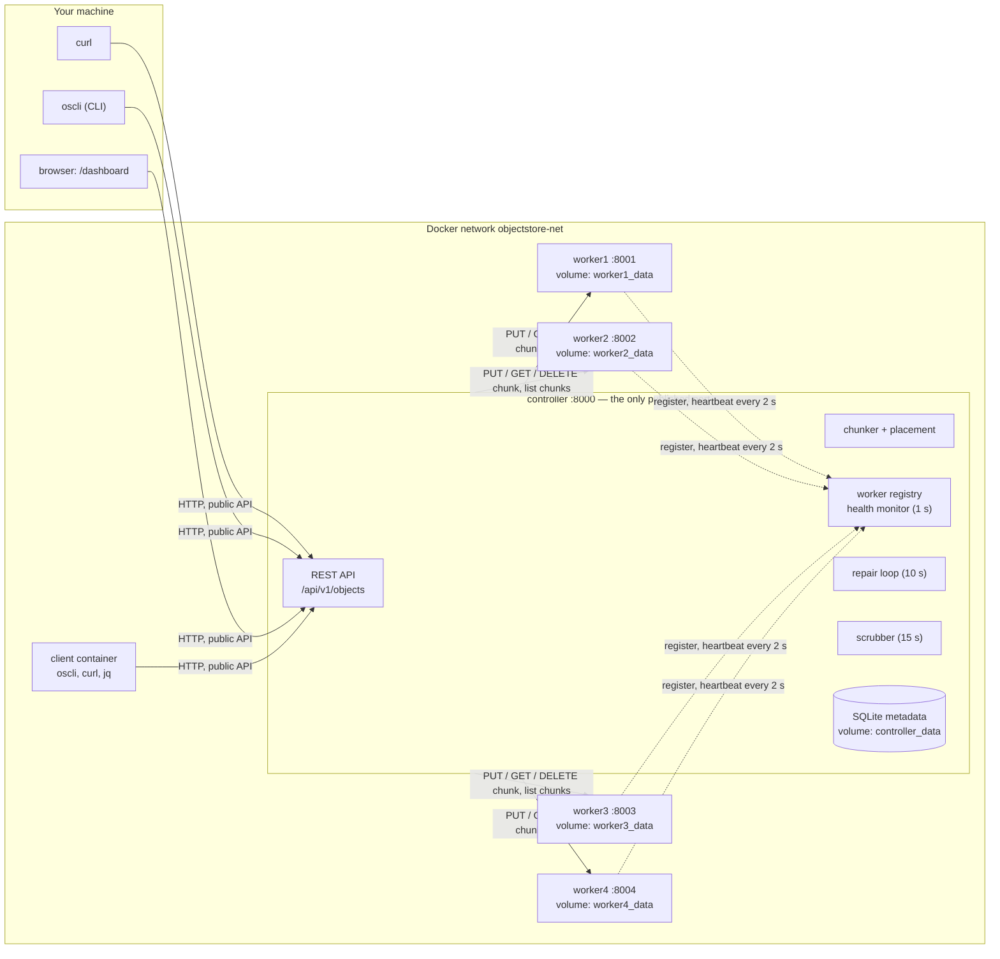
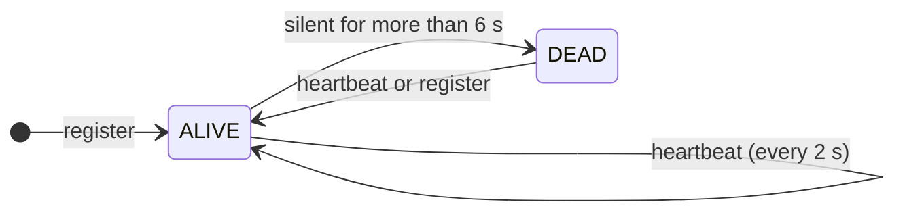
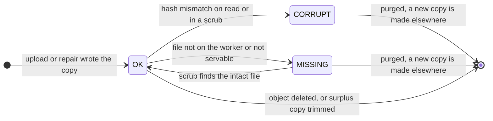

# Mini Distributed Cloud Object Store

A small S3-like object store. Clients upload arbitrary binary objects (documents, images, video,
audio, archives, anything) to a single **controller**, which splits them into **1 MB chunks** and
stores **two copies of every chunk on different storage workers**. The controller detects worker
failures and corrupted data, keeps serving objects from the remaining good copies, and restores
the replication factor on its own.

| | |
|---|---|
| Controller nodes | 1 |
| Storage / worker nodes | 4, each with its own persistent Docker volume |
| Clients | 1 or more: `curl`, the bundled `oscli` CLI (also runs as a container), a browser dashboard |
| Chunk size | 1 MB (1,048,576 bytes) |
| Replication factor | 2, copies always on different workers |
| Deployment | Docker Compose (no Kubernetes) |
| Stack | Java 21, Spring Boot 4.1, Maven, SQLite (controller metadata) |

**Contents:**
[Quick start](#quick-start) ·
[Architecture](#architecture) ·
[Using the system](#using-the-system) ·
[Client REST API](#client-rest-api) ·
[Internal worker APIs](#internal-worker-apis) ·
[Configuration](#configuration) ·
[Demonstrations](#demonstrations) ·
[How it works](#how-it-works) ·
[Requirements traceability](#requirements-traceability) ·
[Testing](#testing) ·
[Design decisions](#design-decisions) ·
[Limitations](#limitations) ·
[Repository layout](#repository-layout) ·
[Troubleshooting](#troubleshooting)

---

## Quick start

**Prerequisites:** Docker Engine or Docker Desktop with Compose v2, plus `bash`, `curl` and `make`.
`jq` is recommended for reading JSON (the demo script falls back to the copy inside the client
container if you do not have it). A JDK is **not** needed: everything is built inside Docker.

```bash
make up          # build the images, start 6 containers, wait until all are healthy
make demo        # run the six required demonstrations; ends with "6/6 PASS"
```

Then open the dashboard at <http://localhost:8000/dashboard>, or store something yourself:

```bash
./oscli upload samples/sample.jpg --meta owner=alice     # prints the new object, including its id
./oscli where  <object-id>                               # which workers hold which chunk
./oscli download <object-id> .demo/copy.jpg              # verifies the checksum while downloading
```

| Command | What it does |
|---|---|
| `make up` | `docker compose up --build -d --wait`, then prints the container table |
| `make down` | stop and remove the containers; **all data is kept** in the volumes |
| `make down-v` | stop and wipe everything, including stored objects |
| `make ps` / `make logs` / `make status` | container table / follow all logs / cluster status JSON |
| `make stop W=worker2` / `make start W=worker2` | simulate a worker failure / bring it back |
| `make corrupt W=worker3 C=<chunk_id>` | overwrite 4 bytes inside a stored chunk file |
| `make demo` | the six required demonstrations, self-checking |
| `make test` | all unit and integration tests (uses local Maven, or a Maven container) |

Without `make`: `docker compose up --build -d --wait`, `./demo.sh`, `docker compose down`.
If port 8000 is taken: `CONTROLLER_PORT=9000 make up` and `BASE=http://localhost:9000 make demo`.

After `make up`, `docker compose ps` shows:

```text
NAME         SERVICE      STATUS                    PORTS
client       client       Up 5 seconds
controller   controller   Up 11 seconds (healthy)   0.0.0.0:8000->8000/tcp
worker1      worker1      Up 5 seconds (healthy)
worker2      worker2      Up 5 seconds (healthy)
worker3      worker3      Up 5 seconds (healthy)
worker4      worker4      Up 5 seconds (healthy)
```

Only the controller is published to the host. The workers are reachable solely inside the private
Docker network, which is what guarantees that a client can only ever go through the controller.

---

## Architecture



**The controller is the only component that thinks.** It receives uploads, cuts them into chunks,
decides which workers hold each chunk, remembers everything in its metadata database, reassembles
objects on download, watches the workers, and repairs what breaks.

**A worker is deliberately dumb.** It stores a chunk, returns it, deletes it, and lists what is on
its disk. It does not know what an object is, which other workers exist, or how many copies there
are. All the logic that has to be right lives in exactly one place.

**Workers never talk to each other.** A repair copy travels worker → controller → worker, so the
internal protocol is just the six endpoints the assignment specifies.

| Module | What it is |
|---|---|
| [`common/`](common) | The wire contract shared by controller and workers: DTOs, SHA-256 helpers, chunk-id format, uniform JSON error handling |
| [`worker/`](worker) | Spring Boot service: chunk store on a volume, the chunk endpoints, register + heartbeat loop |
| [`controller/`](controller) | Spring Boot service: public API, chunking, placement, metadata DB, failure detection, repair, scrubbing, dashboard |
| [`client/`](client) | `oscli`, a plain-Java command-line client for the public API |

---

## Using the system

### With the CLI

`./oscli` runs the client. By default it executes inside the `client` container (so you need
nothing but Docker); the project directory is mounted there, so **file arguments must be paths
inside this directory**. Use `OSCLI_MODE=local ./oscli …` to run it with a local JVM instead
(after `mvn -pl client -am package -DskipTests`), in which case any path works.

```text
Usage: oscli [--base URL] <command> [arguments]

  upload PATH [--name NAME] [--type MIME] [--meta key=value ...]
  download ID OUT_PATH      fetch an object and verify it against its checksum
  meta ID                   show system + custom metadata and chunk locations
  patch ID [key=value ...] [--remove key ...]
  list [--limit N] [--offset N]
  delete ID
  where ID                  table: which workers hold each chunk
  status                    cluster overview (workers, replication health, repairs)
```

Exit codes: `0` success · `1` the server answered with an error (its JSON goes to stderr) ·
`2` server unreachable or transfer broken · `3` downloaded bytes do not match the announced
checksum · `64` wrong usage.

`oscli where` is the quickest way to see chunking, distribution and replication at once:

```text
object  6f7b94b7-ed56-4c5b-8a49-8770976575d7
name    big.bin   (3500000 bytes, application/octet-stream)
chunks  4   replication_ok=true

IDX  CHUNK_ID                                       SIZE  COPIES
0    6f7b94b7-ed56-4c5b-8a49-8770976575d7-00000  1048576  worker1(OK)  worker4(OK)
1    6f7b94b7-ed56-4c5b-8a49-8770976575d7-00001  1048576  worker1(OK)  worker2(OK)
2    6f7b94b7-ed56-4c5b-8a49-8770976575d7-00002  1048576  worker2(OK)  worker3(OK)
3    6f7b94b7-ed56-4c5b-8a49-8770976575d7-00003   354272  worker3(OK)  worker4(OK)

copies per worker: worker1=2  worker2=2  worker3=2  worker4=2
```

### With curl

```bash
API=http://localhost:8000/api/v1

# Upload (multipart/form-data: required "file", optional "metadata" JSON)          -> 201
curl -F "file=@report.pdf" -F 'metadata={"owner":"alice","project":"cloud"}' $API/objects

# Download: the original bytes, with the stored Content-Type                       -> 200
curl -o report.pdf $API/objects/$ID

# Metadata only (system + custom), nothing is downloaded                           -> 200
curl $API/objects/$ID/metadata

# Add / update custom metadata; a null value removes a key                         -> 200
curl -X PATCH -H 'Content-Type: application/json' \
     -d '{"owner":"team","tag":"v1","project":null}' $API/objects/$ID/metadata

# List, newest first, paginated                                                    -> 200
curl "$API/objects?limit=50&offset=0"

# Delete the object and its stored data                                            -> 204
curl -X DELETE $API/objects/$ID

# Cluster overview (workers, replication health, recent repairs)                   -> 200
curl $API/cluster/status
```

### Dashboard

<http://localhost:8000/dashboard> polls the status endpoint every 2 seconds and shows the workers
(ALIVE/DEAD, last heartbeat, number of chunk copies), object/chunk/copy counts, under- and
over-replicated chunks, the chunk-by-worker placement grid of the newest object, and the last 20
actions of the repair loop. Keep it open while running `make demo`.

---

## Client REST API

Base path `/api/v1`. Structured data is JSON with `snake_case` keys. Object data is binary:
`multipart/form-data` on upload, the object's own content type on download.

| Method | Endpoint | Purpose | Success |
|---|---|---|---|
| `POST` | `/api/v1/objects` | Upload an object | `201` |
| `GET` | `/api/v1/objects/{object_id}` | Download an object | `200` |
| `GET` | `/api/v1/objects/{object_id}/metadata` | Retrieve metadata | `200` |
| `PATCH` | `/api/v1/objects/{object_id}/metadata` | Update custom metadata | `200` |
| `DELETE` | `/api/v1/objects/{object_id}` | Delete an object | `204` |
| `GET` | `/api/v1/objects` | List stored objects | `200` |
| `GET` | `/api/v1/cluster/status` | Cluster overview *(extra)* | `200` |
| `GET` | `/health`, `/dashboard` | Liveness probe, dashboard page *(extra)* | `200` |

### Upload — `POST /api/v1/objects`

`multipart/form-data` with a required `file` part and an optional `metadata` field containing a
JSON object of custom key/value pairs. The controller assigns a UUID as object id.

- **Name** = the uploaded file name (client-side directories stripped), or `unnamed`.
- **Content type** = the type declared for the file part. If none is declared, or only the generic
  `application/octet-stream`, it is inferred from the file extension (`.jpg` → `image/jpeg`,
  `.mp4` → `video/mp4`, …).
- An empty file is a valid object: 0 bytes, 0 chunks.
- Responds `201` with a `Location` header and the full object description (below).

### The object description

Returned by upload, `GET …/metadata` and `PATCH …/metadata`:

```json
{
  "object_id": "c25c8bbf-b601-49a4-a20d-57bb7c664211",
  "name": "report.pdf",
  "size": 1500000,
  "content_type": "application/pdf",
  "checksum": "5320dde6be765f4e1cb2d03fbc143cf9aed165f15b17aaa7782a4bf506ebaa66",
  "chunk_count": 2,
  "created_at": "2026-11-16T16:43:50.268Z",
  "updated_at": "2026-11-16T16:43:50.594Z",
  "replication_ok": true,
  "custom_metadata": { "course": "cloud-computing", "owner": "team" },
  "chunks": [
    {
      "chunk_id": "c25c8bbf-b601-49a4-a20d-57bb7c664211-00000",
      "index": 0,
      "size": 1048576,
      "checksum": "cb33b3f01ba887ca83d0e94a8815114a9697fc1840a8b51ed03293f2fe805c7a",
      "locations": [
        { "worker_id": "worker1", "status": "OK", "worker_status": "ALIVE" },
        { "worker_id": "worker4", "status": "OK", "worker_status": "ALIVE" }
      ]
    }
  ]
}
```

| Field | Meaning |
|---|---|
| `object_id` | unique id (UUID v4) assigned at upload |
| `name`, `size`, `content_type` | object name, size in bytes, MIME type |
| `checksum` | SHA-256 of the whole object, lowercase hex |
| `chunk_count` | number of chunks |
| `created_at`, `updated_at` | creation time and last-modified time (UTC, ISO-8601, milliseconds); `updated_at` moves whenever custom metadata changes |
| `replication_ok` | `true` if every chunk currently has at least 2 good copies |
| `custom_metadata` | the user-defined key/value pairs |
| `chunks[]` | per chunk: unique `chunk_id`, `index` (its order in the object), `size`, SHA-256 `checksum`, and `locations` |
| `chunks[].locations[]` | where each copy is stored: `worker_id`, the copy's `status` (`OK`, `CORRUPT`, `MISSING`) and the worker's `worker_status` (`ALIVE`, `DEAD`) |

### Download — `GET /api/v1/objects/{object_id}`

Streams the complete original object. Response headers: `Content-Type` (as stored),
`Content-Length`, `Content-Disposition: attachment; filename="…"`, `ETag: "<sha256 of the object>"`
and `X-Object-Id`. The client never learns worker addresses. `404` if the object does not exist;
`503 chunk_unavailable` if some chunk currently has no intact copy on a live worker (decided before
the first byte is sent, so it is a clean error, never a truncated download).

### Metadata — `GET` / `PATCH /api/v1/objects/{object_id}/metadata`

`GET` returns the object description without touching any worker. `PATCH` takes a JSON object:
a string value adds or overwrites a key, `null` removes it. Only the metadata tables change; the
object's data is not read, moved or re-uploaded. `404` if the object does not exist.

Rules for custom metadata (upload and patch): a flat JSON object; keys are 1–64 characters from
`A-Z a-z 0-9 _ . -`; values are strings of at most 1024 characters; at most 64 keys per object.
Anything else is `400 invalid_metadata`.

### Delete — `DELETE /api/v1/objects/{object_id}`

Deletes the chunk files on every live worker, then the object with its metadata, chunk and copy
records. `204` with an empty body, `404` if the object does not exist. Copies on a worker that is
down at that moment are garbage-collected by the scrubber when the worker returns.

### List — `GET /api/v1/objects?limit=&offset=`

`limit` 1–500 (default 50), `offset` ≥ 0 (default 0). Newest first.

```json
{
  "items": [
    { "object_id": "0c32e95a-…", "name": "integrity.bin", "size": 3500000,
      "content_type": "application/octet-stream", "chunk_count": 4,
      "created_at": "2026-11-16T16:44:15.823Z", "updated_at": "2026-11-16T16:44:15.823Z" }
  ],
  "total": 5, "limit": 50, "offset": 0
}
```

### Status codes and errors

Every error response, without exception, is JSON of the form
`{"error": "<machine_readable_code>", "detail": "<human sentence>"}`.

| Status | When | `error` codes |
|---|---|---|
| `200` | successful download, metadata read/update, list, status | |
| `201` | object created | |
| `204` | object deleted | |
| `400` | invalid request: no `file` part, not multipart, bad `limit`/`offset`, invalid metadata | `bad_request`, `invalid_metadata`, `checksum_mismatch` *(internal)* |
| `404` | object not found; unknown route | `object_not_found`, `not_found`, `chunk_not_found` and `unknown_worker` *(internal)* |
| `409` | conflict: a second delete, or a metadata update, for an object that is being deleted right now; a worker asked to overwrite a chunk id with different content *(internal)* | `conflict` |
| `500` | unexpected server error (stack trace in the log only) | `internal_error` |
| `503` | required storage unavailable: fewer than 2 live workers for an upload, a chunk that could not be stored twice, a chunk with no readable copy | `insufficient_workers`, `upload_failed`, `chunk_unavailable` |

Beyond the required set, three standard codes are used where they are the precise answer:
`405 method_not_allowed`, `413 payload_too_large` (object larger than `MAX_UPLOAD_SIZE`, or a
chunk body larger than 1 MB on a worker) and `415 unsupported_media_type`.

```console
$ curl -s http://localhost:8000/api/v1/objects/00000000-0000-0000-0000-000000000000
{"error":"object_not_found","detail":"object 00000000-0000-0000-0000-000000000000 does not exist"}
$ curl -s "http://localhost:8000/api/v1/objects?limit=abc"
{"error":"bad_request","detail":"parameter 'limit' must be of type int"}
```

### Cluster status — `GET /api/v1/cluster/status` *(extra)*

```json
{
  "config": { "chunk_size": 1048576, "replication_factor": 2, "heartbeat_timeout": 6.0,
              "repair_interval": 10.0, "scrub_interval": 15.0 },
  "workers": [ { "worker_id": "worker1", "url": "http://worker1:8001", "status": "ALIVE",
                 "last_seen": "2026-11-16T16:48:28.570Z", "chunk_count": 8 } ],
  "objects": 5, "chunks": 15,
  "replicas": { "ok": 30, "corrupt": 0, "missing": 0 },
  "under_replicated": 0, "over_replicated": 0,
  "repair_log": [ { "time": "2026-11-16T16:44:43.281Z", "event": "copied",
                    "chunk_id": "0c32e95a-…-00002", "source": "worker1", "target": "worker2",
                    "reason": "under-replicated: 1 of 2 good copies" } ]
}
```

`repair_log` holds the last 100 actions of the repair loop (`copied`, `trimmed`, `purged`,
`unrecoverable`), newest last. It is kept in memory and starts empty after a controller restart.

---

## Internal worker APIs

Used only between the controller and the workers, inside the Docker network.

| Method | Endpoint | Served by | Purpose |
|---|---|---|---|
| `POST` | `/internal/workers/register` | controller | Register a worker with the controller |
| `POST` | `/internal/workers/heartbeat` | controller | Report worker availability |
| `PUT` | `/internal/chunks/{chunk_id}` | worker | Store a chunk on a worker |
| `GET` | `/internal/chunks/{chunk_id}` | worker | Retrieve a chunk from a worker |
| `DELETE` | `/internal/chunks/{chunk_id}` | worker | Delete a chunk from a worker |
| `GET` | `/internal/workers/{worker_id}/chunks` | worker | Retrieve information about chunks stored by a worker |

| Endpoint | Request | Responses |
|---|---|---|
| `POST …/register` | `{"worker_id":"worker1","url":"http://worker1:8001"}` | `200 {"ok":true,"worker_id":"worker1","status":"ALIVE"}`. Insert-or-update, safe to repeat. `400` on a malformed id or URL. |
| `POST …/heartbeat` | `{"worker_id":"worker1"}` | `200` (same body). `404 unknown_worker` if the controller does not know the worker, which makes the worker register again. |
| `PUT /internal/chunks/{id}` | raw bytes, header `X-Checksum: <sha256>` | `201 {"chunk_id","size","checksum"}` when written; `200` if identical content is already there (idempotent); `400 bad_request` for a malformed id or missing header; `400 checksum_mismatch` if the body does not hash to the header (nothing is written); `409 conflict` if the id exists with different content; `413` if the body exceeds one chunk. |
| `GET /internal/chunks/{id}` | – | `200` raw bytes, with `X-Checksum` computed from the bytes just read from disk (never cached); `404 chunk_not_found`. |
| `DELETE /internal/chunks/{id}` | – | `204` if removed, `404 chunk_not_found` if absent. |
| `GET …/{worker_id}/chunks` | – | `200 {"worker_id","chunks":[{"chunk_id","size","checksum"}]}`, every checksum recomputed from the file; `404 unknown_worker` if the id is not this worker's. |

A chunk id must match `^[0-9a-f]{8}-[0-9a-f]{4}-[0-9a-f]{4}-[0-9a-f]{4}-[0-9a-f]{12}-\d{5}$`.
Anything else is rejected before a path is ever built, so a request can never read or write
outside `/data/chunks`.

---

## Configuration

Everything is set through environment variables in [`docker-compose.yml`](docker-compose.yml).

| Variable | Default | Service | Meaning |
|---|---|---|---|
| `CHUNK_SIZE` | `1048576` | both | Bytes per chunk; workers reject larger chunk bodies |
| `REPLICATION_FACTOR` | `2` | controller | Good copies wanted per chunk |
| `HEARTBEAT_INTERVAL` | `2` s | worker | Time between heartbeats |
| `HEARTBEAT_TIMEOUT` | `6` s | controller | Silence after which a worker is DEAD |
| `HEALTH_INTERVAL` | `1` s | controller | Period of the health monitor |
| `STARTUP_GRACE` | `20` s | controller | After a controller start, how long before any worker may be declared DEAD |
| `REPAIR_INTERVAL` | `10` s | controller | Period of the repair loop |
| `SCRUB_INTERVAL` | `15` s | controller | Period of the scrubber |
| `WORKER_TIMEOUT_S` | `10` s | controller | Time limit of one HTTP call to a worker |
| `REPAIR_CONCURRENCY` | `4` | controller | Chunks repaired in parallel |
| `MAX_UPLOAD_SIZE` | `10GB` | controller | Largest accepted object |
| `DB_PATH` | `/data/meta.db` | controller | SQLite metadata file (on the `controller_data` volume) |
| `DATA_DIR` | `/data` | worker | Volume mount; chunks live in `DATA_DIR/chunks`, one file per chunk |
| `WORKER_ID` | *(required)* | worker | `worker1` … `worker4`; also the container name |
| `CONTROLLER_URL` | `http://controller:8000` | worker | Where to register and send heartbeats |
| `ADVERTISE_URL` | `http://<WORKER_ID>:<PORT>` | worker | The address the controller should use for this worker |
| `PORT` | `8000` / `8001`–`8004` | both | Listen port |
| `LOG_LEVEL` | `INFO` | both | Root log level |
| `CONTROLLER_PORT` | `8000` | compose | Host port the controller is published on |

| Container | Port in the network | Port on the host | Volume → mount |
|---|---|---|---|
| `controller` | 8000 | 8000 | `objectstore_controller_data` → `/data` |
| `worker1` … `worker4` | 8001 … 8004 | – (not reachable) | `objectstore_worker1_data` … `objectstore_worker4_data` → `/data` |
| `client` | – | – | project directory → `/work` |

Log lines start with a component tag: `[api]`, `[upload]`, `[download]`, `[registry]`,
`[integrity]`, `[repair]`, `[scrub]` (controller) and `[store]`, `[heartbeat]` (worker).

---

## Demonstrations

`make demo` runs all six and checks every claim; the output ends with:

```text
 PASS  1/6  Object storage - upload an object, retrieve it, verify it is identical
 PASS  2/6  Chunking and distribution - an object larger than 1 MB
 PASS  3/6  Replication - every chunk has two copies; where they are
 PASS  4/6  Metadata - custom metadata on upload; read and modify it without re-uploading
 PASS  5/6  Worker failure - docker stop worker2, then docker start worker2
 PASS  6/6  Data integrity - corrupt stored data on purpose
 6/6 PASS
```

A run takes about a minute. The script never sleeps for a fixed time: every wait polls until the
expected state is reached, so it is as fast as the system and not timing-sensitive. Each run first
deletes the objects of the previous run, and leaves its own behind for inspection on the dashboard.

The sections below show how to do each demonstration by hand. They assume:

```bash
API=http://localhost:8000/api/v1
mkdir -p .demo       # scratch directory; inside the project so that ./oscli can see it
```

### 1. Object storage

Upload an object, retrieve it, verify the retrieved object matches the original.

```bash
head -c 307200 /dev/urandom > .demo/small.bin
ID=$(curl -s -F "file=@.demo/small.bin" $API/objects | jq -r .object_id)
curl -s -D - -o .demo/small.out $API/objects/$ID | grep -iE '^(HTTP|content-|etag)'
shasum -a 256 .demo/small.bin .demo/small.out      # Linux: sha256sum
```

```text
HTTP/1.1 200
Content-Disposition: attachment; filename="small.bin"
ETag: "9c26a3d4e05a34763bdc372b9d20d612114a1ea1b27383e261938574e8269d28"
Content-Type: application/octet-stream
Content-Length: 307200
9c26a3d4e05a34763bdc372b9d20d612114a1ea1b27383e261938574e8269d28  .demo/small.bin
9c26a3d4e05a34763bdc372b9d20d612114a1ea1b27383e261938574e8269d28  .demo/small.out
```

The two hashes are equal, and equal to the `ETag` and to the `checksum` in the metadata. For a real
file type: `./oscli upload samples/sample.jpg` reports `"content_type": "image/jpeg"`, and the
download is served with `Content-Type: image/jpeg`.

### 2. Chunking and distribution

Upload an object larger than 1 MB; show how it was chunked and where the chunks went.

```bash
head -c 3500000 /dev/urandom > .demo/big.bin
BIG=$(./oscli upload .demo/big.bin | jq -r .object_id)
./oscli where $BIG
for w in worker1 worker2 worker3 worker4; do
  echo "$w: $(docker exec $w sh -c "ls /data/chunks | grep -c ^$BIG") chunk files"
done
```

3,500,000 bytes become 4 chunks: three of 1,048,576 bytes and a last one of 354,272. `oscli where`
prints the table shown [above](#with-the-cli); on disk there are 8 files (4 chunks × 2 copies),
exactly 2 on each of the four workers:

```text
worker1: 2 chunk files
worker2: 2 chunk files
worker3: 2 chunk files
worker4: 2 chunk files
```

### 3. Replication

Show that each chunk has two copies, and where they are stored.

```bash
curl -s $API/objects/$BIG/metadata | jq -r '.chunks[] | "\(.chunk_id)  \([.locations[] | "\(.worker_id)=\(.status)"] | join("  "))"'
curl -s $API/cluster/status | jq -c '{chunks, replicas, under_replicated, over_replicated}'
# the two files of a chunk are byte-identical: compare their hashes on the two workers
C=$BIG-00000
docker exec worker1 sha256sum /data/chunks/$C; docker exec worker4 sha256sum /data/chunks/$C
```

```text
6f7b94b7-…-00000  worker1=OK  worker4=OK
6f7b94b7-…-00001  worker1=OK  worker2=OK
6f7b94b7-…-00002  worker2=OK  worker3=OK
6f7b94b7-…-00003  worker3=OK  worker4=OK
{"chunks":5,"replicas":{"ok":10,"corrupt":0,"missing":0},"under_replicated":0,"over_replicated":0}
```

Every chunk has exactly two copies on two different workers, `replicas.ok` is `2 × chunks`, and
both files of a chunk hash to the checksum recorded at upload. (Use the two workers that
`oscli where` lists for the chunk you pick.)

### 4. Metadata

Upload custom metadata; retrieve and modify it without re-uploading the object.

```bash
MID=$(curl -s -F "file=@.demo/big.bin;filename=report.pdf;type=application/pdf" \
           -F 'metadata={"owner":"ansh","course":"cloud-computing"}' $API/objects | jq -r .object_id)
curl -s $API/objects/$MID/metadata | jq '{name, size, content_type, checksum, chunk_count, created_at, updated_at, custom_metadata}'
curl -s -X PATCH -H 'Content-Type: application/json' -d '{"owner":"team","tag":"v1"}' \
     $API/objects/$MID/metadata | jq '{custom_metadata, created_at, updated_at}'
./oscli patch $MID --remove tag | jq '{custom_metadata, updated_at}'
```

```text
{"custom_metadata":{"course":"cloud-computing","owner":"team","tag":"v1"},"created_at":"2026-11-16T16:43:50.268Z","updated_at":"2026-11-16T16:43:50.594Z"}
{"custom_metadata":{"course":"cloud-computing","owner":"team"},"updated_at":"2026-11-16T16:43:50.981Z"}
```

Keys are added, updated and removed; `updated_at` moves forward while `created_at`, `size`,
`checksum` and the chunk layout stay exactly as they were, and no request reaches a worker.

### 5. Worker failure

Stop a worker container; show failure handling and retrieval from the other copy; restart it and
show whether the replication factor is maintained.

```bash
FID=$(./oscli upload .demo/big.bin | jq -r .object_id)

# BEFORE
make status | jq -c '{workers: [.workers[] | "\(.worker_id)=\(.status)"], under_replicated, over_replicated}'
./oscli where $FID

# DURING
docker stop worker2
sleep 8
make status | jq -c '{workers: [.workers[] | "\(.worker_id)=\(.status)"], under_replicated}'
./oscli download $FID .demo/during.bin && cmp .demo/big.bin .demo/during.bin && echo identical
sleep 12
make status | jq -c '{under_replicated, copied: [.repair_log[] | select(.event == "copied") | "\(.source)->\(.target)"]}'
./oscli where $FID

# AFTER
docker start worker2
sleep 25
make status | jq -c '{workers: [.workers[] | "\(.worker_id)=\(.status)"], under_replicated, over_replicated}'
./oscli where $FID
```

What you see (timings from a real run):

| Moment | Observation |
|---|---|
| before | 4 workers `ALIVE`, `under_replicated=0`; worker2 holds a copy of 2 of the object's 4 chunks |
| +6 s after `docker stop` | log: `[registry] worker2 marked DEAD (last seen …)`; status: `worker2=DEAD`, `under_replicated=7` (every chunk that had a copy there) |
| during | the download still succeeds and is identical: the controller reads only from live workers |
| about +14 s | log: `[repair] copied chunk=…-00002 src=worker1 dst=worker4 (under-replicated: 1 of 2 good copies)`; `under_replicated=0` again, while worker2 is **still down**. `oscli where` now shows three entries for the affected chunks: `worker1(OK)  worker2(OK,DEAD)  worker4(OK)` |
| after `docker start` | log: `[registry] worker2 is back`. Its chunk files survived on the volume; the scrubber verifies them, which makes the affected chunks over-replicated (3 good copies) |
| about 8 s later | log: `[repair] trimmed chunk=…-00002 src=worker4 …`; `over_replicated=0`, every chunk has **exactly two** copies again and the object is still identical |

So the replication factor is maintained throughout: it drops to 1 for the affected chunks for a
few seconds, is restored to 2 on the remaining workers without the failed one, and is brought back
to exactly 2 (not 3) after the worker returns.

### 6. Data integrity

Corrupt stored data on purpose; show that it is detected and handled.

```bash
IID=$(./oscli upload .demo/big.bin | jq -r .object_id)
C=$IID-00000
W=$(./oscli meta $IID | jq -r '.chunks[0].locations[0].worker_id')

# A) found by a download
make corrupt W=$W C=$C
./oscli download $IID .demo/int.bin && cmp .demo/big.bin .demo/int.bin && echo identical
docker logs controller 2>&1 | grep -E "\[(integrity|scrub)\] chunk=$C"
sleep 12; ./oscli where $IID

# B) found by the scrubber, without anybody reading the object
C2=$IID-00002
W2=$(./oscli meta $IID | jq -r '.chunks[2].locations[1].worker_id')
make corrupt W=$W2 C=$C2
sleep 30
docker logs controller 2>&1 | grep -E "chunk=$C2"
./oscli where $IID
```

```text
[integrity] chunk=3208f8ac-…-00000 worker=worker1 -> CORRUPT (checksum mismatch on read)
[repair] purged chunk=3208f8ac-…-00000 src=worker1 dst=- (copy was CORRUPT)
[repair] copied chunk=3208f8ac-…-00000 src=worker2 dst=worker1 (under-replicated: 1 of 2 good copies)

[scrub] chunk=3208f8ac-…-00002 worker=worker4 -> CORRUPT (checksum on disk ecd69e51… != recorded …)
[repair] purged chunk=3208f8ac-…-00002 src=worker4 dst=- (copy was CORRUPT)
[repair] copied chunk=3208f8ac-…-00002 src=worker3 dst=worker4 (under-replicated: 1 of 2 good copies)
```

- **Detection:** every chunk carries a SHA-256. In A the controller re-hashes what the worker
  returns and notices the mismatch; in B the scrubber notices that the hash of the file on disk no
  longer matches the database, without any download.
- **Corrupted data is not returned:** in A the download falls back to the other copy and the result
  is byte-identical to the original.
- **Restoration:** the corrupt file is deleted, a new copy is made from the valid one, and
  `replication_ok` is `true` again. (If the damaged copy happens not to be the one the controller
  reads first, A is detected by the scrubber instead; the outcome is the same.)

---

## How it works

### Chunking

The upload is read in pieces of exactly `CHUNK_SIZE` bytes; only the last piece can be shorter and
an empty piece is never produced (2 MiB → 2 chunks, 0 bytes → 0 chunks). Chunk `i` of an object
gets the id `<object_id>-<i as 5 digits>`, for example `3f1c…-00003`. The id is unique (the object
id is a UUID) and encodes the chunk's position; the `chunks` table additionally stores the index
with a unique constraint per object, and downloads concatenate in index order. For every chunk the
controller computes a SHA-256, and a running SHA-256 over the whole stream becomes the object's
checksum. At most one chunk is in memory at any time, however large the object is.

### Placement and replication

The live workers, sorted by id, form a ring. Chunk `i` starts at ring position
`(offset + i) mod n`, where `offset` comes from the object id, and its two copies go to that
worker and the next one. Therefore the two copies of a chunk are always on different workers,
consecutive chunks rotate around the ring (four chunks on four workers give every worker exactly
two copies), and different objects start at different positions, so a store full of small
one-chunk objects still fills all workers evenly. The two writes of a chunk happen in parallel.
The worker re-hashes the bytes it received and refuses a mismatch, writes to a temporary file,
flushes it to the device, and renames it into place, so a crash can never leave a half-written
file under a chunk id.

If a write fails (the worker may have died a moment ago and not been declared dead yet), the next
worker on the ring is used instead. If fewer than two workers are alive the upload is refused with
`503 insufficient_workers`; if a chunk cannot be stored twice, everything written so far is deleted
and the answer is `503 upload_failed`. The database is written exactly once, at the very end, in a
single transaction: a half-uploaded object can never be observed.

### The metadata database

SQLite, on the controller's volume, schema in
[`V1__init.sql`](controller/src/main/resources/db/migration/V1__init.sql) (applied by Flyway):

| Table | One row per | Holds |
|---|---|---|
| `workers` | worker | url, `ALIVE`/`DEAD`, last heartbeat |
| `objects` | object | name, size, content type, checksum, chunk count, created/updated time |
| `object_metadata` | custom key of an object | key, value |
| `chunks` | chunk | object, index, size, checksum |
| `chunk_replicas` | physical copy of a chunk | worker, `OK`/`CORRUPT`/`MISSING` |

One definition is used everywhere: a **good copy** is a `chunk_replicas` row with status `OK` whose
worker is `ALIVE`. A chunk is *under-replicated* with fewer than 2 good copies and
*over-replicated* with more. The status endpoint, `replication_ok`, the download pre-check, repair
and trimming all count with this rule, so they cannot disagree.

### Failure detection

Each worker registers when it starts and then sends a heartbeat every 2 s. The controller's health
monitor runs every second and marks a worker `DEAD` once it has been silent for more than 6 s; the
next heartbeat or registration marks it `ALIVE` again.



A dead worker's copy records are kept, they simply stop counting as good copies. That alone makes
its chunks under-replicated, without any special case.

### Repair

Every 10 s the repair loop does three things, in this order:

1. **Purge** copies known to be bad (`CORRUPT`/`MISSING`) on live workers: delete the file and the
   record. A bad copy is only discarded while the chunk still has a good copy to rebuild from.
2. **Repair** every under-replicated chunk: read a good copy, verify its hash (a repair must never
   spread corruption), and write it to a live worker that holds no copy of that chunk yet, choosing
   the one with the fewest copies overall.
3. **Trim** every over-replicated chunk, which happens when a worker returns after its chunks were
   re-replicated: remove the copy on the worker with the most copies overall, until two remain.
   Trimming waits until the scrubber has verified the returned worker, so a fresh, known-good copy
   is never deleted in favour of an old one that nobody has looked at.

The loop does not care why a chunk is short of copies. A dead worker, a corrupt file found by the
scrubber, a failed read during a download: each just leaves fewer good copies than required, and
the same code fixes it. If a chunk has no good copy at all, it is reported once as `unrecoverable`
and repaired automatically as soon as a worker holding a copy comes back.

### Integrity

Checksums are verified at three points:

| Where | What happens on a mismatch |
|---|---|
| **on write** (worker) | the chunk is rejected with `400 checksum_mismatch`; nothing touches the disk |
| **on read** (controller, every chunk of every download and every repair) | the copy is marked `CORRUPT`, its file is deleted, and the next copy is used; the client receives correct data |
| **in the background** (scrubber, every 15 s, and immediately when a worker comes online) | the controller asks each live worker for the ids, sizes and hashes of the files really on its disk and compares them with the database |



The scrubber's comparison has four outcomes: intact file → `OK` (this also restores a copy that
was marked bad earlier); wrong hash → `CORRUPT` and the file is deleted; no file → `MISSING`; a file
the database does not know → an orphan, deleted. Orphans arise when an object is deleted while a
worker is down. The scrubber only detects; making the replacement copy is the repair loop's job.

### Concurrency

- **One lock for copy records.** Repairing, trimming, purging, scrubbing, marking a copy bad after
  a failed read, and deleting an object all change existing `chunk_replicas` rows together with
  something on a worker. They run under one fair lock, so "check the database, act on the worker,
  update the database" is atomic with respect to all the others.
- **Uploads and the scrubber.** While an upload is running, chunk files exist on workers that the
  database does not know yet, which to the scrubber looks exactly like orphans. The controller
  therefore tracks uploads in flight and the scrubber skips their files. Without this, the scrubber
  would delete the chunks of any upload that takes longer than a scrub interval.
- **Scrubbing does not block.** A worker is listed without holding the lock (hashing every file
  takes time). A copy record is only judged if it is identical before and after the listing, so a
  copy created or changed meanwhile is simply left for the next pass.
- **No transaction spans a network call**, so the database is never held while waiting for a worker.

### What happens when things fail

| Event | Noticed by | Downloads | Uploads | Recovery |
|---|---|---|---|---|
| One worker stops | health monitor, within ~7 s | keep working (other copy) | keep working (3 workers) | new second copies within ~16 s |
| The worker comes back | register / heartbeat, at once | its copies are usable again | it is back in the ring | scrubbed at once; surplus copies trimmed to exactly 2 within ~10 s |
| Two workers stop | health monitor | work unless a chunk had both copies on those two → that object answers `503` | keep working (2 workers) | chunks with one copy left are repaired; the rest recover when a worker returns |
| Three workers stop | health monitor | only objects fully on the last worker | refused: `503 insufficient_workers` | waits for workers |
| A worker dies during an upload | the failed write | – | the next worker on the ring is used; `503 upload_failed` only if two copies are impossible | – |
| A chunk file is damaged | scrubber within 15 s, or the next download at once | never served; other copy used | – | bad file deleted, new copy made |
| A chunk file is deleted by hand | scrubber or download | other copy used | – | marked `MISSING`, then repaired |
| The controller restarts | – | unavailable for a few seconds | same | the database is on a volume; workers keep heartbeating; loops resume |
| Object deleted while a worker was down | scrubber, when it returns | – | – | leftover files removed (`[scrub] gc orphan …`) |

---

## Requirements traceability

Every requirement of the assignment, where it is implemented, and how it is shown.

| § | Requirement | Implemented in | Shown by |
|---|---|---|---|
| 1 | Store and retrieve arbitrary binary objects across multiple nodes, chunked and replicated | `UploadService`, `DownloadService` | demos 1–3 |
| 2 | 1 controller, 4 workers, 1+ clients, 1 MB chunks, replication factor 2, Docker, persistent worker storage, no Kubernetes | `docker-compose.yml`, `Dockerfile` | `docker compose ps`; data survives `make down && make up` |
| 3 | Unique object id; name, size, content type, creation and last-modified time, checksum, number of chunks, chunk information and storage locations | tables `objects`, `chunks`, `chunk_replicas`; `ObjectViewAssembler` | `GET …/metadata`, demo 4 |
| 3 | Custom user-defined key/value metadata | table `object_metadata`; `MetadataValidator` | demo 4 |
| 4 | 1 MB chunks, last may be smaller; unique chunk id; order preserved | `UploadService`, `ChunkIds` | demo 2 |
| 4 | Two copies per chunk on different workers; distributed across workers | `PlacementPolicy` | demos 2, 3 |
| 4 | Detect when the replication factor is no longer maintained, and restore it | `ChunkRepository.findUnderReplicated`, `RepairService` | demos 5, 6 |
| 5 | The six client endpoints with their success codes; JSON; binary with the right content type | `ObjectsController` | all demos; [API](#client-rest-api) |
| 5.7 | Status codes 200/201/204/400/404/409/500/503 with a meaningful JSON message | `GlobalExceptionHandler`, `ApiException` | [status codes](#status-codes-and-errors) |
| 6 | The six internal endpoints | worker `ChunkController`; controller `InternalWorkersController` | container logs; [internal API](#internal-worker-apis) |
| 7 | Detect an unavailable worker; keep serving while copies remain; detect lost replication; `docker stop` / `docker start worker2` | `WorkerRegistry`, `MaintenanceLoops`, `DownloadService`, `RepairService` | demo 5 |
| 8 | Detect corruption; do not return corrupted data when a valid copy exists; restore | `ChunkStore` (write), `DownloadService` + `IntegrityReporter` (read), `ScrubService`, `RepairService` | demo 6 |
| 9 | Instructions to build, start and interact | this README, `Makefile`, `oscli`, `demo.sh` | [Quick start](#quick-start) |
| 10 | The six demonstrations | `demo.sh` | `make demo` → `6/6 PASS` |

---

## Testing

```bash
make test        # 110 tests: mvn verify, with local Maven + JDK 21, or else in a Maven container
```

| Module | Tests | What they cover |
|---|---|---|
| `common` | 18 | SHA-256 against known vectors; chunk-id format and rejection of anything path-like |
| `worker` | 22 | the chunk store on a real directory (atomic write, idempotence, conflict, traversal attempts, leftover temp files) and the internal API over real HTTP |
| `controller` | 58 | placement and metadata rules as unit tests, and 20 end-to-end tests |
| `client` | 12 | the CLI against a stub server: multipart encoding, checksum verification, exit codes |

The controller's end-to-end tests
([`ObjectStoreIntegrationTest`](controller/src/test/java/com/objectstore/controller/ObjectStoreIntegrationTest.java))
start the real application (HTTP layer, SQLite, background loops) against four in-memory workers
that speak the internal API and can be stopped, restarted and damaged. With the timers shortened
they cover, in about 20 seconds: chunking and placement of a 3.5 MB object, awkward sizes (0 bytes,
1 MiB ± 1), metadata, listing, deletion, every error code, a worker dying and returning
(re-replication, then trimming back to two), an upload surviving a worker that just died, loss of
both copies and automatic recovery, corruption found on read and by the scrubber, orphan
collection, a download that loses every copy mid-stream, the 409 conflict, and the scrubber
leaving an upload in progress alone.

---

## Design decisions

The project follows the two design documents it was planned with (*Architecture & Project Flow v2*
and *Implementation Specification v2*). Those describe a Python/FastAPI build; this implementation
is **Java 21 with Spring Boot 4.1**. The architecture is unchanged, and everything visible from
outside is as specified there: endpoint paths, JSON keys, status strings, error codes, environment
variable names, timers and log tags.

**Choices carried over**

| Decision | Reason |
|---|---|
| SQLite rather than a database server | No extra container. The project needs durability, not heavy concurrency, and a file on a volume provides it. |
| The controller chunks the object, not the client | Keeps the client trivial and all checksums in one trusted place. |
| The controller pushes copies; workers never copy to each other | Matches the internal API of the assignment; no worker-to-worker protocol is needed. |
| SHA-256 per chunk and per object | The chunk hash pinpoints the damaged piece; the object hash is the checksum the assignment asks for and doubles as the `ETag`. |
| Bad copy records are deleted after repair, not reused | "Good copies = `OK` rows on live workers" stays trivially correct. |
| Timers 2 / 6 / 10 / 15 s | Fast enough to watch recovery happen in a demo, slow enough not to flap on a laptop. |

**Where this implementation deliberately differs from the specification**

| Topic | Specification | Here | Why |
|---|---|---|---|
| Language and framework | Python 3.12, FastAPI, SQLAlchemy | Java 21, Spring Boot 4.1, Spring JDBC (`JdbcClient`), Flyway | Team preference. Virtual threads give the same "blocking code, many concurrent calls" simplicity as `async`. |
| Client | `client.py` | `oscli`, a Java CLI, also shipped as a `client` container | Same commands and exit codes; needs nothing but Docker on the host. |
| **Uploads vs. the scrubber** | not addressed | uploads in flight are tracked and skipped by the scrubber | In the specified design the scrubber deletes "files without a database row" every 15 s, while an upload records its rows only at the end. An upload longer than 15 s would lose its chunks. A test reproduces this. |
| Placement | ring position = chunk index | ring position = chunk index + an offset derived from the object id | With the plain rule, chunk 0 always lands on worker1 and worker2, so a store of small one-chunk objects never uses worker3 and worker4. |
| A worker failing during an upload | fail the whole upload | try the next worker on the ring; fail only if two copies are impossible | An upload should not fail just because a worker died within the last 6 s. |
| Trimming after a worker returns | as soon as counts say "3 copies" | only after the scrubber has verified the returned worker | Otherwise a fresh, verified copy could be deleted in favour of an old one that may no longer be intact. |
| Purging bad copies | always | only while the chunk still has a good copy | A copy marked `MISSING` after a transient error may be intact; if it is the last one, it must not be deleted. The scrubber restores it. |
| Scrubbing | compare under the global lock | list without the lock, judge only records unchanged before and after | A slow listing no longer blocks deletes and read-path bookkeeping. |
| Start-up | – | no worker is declared dead for `STARTUP_GRACE` (20 s) after a controller start | On a cold start the workers boot after the controller; without this they are all marked DEAD and "come back" seconds later. |
| `unrecoverable` events | logged every repair pass | logged once per chunk until the situation changes | Keeps the repair log readable. |
| Timestamps | whole seconds | milliseconds, fixed width | A metadata update within the same second as the upload must still show a later `updated_at`. |
| `503 insufficient_workers` | before reading the request body | after the body has been received | The servlet container spools the multipart body to a temporary file before the application sees it. Memory use stays constant either way. |
| Verification | pytest smoke tests against a running stack; fixed `sleep`s in the demo | JUnit tests against in-memory workers; a polling demo | Runs in CI without Docker; the demo cannot be broken by a slow machine. |
| Last chunk of 3,500,000 bytes | 354,304 | 354,272 | 3,500,000 − 3 × 1,048,576 = 354,272. |

**Other implementation notes**

- **One database connection.** SQLite allows one writer at a time. The connection pool holds a
  single connection, which serialises all statements in-process instead of relying on lock
  time-outs between connections. This is safe because transactions are tiny and never wait on I/O.
- **A download that breaks after it started.** If every copy of a later chunk fails once the first
  bytes are on the wire, the status code can no longer change. The controller then drops the
  connection, so the client sees fewer bytes than `Content-Length` (and `oscli` exits with 2),
  never a silently truncated "200 OK".
- **Images.** One multi-stage `Dockerfile` with three targets. Services run as a non-root user;
  `/data` is owned by that user, and a named volume mounted there inherits the ownership.
- **Deleting while a download is streaming** is not guarded; that download may be cut off.

---

## Limitations

- **The controller is a single point of failure.** The assignment fixes the number of controllers
  at one. Its state is durable and it restarts in about a second, but while it is down the store is
  unavailable.
- **No authentication, TLS or multi-tenancy.** The internal endpoints the controller serves
  (`/internal/workers/*`) share its published port; a real deployment would put them on a separate,
  unpublished listener.
- **The scrubber re-hashes every chunk on every pass.** Fine at this scale; a real system would
  sample, or checkpoint its progress.
- **No rebalancing.** A new or returning worker only receives new chunks and repair copies;
  existing chunks are not moved to even out the load.
- **Uploads are spooled to the controller's local disk** before being chunked, so the controller
  needs free temporary space equal to the largest upload in flight.
- **An object can have at most 100,000 chunks** (about 97 GiB), because the chunk index has five
  digits; `MAX_UPLOAD_SIZE` (10 GB by default) is the practical limit.

---

## Repository layout

```text
.
├── docker-compose.yml        1 controller, 4 workers, 1 client; volumes and network
├── Dockerfile                multi-stage build with three targets: controller, worker, client
├── Makefile                  up / down / status / stop / start / corrupt / test / demo
├── demo.sh                   the six required demonstrations, self-checking
├── oscli                     wrapper that runs the CLI (in the client container, or locally)
├── samples/sample.jpg        a real image for the demo
├── pom.xml                   Maven parent (Spring Boot 4.1, Java 21)
├── common/                   shared wire contract
│   └── src/main/java/com/objectstore/common/
│       ├── Checksums.java, ChunkIds.java, InternalApi.java
│       ├── dto/              ApiError, ChunkInfo, RegisterRequest, HeartbeatRequest, ...
│       └── web/              ApiException, ErrorCodes, GlobalExceptionHandler, JsonErrorController
├── worker/
│   └── src/main/java/com/objectstore/worker/
│       ├── api/              ChunkController (PUT/GET/DELETE chunk, list), HealthController
│       ├── storage/          ChunkStore (atomic, checksum-verified disk operations)
│       ├── registration/     ControllerLink (register with retry, heartbeat loop)
│       └── config/           WorkerProperties
├── controller/
│   └── src/main/
│       ├── java/com/objectstore/controller/
│       │   ├── api/          ObjectsController, InternalWorkersController, ClusterController, dto/
│       │   ├── objects/      UploadService, DownloadService, ObjectService, PlacementPolicy,
│       │   │                 MetadataValidator, InFlightUploads, ObjectViewAssembler
│       │   ├── cluster/      WorkerRegistry, WorkerClient, ClusterStatusService
│       │   ├── replication/  RepairService, ScrubService, IntegrityReporter, ReplicaGuard,
│       │   │                 RepairLog, MaintenanceLoops
│       │   ├── repository/   WorkerRepository, ObjectRepository, ChunkRepository
│       │   ├── domain/       Worker, StoredObject, Chunk, ReplicaLocation, ...
│       │   └── config/       ControllerProperties, InfrastructureConfig, WorkerIo
│       └── resources/
│           ├── application.yml
│           ├── db/migration/V1__init.sql
│           └── static/dashboard.html
└── client/
    └── src/main/java/com/objectstore/client/   ObjectStoreCli, Arguments, ContentTypes
```

For readers coming from the specification, the modules it names map as follows:
`routes_objects.py` → `ObjectsController` + `UploadService`/`DownloadService`/`ObjectService` ·
`routes_internal.py` → `InternalWorkersController` · `routes_cluster.py` → `ClusterController` ·
`registry.py` → `WorkerRegistry` · `chunker.py` → `UploadService` + `ChunkIds` ·
`placement.py` → `PlacementPolicy` · `workers_client.py` → `WorkerClient` ·
`replicas.py` → `ChunkRepository` + `ReplicaGuard` + `IntegrityReporter` ·
`repair.py` → `RepairService` + `RepairLog` · `scrub.py` → `ScrubService` ·
`errors.py` → `ApiException` + `GlobalExceptionHandler` · `models.py` → `V1__init.sql` + `domain/` ·
`schemas.py` → `api/dto/` + `common/dto/` · `store.py` → `ChunkStore` · worker `main.py` →
`ChunkController` + `ControllerLink`.

---

## Troubleshooting

| Symptom | Cause and fix |
|---|---|
| `make up` fails with "port is already allocated" | Something else uses port 8000. `CONTROLLER_PORT=9000 make up`, then pass `BASE=http://localhost:9000` to `make status` / `make demo`. |
| `oscli: in docker mode, run this from inside …` | The client container only sees the project directory. Copy the file into it (for example into `.demo/`), or use `OSCLI_MODE=local`. |
| `oscli` says a file "is not a readable file" although it exists | Same reason: an absolute path on your machine does not exist inside the container. Use a path relative to the project directory. |
| Upload answers `503 insufficient_workers` | Fewer than two workers are `ALIVE`. Check `make status` and `docker compose ps`; start the stopped ones. |
| Download answers `503 chunk_unavailable` | Both workers holding some chunk are down. The object becomes available again as soon as one returns. |
| A worker stays `DEAD` after `docker start` | Check `docker logs <worker>`: it logs every registration attempt and why it failed. |
| Start with a clean slate | `make down-v && make up` wipes all volumes. |
